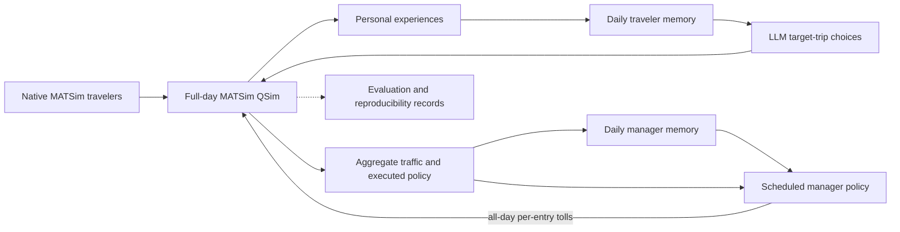

<div align="center">

# AgenticMobility

**A research platform for LLM travelers and congestion-pricing managers in MATSim.**

[](pom.xml)
[](pom.xml)
[](LICENSE)

[Quickstart](#quickstart) · [Experiments](#experiments) · [How it works](#how-it-works) · [Documentation](#documentation)

</div>

AgenticMobility connects language-model decisions to an executable transport simulation. Travelers choose routes and departure times, experience congestion and tolls, and update their own memories. A manager observes aggregate traffic, reflects after each simulation day, and revises congestion-pricing policies at scheduled opportunities.

The included Sioux Falls scenario retains full-day activity chains and native MATSim background traffic. Decisions, executed trips, policies, memories, and reproducibility records make it possible to compare intended actions with actual outcomes.

## When to use AgenticMobility

| Research question | Experiment setup |
| --- | --- |
| How do LLM travelers choose routes and departure times? | LLM-controlled target trips within native full-day traffic |
| How does access to toll announcements affect choices? | Fixed informed and uninformed groups with distinct information access |
| What happens when a manager adjusts congestion pricing? | Native or LLM travelers with an LLM pricing manager |
| How do adaptive policies compare with a fixed intervention? | Native baseline, file-defined tolls, and manager experiments |
| How sensitive are choices to a model or candidate order? | Replay saved traveler contexts without rerunning traffic |

This is a research implementation. Memories and decisions evolve through inference; model weights are not trained. Traffic improvement, behavioral realism, and causal policy effects require experimental evaluation.

## How it works

The simulation separates daily observation and memory from periodic policy intervention.

| Stage | What happens | Implementation |
| --- | --- | --- |
| Prepare | Select a stable population and cohort, construct route/time options, and assign profiles and information groups. | [`MorningExperiment`](src/main/java/org/matsim/agentic/MorningExperiment.java), [`MorningCohort`](src/main/java/org/matsim/agentic/MorningCohort.java) |
| Decide | Publish a policy if an update is scheduled, then obtain choices for controlled target trips. | [`MorningLoop`](src/main/java/org/matsim/agentic/MorningLoop.java), [`MorningLlmPolicy`](src/main/java/org/matsim/agentic/MorningLlmPolicy.java), [`MorningManager`](src/main/java/org/matsim/agentic/MorningManager.java) |
| Execute | Run full-day traffic and charge actual entries into priced car links. | MATSim QSim, [`MorningTollSystem`](src/main/java/org/matsim/agentic/MorningTollSystem.java) |
| Observe and reflect | Record personal experiences and public aggregates; update memories after the completed day. | [`MorningObservations`](src/main/java/org/matsim/agentic/MorningObservations.java), [`MorningMemoryUpdater`](src/main/java/org/matsim/agentic/MorningMemoryUpdater.java), [`MorningManagerMemory`](src/main/java/org/matsim/agentic/MorningManagerMemory.java) |

**Traveler actions.** Eligible target trips are selected from original plans, by default with a planned destination activity start before 09:00. Controlled trips have up to four frozen route candidates. The default departure grid spans 90 minutes before to 30 minutes after the original departure, in 15-minute steps, subject to activity and simulation boundaries. Profiles, schedules, visible prices, and personal history enter the prompt. Other trips retain native behavior in the main `hybrid` mode.

**Traveler memory and information.** LLM travelers replace their summaries after each day: a 500 Unicode-character limit, with a prompt target of 240 characters. Recent factual experiences are provided separately. Informed travelers see relevant current announcements; uninformed travelers retain unknown current prices and use their own experiences. The default information split applies to controlled people; `--information-scope all` extends it to background people.

**Manager actions.** The default `basic` manager returns a complete policy with at most 40 rules, one per existing directed car link. Each rule sets a finite nonnegative amount per entry throughout `[0, QSim endTime)`. The supplied public scenario ends at 30:00, so its all-day window is `[0,108000)`, including trips after midnight. Each traversal is charged separately. An accepted policy replaces the previous policy; an empty policy withdraws all tolls.

**Two timescales.** The first 20 simulation days are free. Policy decisions occur on days **21, 51, 81, ...** by default. Manager memory updates **every completed day**, including the free period, targeting 400–600 English words with a 1,000-word hard limit. Reflection cannot change tolls. Failed or timed-out reflection retains old memory; the next input includes missed observations. Holding an identical price function does not restart its observation period. The optional `controlled` profile adds legacy pricing restrictions, daily safety withdrawal, and cooldown behavior.

## Installation

| Requirement | Purpose |
| --- | --- |
| **JDK 25**, including `javac` | Compile and run the project |
| Git | Obtain and update source code |
| Bundled Maven Wrapper | Build without installing Maven separately; first use downloads Maven and dependencies |
| Reachable Chat Completions service | Live LLM travelers or a manager |
| Python 3 / PowerShell | Optional analysis, scenario utilities, and convenience scripts |

MATSim runs on the CPU. Model serving can run locally or on a separate GPU server. This repository calls an existing service; it does not start a model server.

```bash
git clone https://github.com/Jiaheng-Xiao/AgenticMobility.git
cd AgenticMobility
java -version
javac -version
```

Private repository access requires an authorized GitHub account. Both Java commands must use JDK 25. If needed, set `JAVA_HOME` to your JDK installation and add its `bin` directory to `PATH`.

All commands below run from the repository root. Build on Linux/macOS:

```bash
sh ./mvnw -B clean package
```

Build on Windows PowerShell:

```powershell
.\mvnw.cmd -B clean package
```

An installed Maven can also run `mvn -B clean package`. The build produces **`matsim-example-project-0.0.1-SNAPSHOT.jar` in the repository root**. Rebuild after changing Java source code. Use the explicit entry point below; the JAR's default main class is an upstream MATSim example.

## Quickstart

Run a small, two-day traffic simulation with no model calls:

```bash
java -Xmx4g -cp matsim-example-project-0.0.1-SNAPSHOT.jar org.matsim.agentic.MorningExperiment \
  --config scenarios/SiouxFalls-public/config.xml \
  --mode hybrid --policy mnl --llm-agents 0 \
  --demand 100 --sample-persons 100 --days 2 --seed 4711 \
  --output output/quickstart
```

Windows PowerShell:

```powershell
java -Xmx4g -cp matsim-example-project-0.0.1-SNAPSHOT.jar org.matsim.agentic.MorningExperiment `
  --config scenarios/SiouxFalls-public/config.xml `
  --mode hybrid --policy mnl --llm-agents 0 `
  --demand 100 --sample-persons 100 --days 2 --seed 4711 `
  --output output/quickstart
```

`--llm-agents 0` leaves all travelers under native MATSim behavior. `--sample-persons 100` is a diagnostic subsample **without capacity scaling**; use `--sample-rate` for sampled experiments. Add `--validate-only` to prepare and check inputs without QSim or model calls.

## Experiments

These examples share 10% population sampling, a fixed population seed, and a fixed MATSim seed.

### Bash: common configuration

```bash
JAR="matsim-example-project-0.0.1-SNAPSHOT.jar"
APP="org.matsim.agentic.MorningExperiment"
COMMON=(--config scenarios/SiouxFalls-public/config.xml --mode hybrid
        --demand 100 --sample-rate 0.1 --population-seed 4711 --seed 4711 --days 100)
```

The following commands use **Bash arrays**. PowerShell equivalents are provided below.

### Native baseline

```bash
java -Xmx8g -cp "$JAR" "$APP" "${COMMON[@]}" \
  --policy mnl --llm-agents 0 --output output/baseline
```

This mode needs no model service. With zero controlled travelers, `--policy mnl` does not replace native MATSim route choices.

### Connect a model service

Configure these variables in the same terminal before any LLM experiment:

```bash
export AGENTIC_API_KEY='YOUR_MODEL_API_KEY'
export AGENTIC_MODEL='YOUR_SERVED_MODEL_NAME'
export AGENTIC_BASE_URL='http://127.0.0.1:8001/v1'
```

Use the exact served model name and a reachable endpoint. The client sends requests to `/chat/completions` under the base URL. See [`.env.example`](.env.example) for configuration variables; the application does not automatically load `.env` files.

### LLM travelers

```bash
java -Xmx8g -cp "$JAR" "$APP" "${COMMON[@]}" \
  --policy llm --llm-agents 3 --concurrency 3 \
  --thinking omit --response-format omit \
  --max-output-tokens 512 --memory-max-output-tokens 1024 --max-requests 1000 \
  --output output/llm-travelers
```

Three eligible people have their target trips controlled by the LLM; the sampled traffic background remains present. `--llm-agents all` controls all eligible target people, rather than every trip in the full-day population. For a short initial service check, change `--days 100` to `--days 7` when defining `COMMON`.

### Native travelers + manager

```bash
java -Xmx8g -cp "$JAR" "$APP" "${COMMON[@]}" \
  --policy mnl --llm-agents 0 --manager --manager-profile basic \
  --manager-update-interval 30 --manager-max-output-tokens 8192 \
  --manager-memory-max-output-tokens 2048 --max-requests 300 \
  --thinking omit --response-format omit \
  --output output/native-manager
```

The model controls the manager only. A 100-day run has 100 daily reflections and three scheduled policy opportunities before repairs. The manager needs a working API from the **first day**, even though charging starts no earlier than day 21.

### LLM travelers + manager

Add `--manager --manager-profile basic --manager-memory-max-output-tokens 2048` to the LLM traveler command and choose a separate output directory. Include both traveler stages and both manager tasks in the request budget.

### Fixed tolls

For an intervention without a model manager:

```bash
java -Xmx8g -cp "$JAR" "$APP" "${COMMON[@]}" \
  --policy mnl --llm-agents 0 \
  --fixed-toll-policy scenarios/SiouxFalls-public/fixed-tolls-75_1-1unit.json \
  --fixed-toll-free-days 20 --output output/fixed-tolls
```

The file-defined policy activates after the free period and then repeats unchanged. Fixed files retain their explicit time windows; this example charges 08:00–09:00. They are independent of the manager's all-day constraint. `--fixed-toll-policy` and `--manager` are mutually exclusive.

### Windows PowerShell equivalents

```powershell
$Jar = 'matsim-example-project-0.0.1-SNAPSHOT.jar'
$App = 'org.matsim.agentic.MorningExperiment'
$Common = @('--config', 'scenarios/SiouxFalls-public/config.xml', '--mode', 'hybrid',
            '--demand', '100', '--sample-rate', '0.1', '--population-seed', '4711',
            '--seed', '4711', '--days', '100')

# Native baseline
java -Xmx8g -cp $Jar $App @Common --policy mnl --llm-agents 0 --output output/baseline

# Configure the existing model service before either LLM command
$env:AGENTIC_API_KEY = 'YOUR_MODEL_API_KEY'
$env:AGENTIC_MODEL = 'YOUR_SERVED_MODEL_NAME'
$env:AGENTIC_BASE_URL = 'http://127.0.0.1:8001/v1'

# LLM travelers
java -Xmx8g -cp $Jar $App @Common --policy llm --llm-agents 3 --concurrency 3 `
  --thinking omit --response-format omit --max-output-tokens 512 `
  --memory-max-output-tokens 1024 --max-requests 1000 --output output/llm-travelers

# Native travelers + manager
java -Xmx8g -cp $Jar $App @Common --policy mnl --llm-agents 0 --manager --manager-profile basic `
  --manager-update-interval 30 --manager-max-output-tokens 8192 `
  --manager-memory-max-output-tokens 2048 --max-requests 300 `
  --thinking omit --response-format omit --output output/native-manager
```

`--thinking omit` omits the provider-specific field; it does not guarantee that model reasoning is disabled. Enable `--response-format json_schema` only if the service supports it. Responses are always validated locally.

### Sampling and reproducibility

For sample rate `k` in `(0,1]`, population size is `floor(N × k)` and the absolute QSim capacity factors are:

$$
\text{flowCapacityFactor}=k,\qquad \text{storageCapacityFactor}=k^{0.75}.
$$

These factors apply to the original road network. For `--demand 100`, `k=0.1` selects 8,411 of 84,110 people; storage capacity is approximately 0.177828. `--demand 200` selects doubled-demand input before sampling.

`--population-seed` fixes sampling independently of `--seed`, which controls MATSim randomness. Keep input files, demand, sample rate, and population seed identical across comparison groups. Reuse candidates and profiles with `--candidate-file` and `--profile-file`. Model generation seeds are separate; recorded requests and responses are still needed to reproduce LLM experiments.

The defaults retain native departure-time mutation. Use `--no-native-time-mutation` consistently across comparison groups when testing fixed native activity ends. Do not combine `--sample-rate` with diagnostic `--sample-persons`.

### Output limits and request budgets

| Task | Output-token option | Default / example |
| --- | --- | --- |
| Traveler choice | `--max-output-tokens` | 512 in these examples |
| Traveler reflection | `--memory-max-output-tokens` | 1024 |
| Manager policy | `--manager-max-output-tokens` | 8192 |
| Manager reflection | `--manager-memory-max-output-tokens` | 2048 |

The service context limit must cover input, chat/structured-output overhead, and requested output. Compression and prefix caching do not remove this requirement. Reduce policy output allocation only if it still accommodates the intended complete policy.

For `n` controlled target trips over `D` days, the planned call count is approximately `2 × n × D`, plus `D` manager reflections and scheduled policy calls when enabled. `--max-requests` counts client calls including output repairs; internal HTTP retries may send additional requests. Leave room for repairs and retries.

## Outputs and evaluation

Each experiment writes MATSim outputs and a `morning/` record directory. `--output` names the experiment; otherwise the program generates a date-and-parameter directory. Repeated names receive a suffix. JSONL records are UTF-8 and gzip-compressed.

| Record | What to inspect |
| --- | --- |
| `manifest.json` | Inputs, seeds, population hash, runtime/JAR hash, model settings, and protocol versions |
| `status.json`, `progress.json` | Completion, completed days, current phase, and failures |
| `metrics.jsonl.gz`, `link-hours.jsonl.gz` | Daily evaluation, all-car travel, aggregate link traffic, and completion counts |
| `cohort.jsonl.gz`, `candidates.jsonl.gz` | Fixed target membership and frozen route options |
| `decisions.jsonl.gz`, `trips.jsonl.gz`, `experiences.jsonl.gz` | Intended choices, executed travel, and personal outcomes |
| `memory-updates.jsonl.gz`, `memory-final.jsonl.gz` | Traveler summaries |
| `policies.jsonl.gz`, `policy-applications.jsonl.gz`, `toll-payments.jsonl.gz` | Accepted policies, daily effective versions, and actual entry charges |
| `manager-contexts.jsonl.gz`, `manager-decisions.jsonl.gz` | Policy inputs and accepted decisions |
| `manager-memory-contexts.jsonl.gz`, `manager-memory-updates.jsonl.gz` | Daily manager reflection inputs and replacement/retained memory |
| `attempts.jsonl.gz`, `memory-attempts.jsonl.gz`, `manager-attempts.jsonl.gz`, `manager-memory-attempts.jsonl.gz` | Prompts, responses, settings, validation, latency, and reported token/cache usage |
| `api-usage.json` | Traveler/manager call counters and service-reported usage |

Check `morning/status.json` for `complete=true` and the expected number of days before analyzing a completed run. `--validate-only` uses validation-specific status fields. Process exit status and console/MATSim logs also report errors and interruptions.

### Evaluation metrics

Report completion and failure counts alongside travel time and delay:

- Full-day car person-hours include waiting before road-traffic entry. The complete total is `null` if any planned car leg fails to finish; completed totals and observed lower bounds are retained separately.
- Cohort metrics include car and door-to-door travel times, completion, punctuality, P95/slowest-5% completed car times, route distance, and travel-time index.
- The manager's objective uses full-day delay on completed full-link traversals. Aborted, unfinished, and partial traversals are separate; this scope differs from complete OD journeys.

Missing outcomes are not filled with zero travel time. Compare matched experimental groups and multiple simulation seeds. Changes relative to the initial free period describe observed differences; they do not alone establish causal pricing benefits.

### Manager input

Basic policy decisions retain complete car-network topology and necessary capacity parameters. Repeated values use shared dictionaries; traffic uses period and recent seven-day aggregates. Road details retain major delay/failure locations, current priced links, and recently withdrawn links. Recent policy effects are preserved while older observations are summarized.

Daily reflection omits full topology and uses the executed policy, current price episode, new observations, trends, and selected road statistics. The manager receives public aggregate facts and its own notes; traveler profiles, private memories, and individual payment histories are excluded. Execution records remain separate from the model's interpretations.

## Architecture



| Location | Responsibility |
| --- | --- |
| [`src/main/java/org/matsim/agentic/`](src/main/java/org/matsim/agentic/) | Orchestration, decisions, memories, candidates, tolls, and records |
| [`src/test/java/`](src/test/java/) | Offline regression and synthetic traffic tests |
| [`scenarios/SiouxFalls-public/`](scenarios/SiouxFalls-public/) | Current full-day configuration and fixed-policy examples |
| [`scenarios/Souix Falls 2014/`](scenarios/Souix%20Falls%202014/) | Car network, facilities, and original/doubled-demand populations |
| [`scripts/`](scripts/) | Runners, replay, analysis, scenario conversion, and Slurm templates |

`MorningExperiment` is the current full-day entry point. `MorningReplay` evaluates saved traveler contexts without QSim or memory updates. `AgenticMobilityApplication` is a separate earlier prototype; its options and semantics differ.

## Documentation

The existing detailed guides below are in Chinese; this README provides the English entry point and runnable examples.

| Guide | Contents |
| --- | --- |
| [Detailed operating guide](docs/usage-guide.zh.md) | Windows/Linux setup, advanced options, output fields, and replay |
| [Public scenario](scenarios/SiouxFalls-public/README.md) | Population, cohort, route/time candidates, and measurement protocol |
| [Current traveler and basic manager protocol](scripts/manager_basic_joint.md) | Actions, information boundaries, and all-day pricing |
| [Daily manager memory](scripts/manager_daily_memory.md) | Timing, context, validation, failures, and audit records |
| [Controlled manager](scripts/manager_v5.md) | Restrictions, safety withdrawal, and cooldown |
| [Fixed toll policies](scenarios/SiouxFalls-public/fixed-tolls.md) | File schema, activation, and time windows |
| [Slurm guide](scripts/agentic_morning_qwen35.md) | Run a CPU simulation against an existing Qwen service |
| [Data provenance](THIRD_PARTY.md) | Sources, modifications, attribution, and hashes |

List all CLI options:

```bash
java -cp matsim-example-project-0.0.1-SNAPSHOT.jar org.matsim.agentic.MorningExperiment --help
```

The [PowerShell runner](scripts/run_public_experiment.ps1) additionally creates an isolated runtime JAR copy and captures console logs. The [generic Slurm template](scripts/run_hpc_qwen.slurm) and [Qwen template](scripts/agentic_morning_qwen35.slurm) require site-specific paths, partition settings, and a running service; submit them with `sbatch`.

## Development and troubleshooting

```bash
sh ./mvnw -B test
python -B -m unittest discover -s scripts -p 'test_extract_morning_scenario.py'
```

Windows runner checks:

```powershell
pwsh -File scripts/test_run_public_experiment.ps1
```

Normal regression tests use offline clients or local test services. Full-background validation is opt-in with `-Dmorning.fullTrafficValidation=true`. See [CI](.github/workflows/ci.yml) for Linux and Windows checks.

| Symptom | Check |
| --- | --- |
| Missing `javac` or `No compiler is provided` | Select a full JDK 25; check Maven's Java version |
| `mvn: command not found` | Use the bundled Wrapper: `sh ./mvnw` or `.\mvnw.cmd` |
| `release version 25 not supported` | Align `JAVA_HOME`, `PATH`, and Maven with JDK 25 |
| HTTP 400 for `response_format` | Use `--response-format omit`, or a format supported by the service |
| Model context-length error | Reduce input/output allocation or increase service context; include chat-template overhead |
| Connection refused / model not found | Verify service node, port, API credentials, and exact model name |
| No pricing during the first 20 days | Expected: policy decisions begin on day 21; manager reflection begins on day 1 |
| Insufficient request budget | Include traveler choices/reflections, daily manager reflections, and policy calls |

Contributions can include reproducible bug reports, tests, compatibility fixes, and documented experiment protocols. Include the commit, runtime configuration, and relevant logs when reporting a problem, with credentials removed.

## License and acknowledgments

Code retains the project's [GPL-2.0 license](LICENSE) and existing source notices. Maven Wrapper is covered by [Apache-2.0](LICENSES/Apache-2.0.txt). Sioux Falls inputs and derived populations retain their documented CC BY 4.0 attribution conditions; see [THIRD_PARTY.md](THIRD_PARTY.md).

The project builds on MATSim and its example-project lineage. Sioux Falls is a synthetic benchmark, rather than individual observations of real city residents.

README organization was inspired by [REEF](https://github.com/Human-Agent-Society/reef). AgenticMobility's implementation and protocols are described by the linked source and guides.
