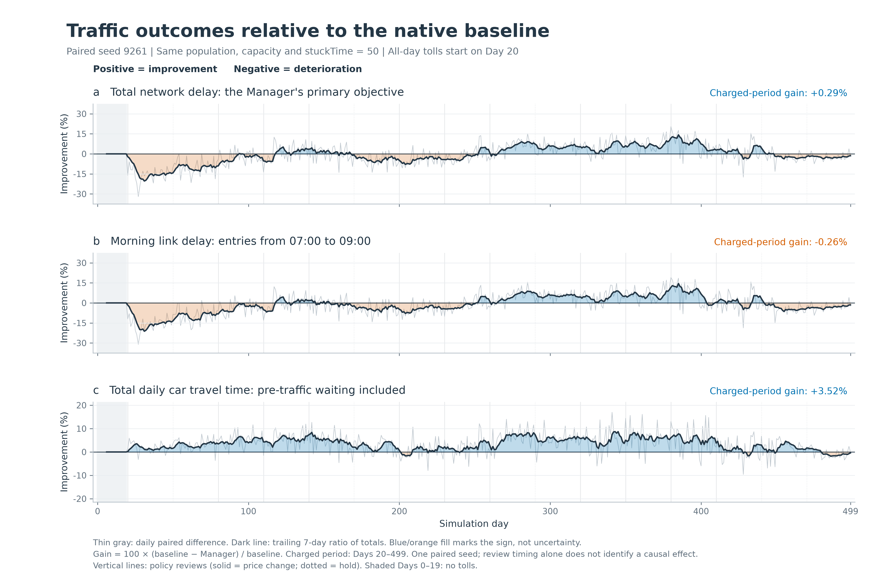
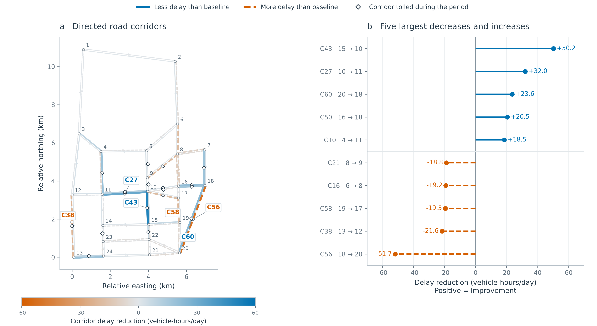

<div align="center">

<h1>Agentic Mobility</h1>

<p><strong>A research platform for studying LLM-driven travel decisions and traffic management in a shared MATSim environment.</strong></p>
<p align="center">
  <a href="#quickstart">
    
  </a>
  <a href="LICENSE">
    
  </a>
</p>

English | [中文](README.zh.md)
</div>

<div align="left">
    
Part of [AgenticCity](https://github.com/Agentic-City-Research),
an open research exploring interconnected urban systems,
starting with transportation.

</div>


<div align="center">
    
🧪 [Results](#experimental-results) · 🚀 [Quickstart](#quickstart) · 📖 [Documentation](#documentation) · 🎯 [Research directions](#research-directions) · 🤝 [Community](#community--contributing)

</div>

<a id="overview"></a>

## 🧩 Overview


Agentic Mobility connects LLM travelers and traffic managers in a shared MATSim environment to study travel decisions, management policies, and day-to-day traffic feedback. The platform supports traveler-only, manager-only, and joint configurations. The experiments reported here evaluate traveler decisions and manager pricing separately.

The current implementation supports joint route and departure-time choice, daily reflection, and periodic congestion pricing in **enriched Sioux Falls scenario**.

### Daily simulation cycle

Each day follows a decide–execute–reflect cycle: travelers select routes and departure times, enabled pricing policies are applied, and MATSim executes the full-day traffic simulation. Each role then receives its permitted feedback and updates its own experience record. Manager policy changes occur on scheduled review days.

LLMs control selected target trips; other trips follow native simulation behavior. Model weights remain fixed during the simulation. See [Methods & protocols](docs/methods-and-protocols.md) for information access, reflection, and policy execution.

<a id="experimental-results"></a>

## 🧪 Experimental results

The following exploratory experiments examine traveler decisions and traffic management separately: LLM travelers choosing routes and departure times without pricing, and an LLM manager setting congestion tolls for native travelers. Each setting is compared with its corresponding native MATSim baseline.

### LLM travelers: route and departure-time choice

We compare LLM-driven travelers against native MATSim over the same 61 completed simulation days (Days 0–60), using seed 9261. Population, network and capacity settings match within the comparison. Neither run includes a manager or tolls.

Across these days, the LLM run records lower average target-trip travel times and fewer late work arrivals. Total daily car travel time across the full population is also lower.

| Metric | Native MATSim | LLM travelers | Change vs. native |
| :--- | ---: | ---: | ---: |
| Mean target-trip car travel time (min) | 22.29 | 17.76 | −20.35% |
| Mean target-trip door-to-door travel time (min) | 41.02 | 36.48 | −11.06% |
| P95 target-trip car travel time (min) | 70.55 | 57.99 | −17.80% |
| Late work arrivals (%) | 15.48 | 6.02 | −9.46 pp |
| Total daily car travel time (person-hours) | 11,424.11 | 10,480.04 | −8.26% |

Values are daily averages over Days 0–60. P95 is the average of daily P95 values, and pp denotes percentage points. Target-trip metrics cover 11,793 trips/day, work lateness covers 11,332 work trips/day, and total car travel time covers 33,644 car legs/day.

[](docs/assets/llm-vs-native-61days.svg)

The gray curves show two additional native runs (seeds 268 and 4711); the primary comparison uses seed 9261 in both conditions. Shading marks Days 56–60.

<details>
<summary>Traffic replay: Day 0 vs. Day 50</summary>

This replay compares two days within the LLM run. It illustrates how traffic patterns change during that run; it is not a comparison against the native baseline.


</details>

### LLM manager: congestion pricing with native travelers

We compare native travelers under an LLM pricing manager with a native baseline without a manager over 500 completed simulation days (Days 0–499), using seed 9261. Population, network, capacity and native strategy settings match within this comparison. Both runs use `stuckTime = 50` seconds. All-day tolling begins on Day 20.

Across the charged period (Days 20–499), total network delay is **0.29% lower**, morning link delay is **0.26% higher**, and total daily car travel time is **3.52% lower** than the baseline. The time series shows periods of both improvement and deterioration, rather than a sustained reduction in every metric.

[](docs/assets/traffic_outcomes_manager.svg)

Positive values in this figure indicate improvement. Charged-period percentages use ratios of totals over Days 20–499. Network delay excludes pre-traffic waiting, whereas total car travel time includes it. Morning link delay covers link entries from 07:00 to 09:00.

**Where do delays change?**

The corridor comparison shows spatially uneven outcomes: some directed corridors experience less delay while others experience more. Colors report the change in mean daily corridor delay across the charged period. Diamonds identify corridors with at least one tolled link on at least one day during that period.



These exploratory comparisons include one LLM seed per setting. Different code builds and decision constraints limit attribution to individual design choices. The experiments also use different observation windows and metric scopes. See the [experiment records and data](docs/reported-experiments.md) for model settings, build identifiers, metric definitions, and interpretation.

<a id="quickstart"></a>

## 🚀 Quickstart


Requires **JDK 25** (including `javac`) and Git. The Maven Wrapper downloads Maven and dependencies on first use.

**Get the source and build**

```bash
git clone https://github.com/Agentic-City-Research/Agentic-Mobility.git
cd Agentic-Mobility
sh ./mvnw -B clean package
```

On Windows PowerShell, build with `.\mvnw.cmd -B clean package`.

**Run a diagnostic baseline without model API calls**

The following command runs a two-day diagnostic baseline with 100 native travelers.

```bash
java -Xmx4g -cp matsim-example-project-0.0.1-SNAPSHOT.jar org.matsim.agentic.MorningExperiment \
  --config scenarios/SiouxFalls-public/config.xml \
  --mode hybrid --policy mnl --llm-agents 0 \
  --demand 100 --sample-persons 100 --days 2 \
  --population-seed 4711 --seed 4711 \
  --output output/quickstart
```

<details>
<summary>Windows PowerShell command</summary>

```powershell
java -Xmx4g -cp matsim-example-project-0.0.1-SNAPSHOT.jar org.matsim.agentic.MorningExperiment `
  --config scenarios/SiouxFalls-public/config.xml `
  --mode hybrid --policy mnl --llm-agents 0 `
  --demand 100 --sample-persons 100 --days 2 `
  --population-seed 4711 --seed 4711 `
  --output output/quickstart
```

</details>

After a successful run, `morning/status.json` in the actual output directory should contain `complete=true` and `daysCompleted=2`. If the requested directory already exists, the application creates a numbered alternative. Use the output path reported in the console.

This 100-person example checks installation and execution. The `--sample-persons` option reduces the population without scaling road capacity. For research experiments, follow the [sampling and capacity guidance](docs/scenarios-and-data.md#sampling-and-capacity).

**Connect a model API**

Before running LLM travelers, an LLM manager, or joint experiments, follow the [API connection guide](docs/getting-started.md#5-connect-an-existing-model-service) to configure `AGENTIC_BASE_URL`, `AGENTIC_MODEL`, and `AGENTIC_API_KEY`. The platform then calls the configured service automatically during decisions, reflection, and other enabled stages. The service must support the Chat Completions API. MATSim runs on CPU, and the model service can be hosted on another machine.

For installation, troubleshooting, and additional instructions, see the [operating guide](docs/usage-guide.md) or its [Chinese version](docs/usage-guide.zh.md).

<a id="documentation"></a>


## 📖 Documentation

| Guide | What you will find |
| :--- | :--- |
| [Getting started](docs/getting-started.md) | Installation, API setup, first run, and troubleshooting |
| [Methods & protocols](docs/methods-and-protocols.md) | Agent roles, information access, memory, and pricing |
| [Experiments & evaluation](docs/experiments-and-evaluation.md) | Experiment configurations, baselines, and run records |
| [Reported experiments](docs/reported-experiments.md) | Model settings, build identifiers, result definitions, and aggregate data |
| [Scenarios & data](docs/scenarios-and-data.md) | Scenario inputs, data provenance, and extensions |

<a id="research-questions"></a>
<a id="research-directions"></a>

## 🎯 Research directions

The platform supports the following research directions. The results above currently cover traveler decision-making and manager-led congestion pricing; information-access and joint traveler–manager comparisons are further research directions.

| Research focus | Comparison setting |
| :--- | :--- |
| 📊 **Traveler decisions** | Native baseline vs. LLM-controlled route and departure-time choices |
| 🔎 **Information access** | Informed vs. uninformed controlled travelers |
| 🚦 **Policy comparison** | Native baseline vs. fixed tolls vs. LLM pricing |
| 🔄 **Traveler–manager interaction** | LLM travelers with vs. without an LLM manager |

Configuration templates are provided in the [experiment guide](docs/experiments-and-evaluation.md). Each comparison requires its own documented population, action constraints, background traffic, and evaluation protocol.

<a id="community--contributing"></a>

## 🤝 Community & Contributing

We welcome contributions from researchers and developers working on
agents, transportation, simulation, and policy evaluation. You can help
improve documentation, add reproducible examples, develop analysis tools,
or extend simulation scenarios.

[Report an issue](https://github.com/Agentic-City-Research/Agentic-Mobility/issues) · [Read the contribution guide](CONTRIBUTING.md) · [Contributors](https://github.com/Agentic-City-Research/Agentic-Mobility/graphs/contributors)

If Agentic Mobility looks useful to you, please give it a ⭐ — it helps the community to discover and contribute to the project.

<a id="citation-and-license"></a>

## 📚 Citation and license

For research use, reference [Agentic-City-Research/Agentic-Mobility](https://github.com/Agentic-City-Research/Agentic-Mobility) and report the exact commit, scenario, model, and experimental settings. Manuscript information will be added when publicly available.

Code is licensed under [GPL-2.0](LICENSE). Third-party code and data retain their documented terms in [THIRD_PARTY.md](THIRD_PARTY.md). Built on MATSim and its example-project lineage.
