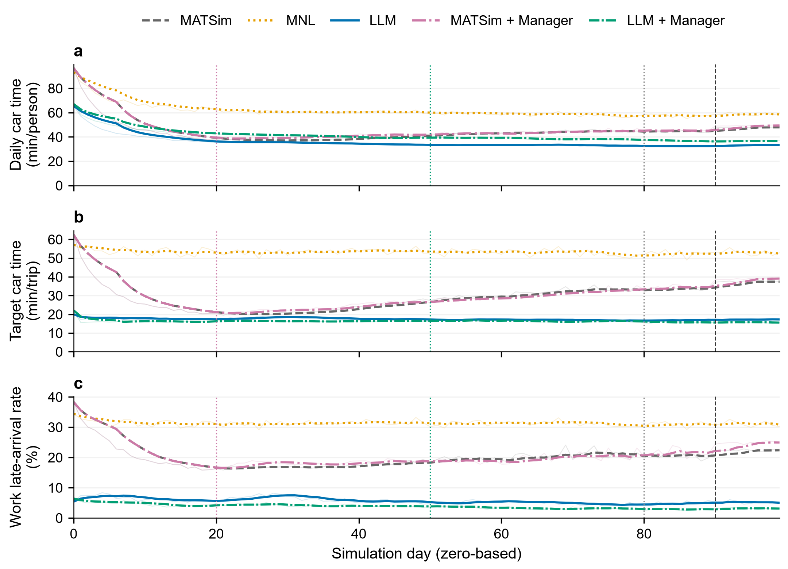

<div align="center">

<h1>Agentic Mobility</h1>

<p><strong>Exploring AI Agents and Emergent Dynamics in Mobility Systems</strong></p>


<p>
  <a href="#quickstart"></a>
  <a href="LICENSE"></a>
</p>

Part of [AgenticCity](https://github.com/Agentic-City-Research), exploring AI agents and interconnected urban systems.

[📚 Paper](https://arxiv.org/abs/2611.01918) · [🚀 Quickstart](#quickstart) · [🧪 Experiments](#experiments) · [📖 Documentation](#documentation) · [🤝 Contributing](#community--contributing)

</div>


<a id="overview"></a>

## 🧩 Overview 

Agentic Mobility is a research platform for studying AI agents and collective dynamics in mobility systems. Traveler agents select routes and departure times; optional pricing policies change travel incentives. MATSim executes these decisions in a shared traffic environment, where one agent's choices can affect conditions experienced by others.

### 🔄 Daily simulation cycle

Each simulation day connects decisions, traffic execution, and feedback. Agents receive information permitted by their configuration; reflection and pricing updates follow configurable schedules. LLMs control selected target trips, while other trips follow MATSim behavior. Model weights remain fixed during the simulation.

The platform supports MATSim agents, constrained MNL, and LLM traveler agents, with no tolls or an LLM pricing manager. See [Methods & protocols](docs/methods-and-protocols.md) for information access, decision constraints, reflection, and policy execution.

<a id="research-questions"></a>
## 🎯 What you can study 

| Research task         | What you can vary                     | What you can inspect                          |
| :-------------------- | :------------------------------------ | :-------------------------------------------- |
| 🗳️ Traveler decisions    | MATSim, MNL, or LLM decision policies | Routes, departure times, and arrival outcomes |
| ℹ️ Information access    | Access to current toll announcements  | Route use, payments, and individual traces    |
| 💰 Pricing interventions | No tolls or an LLM pricing manager    | Individual and system-level outcomes          |

Explore the [experiment guide](docs/experiments-and-evaluation.md) for configurations, evaluation, and run records. Information-access effects and causal interactions between traveler and pricing agents remain open research questions.

## 🎬 See it in action

### Traffic replay

In the [five-configuration experiment](#experiments), compare **MATSim agents**, **LLM traveler agents**, and **LLM traveler agents with a pricing manager** at three simulation days. Each animation follows the same 500 sampled travelers from the 16,822-person population. Quantitative results use the full population relevant to each metric.

**Final day — simulation Day 100**

<p align="center">
  
</p>

<details>
<summary>View the initial and intermediate snapshots</summary>

#### Initial snapshot — simulation Day 1

<p align="center">
  
</p>

#### Intermediate snapshot — simulation Day 50

<p align="center">
  
</p>

</details>

<a id="quickstart"></a>
## 🚀 Quickstart 

**Requirements:** Git and JDK 25 (`java` and `javac` on your PATH). The Maven Wrapper downloads build dependencies on first use. MATSim runs on CPU; LLM experiments also need a Chat Completions-compatible model service.

### 1. Download and build

Open a terminal in the folder where you want to keep the project:

```bash
git clone https://github.com/Agentic-City-Research/Agentic-Mobility.git
cd Agentic-Mobility
sh ./mvnw -B clean package
```

On **Windows PowerShell**, replace the last line with `.\mvnw.cmd -B clean package`.

The build creates `matsim-example-project-0.0.1-SNAPSHOT.jar`. Run the remaining commands from this project folder.

### 2. Run example without LLM

Check your installation with **100 people over two simulation days**, without model API calls.

```bash
java -Xmx4g -cp matsim-example-project-0.0.1-SNAPSHOT.jar org.matsim.agentic.MorningExperiment \
  --config scenarios/SiouxFalls-public/config.xml \
  --mode hybrid --policy mnl --llm-agents 0 \
  --demand 100 --sample-persons 100 --days 2 \
  --population-seed 4711 --seed 4711 \
  --output output/quickstart
```

<details>
<summary>Windows PowerShell</summary>

```powershell
java -Xmx4g -cp matsim-example-project-0.0.1-SNAPSHOT.jar org.matsim.agentic.MorningExperiment `
  --config scenarios/SiouxFalls-public/config.xml `
  --mode hybrid --policy mnl --llm-agents 0 `
  --demand 100 --sample-persons 100 --days 2 `
  --population-seed 4711 --seed 4711 `
  --output output/quickstart
```

</details>

Open `morning/status.json` in the output folder printed by the console (normally `output/quickstart`). A successful run reports `complete: true`, `daysCompleted: 2`, and `integrityVerified: true`.

This is an installation check; for research runs, follow the [sampling and capacity guidance](docs/scenarios-and-data.md#sampling-and-capacity).

### 3. Run AgenticMobility

Set your model service's API root, model ID, and key in the same terminal, replacing the placeholders below. See [API setup](docs/getting-started.md#5-connect-an-existing-model-service) for connection details.

**Bash (Linux/macOS)**

```bash
export AGENTIC_BASE_URL='https://YOUR_API_HOST/v1'
export AGENTIC_MODEL='YOUR_MODEL_ID'
export AGENTIC_API_KEY='YOUR_API_KEY'

java -Xmx8g -cp matsim-example-project-0.0.1-SNAPSHOT.jar org.matsim.agentic.MorningExperiment \
  --config scenarios/SiouxFalls-public/config.xml \
  --mode hybrid --demand 100 --sample-rate 0.1 \
  --population-seed 4711 --seed 4711 --days 7 \
  --policy llm --llm-agents 3 --concurrency 3 \
  --thinking omit --response-format omit --max-requests 500 \
  --output output/first-llm-travelers
```

<details>
<summary>Windows PowerShell</summary>

```powershell
$env:AGENTIC_BASE_URL = 'https://YOUR_API_HOST/v1'
$env:AGENTIC_MODEL = 'YOUR_MODEL_ID'
$env:AGENTIC_API_KEY = 'YOUR_API_KEY'

java -Xmx8g -cp matsim-example-project-0.0.1-SNAPSHOT.jar org.matsim.agentic.MorningExperiment `
  --config scenarios/SiouxFalls-public/config.xml `
  --mode hybrid --demand 100 --sample-rate 0.1 `
  --population-seed 4711 --seed 4711 --days 7 `
  --policy llm --llm-agents 3 --concurrency 3 `
  --thinking omit --response-format omit --max-requests 500 `
  --output output/first-llm-travelers
```

</details>

This runs **seven days**, with LLMs controlling the eligible target trips of **three people** in a **10% population sample**. Check `morning/status.json` for completion with `daysCompleted: 7`. The same folder contains choices in `decisions.jsonl.gz` and realized trips in `trips.jsonl.gz`.

[Inspect agent decisions and outcomes →](docs/usage-guide.md#outputs-and-evaluation) · [More experiment configurations →](docs/experiments-and-evaluation.md) · [Troubleshooting →](docs/getting-started.md#troubleshooting)

<a id="experiments"></a>
## 🧪 Experiments 

The following historical experiment connects individual decisions with outcomes across a shared mobility system.

### Five configurations over 100 simulation days

**Historical results:** these figures describe the recorded experiment builds and settings. Consult the [experiment record](docs/assets/data/seed268/seed268-experiments.md) for reproduction.

We compare five configurations of the enriched Sioux Falls scenario over **Days 1–100**, using **simulation seed 268**. All share the same scenario inputs, sampled population and target-trip cohort. Constrained MNL and both LLM traveler configurations share fixed route and departure-time options. Traveler agents use `qwen3.5-9b`; pricing agents use `deepseek-flash`.

| Configuration | Traveler decisions | Pricing agent |
| :--- | :--- | :--- |
| MATSim agents | MATSim replanning | None |
| Constrained MNL | MNL over fixed route–departure options | None |
| LLM traveler agents | LLM route–departure choices | None |
| Manager | MATSim replanning | Enabled; tolls from simulation Day 21 |
| Joint | LLM route–departure choices | Enabled; tolls from simulation Day 21 |

For the MNL configuration implementation, see [MNL setup](docs/mnl-joint.md).

### Individual and system outcomes

**LLM traveler agents record the lowest all-day car time, 19.90% below MATSim agents. Joint records the shortest target-trip time and lowest work late-arrival rate.**

| Configuration | Daily car time (min/person/day) | Change vs. MATSim agents | Target-trip car time (min/trip) | Work late-arrival rate |
| :--- | ---: | ---: | ---: | ---: |
| MATSim agents | 44.34 | — | 29.32 | 19.97% |
| Constrained MNL | 61.35 | +38.37% | 53.19 | 31.25% |
| LLM traveler agents | **35.52** | −19.90% | 17.40 | 5.61% |
| Manager | 45.16 | +1.86% | 29.64 | 20.42% |
| Joint | 40.71 | −8.18% | **16.25** | **3.73%** |

All-day car time is normalized to min/person by dividing the daily person-hours total by the 16,822 simulated travelers and converting to minutes. 

Daily means cover **11,793 target trips**, including **11,332 work trips with arrival deadlines**, and **33,644 all-day car legs** across **16,822 people**.
All car legs completed, with no stuck agents. Car time includes waiting before network entry; target trips cover multiple activity purposes. Contrasts use unrounded means.

[](docs/assets/seed268/outcomes.svg)

Thin lines show daily values; thick lines show trailing seven-day means. Positive tolls begin on simulation Day 21 for Manager and Day 51 for Joint; a review occurs on Day 81 and MATSim route/time innovation stops on Day 91. Existing-plan selection continues after the cutoff. The original figure axis uses zero-based log days; add 1 to obtain the simulation day.

Compared with LLM traveler agents alone, **Joint has 6.63% shorter target-trip time and 1.87 percentage points less work lateness, alongside 14.62% more all-day car time**.

<details>
<summary>Behavioral patterns and outcome breakdowns</summary>

Target trips save 226.73 person-hours/day, while other car trips add 1,682.97. Across individual targets, 60.65% have lower 100-day mean car time in Joint and 39.28% have higher time.

Route persistence coexists with schedule adjustment: LLM traveler agents and Joint change routes in **3.08% / 2.19%** of adjacent-day target decisions, but change departure times in **29.45% / 28.04%**. Their mean departures are **34.96 / 39.65 minutes earlier** than the original plans.

</details>

### Zoom in on individual decisions

Two recorded examples connect available information, selected actions, generated rationales and realized outcomes.

<details>
<summary>LLM traveler agent: switching routes after a late arrival</summary>

Traveler `1005_1`, simulation Day 66; LLM traveler agents configuration.

| Stage | Recorded example |
| :--- | :--- |
| Available information | Four routes, nine departure times, a 09:00 arrival target, and personal trips from simulation Days 63–65; no network traffic information. |
| Selected action | `c1` at **08:12:47**, the same departure time as the previous day. |
| Recorded rationale | “I chose route c1 to avoid the inconsistency of c0 while ensuring I meet the 09:00 deadline on time.” |
| Realized outcome | **7.85 min** car time; destination arrival **08:41:33**. The previous day's `c0` trip took **31.28 min**, arriving **4 min 59 s late**. |

Both choices were executed as recorded. Shared conditions also varied between days.

</details>

<details>
<summary>Joint: trying different routes after delays</summary>

Traveler `20336_4` keeps the original **07:49:58** departure across simulation Days **22–27**, with a **09:00** arrival target. The traveler belongs to the uninformed group. This sequence precedes Joint toll activation.

| Simulation day | Route | Car time (min:sec) | Destination arrival | Arrival status |
| :--- | :--- | ---: | :--- | :--- |
| 22 | c0 | 14:17 | 08:16:59 | On time |
| 23 | c0 | 65:35 | 09:08:17 | 8:17 late |
| 24 | c1 | 97:43 | 09:40:25 | 40:25 late |
| 25 | c2 | 37:55 | 08:40:37 | On time |
| 26 | c2 | 87:52 | 09:30:34 | 30:34 late |
| 27 | c0 | 64:00 | 09:06:42 | 6:42 late |

After a late `c0` trip, the traveler tries `c1` and arrives later still. On simulation Day 25, the recorded rationale describes `c0` as unreliable and `c1` as too slow; the selected `c2` trip arrives on time. The next `c2` trip is late, followed by a return to `c0` that is also late.

All six selected routes and departure times match execution. Simulation Day 27's rationale calls `c0` “untested”, although it was used earlier. Car time includes pre-network waiting; this sequence shows changing choices and outcomes, without isolating a route or memory effect.

</details>

[Case records and execution checks →](docs/assets/data/seed268/seed268-individual-cases.md)

### Current toll information and route choice

In Joint, **5,897 travelers receive current toll announcements and 5,896 do not**; both groups receive personal trip feedback, and neither receives network-wide traffic information. After charging starts, use of the two tolled links falls from **6.67% to 2.49%** among informed travelers, versus **6.54% to 6.94%** among uninformed travelers. Informed travelers pay **64.15% less per target trip**, while uninformed travelers depart earlier and record shorter travel times.

<details>
<summary>Information-group outcomes and route-use trajectories</summary>

| Measure | Informed | Uninformed |
| :--- | ---: | ---: |
| Use of subsequently tolled links, Days 1–50 | 6.67% | 6.54% |
| Use of tolled links, Days 51–100 | 2.49% | 6.94% |
| Mean target payment, Days 51–100 (scenario units/trip) | 0.075 | 0.208 |
| Target car time, Days 51–100 (min/trip) | 17.02 | 15.17 |
| Work late-arrival rate, Days 51–100 | 3.81% | 2.50% |

[](docs/pic/information_route_response.svg)

Links are identified retrospectively before charging and in the no-toll comparison. Payments include zero-payment trips. The original figure uses zero-based log days, so its Day 50 is simulation Day 51. Group time differences already exist before charging; these observations do not isolate a toll-information treatment effect.

</details>

**Interpretation.** The main comparison contains one run per configuration. MNL uses uncalibrated homogeneous parameters, and some executable builds differ. Shared traffic and pre-existing differences limit causal attribution and claims of traveler–pricing synergy.

**[Experiment settings, data, behavioral results and validation →](docs/assets/data/seed268/seed268-experiments.md)**


<br>

<a id="documentation"></a>
## 📖 Documentation 

New to the project? Start with [Getting started](docs/getting-started.md). For research experiments, check the scenario and sampling settings, review the methods, then use the experiment guide to configure and record your runs.

| I want to… | Read | What it covers |
| :--- | :--- | :--- |
| Install and run my first simulation | [Getting started](docs/getting-started.md) | Requirements, diagnostic baseline, model API setup, and troubleshooting |
| Choose data and set the simulation scale | [Scenarios & data](docs/scenarios-and-data.md) | Scenario inputs, data provenance, population sampling, and road capacity |
| Understand how the agents work | [Methods & protocols](docs/methods-and-protocols.md) | Agent roles, information access, decisions, memory, and pricing |
| Inspect agent prompts | [Agent prompts](docs/agent-prompts.md) | System prompts, dynamic inputs, and request logs |
| Design and evaluate an experiment | [Experiments & evaluation](docs/experiments-and-evaluation.md) | Configuration templates, baselines, request budgets, and run records |
| Inspect the five-configuration experiment | [Experiment record](docs/assets/data/seed268/seed268-experiments.md) | Settings, results, provenance, and available data |
| Inspect earlier exploratory results | [Reported experiments](docs/reported-experiments.md) | Separate earlier comparisons, model settings, and aggregate data |
| Find detailed operating instructions | [Operating guide](docs/usage-guide.md) | Execution options, deployment, outputs, and troubleshooting |

<a id="community--contributing"></a>

## 🤝 Community & Contributing 

Contributions are welcome, including decision policies, reproducible examples, simulation scenarios, and tools for inspecting agent trajectories.

[Report an issue](https://github.com/Agentic-City-Research/Agentic-Mobility/issues) · [Contribution guide](CONTRIBUTING.md) · [Contributors](https://github.com/Agentic-City-Research/Agentic-Mobility/graphs/contributors)

⭐ If you find Agentic Mobility useful, consider starring the repository.

## 📚 Citation & License

If you use Agentic Mobility in research, please cite the [paper](https://arxiv.org/abs/2611.01918) and report the exact code version, scenario, model, and experimental settings.

```bibtex
@article{xiao2026agenticmobility,
  title   = {AgenticMobility: An Open-Source Platform for Multi-AI-Agent Mobility Dynamics},
  author  = {Xiao, Jiaheng and Han, Jiangtao and Wang, Jiachen and Li, Honghai and Sun, Lijun and Axhausen, Kay and Liu, Chang and He, Zhengbing},
  journal = {arXiv preprint arXiv:2611.01918},
  year    = {2026},
  url     = {https://arxiv.org/abs/2611.01918}
}
```

Code is licensed under [GPL-2.0](LICENSE). Third-party code and data retain their documented terms in [THIRD_PARTY.md](THIRD_PARTY.md). Built on MATSim and its example-project lineage.
