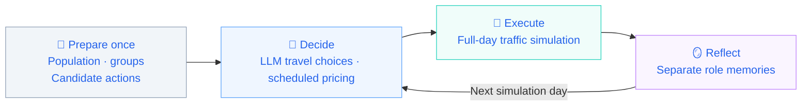
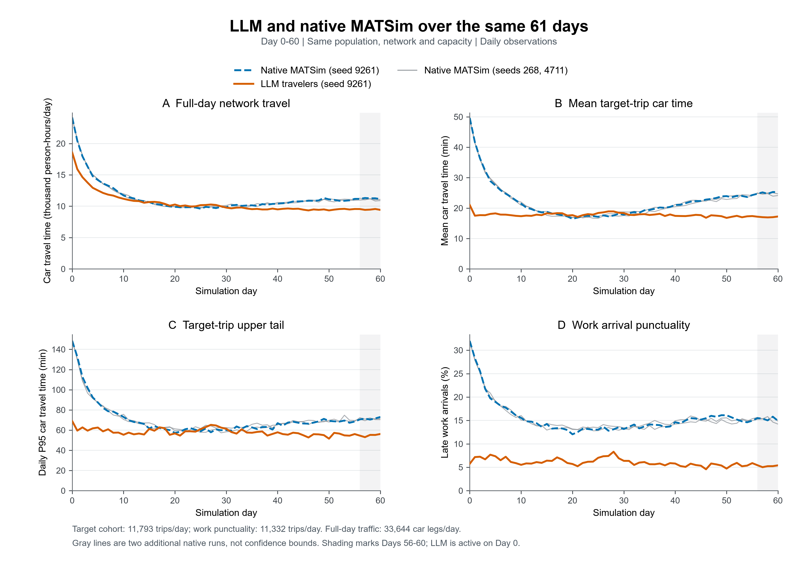

<div align="center">

<h1>Agentic Mobility</h1>

<p><strong>An open research platform for interactions between LLM travelers and traffic managers.</strong></p>
<p align="center">
  <a href="#quickstart">
    
  </a>
  <a href="LICENSE">
    
  </a>
</p>

English | [中文](README.zh.md)
</div>

<div align="left">
    
Part of [AgenticCity](https://github.com/Agentic-City-Research),
an open research exploring interconnected urban systems,
starting with transportation.

</div>


<div align="center">
    
🚀[Quickstart](#quickstart) | 📖[Documentation](#documentation) |🎯[Research questions](#research-questions) |  🤝[Community](#Community & Contributing)

</div>

## 🧩Overview


Agentic Mobility connects LLM travelers and traffic managers in a
shared MATSim environment to study travel choices, memory, and policy
responses. 

The current implementation supports joint route and 
departure-time choice, daily reflection, and periodic congestion 
pricing in **enriched Sioux Falls scenario**.


## 🔄How it works




Each simulation day follows a decide–execute–reflect cycle, 
with pricing updates on scheduled days.

LLMs control selected target trips; other trips follow native
simulation behavior. Agents adapt through memory updates 
while model weights remain fixed.

## 🎯Research questions

| Research focus | Experiment setup |
| :--- | :--- |
| 📊 **Traveler adaptation** | Native baseline vs. LLM-controlled target trips |
| 🔎 **Information access** | Informed vs. uninformed controlled travelers |
| 🚦 **Policy comparison** | Native baseline vs. fixed tolls vs. LLM pricing |
| 🔄 **Traveler–manager interaction** | LLM travelers with vs. without an LLM manager |

For comparisons with matched population, scenario, and background-traffic
settings, see the [experiment guide](docs/experiments-and-evaluation.md).

## 🚀Quickstart


Requires **JDK 25** (including `javac`) and Git. The Maven Wrapper downloads Maven and dependencies on first use.

**Get the source and build**

```bash
git clone https://github.com/Agentic-City-Research/Agentic-Mobility.git
cd Agentic-Mobility
sh ./mvnw -B clean package
```

On Windows PowerShell, build with `.\mvnw.cmd -B clean package`.

**Run a diagnostic baseline without model API calls**

The following command runs a two-day diagnostic baseline with 100 native travelers.

```bash
java -Xmx4g -cp matsim-example-project-0.0.1-SNAPSHOT.jar org.matsim.agentic.MorningExperiment \
  --config scenarios/SiouxFalls-public/config.xml \
  --mode hybrid --policy mnl --llm-agents 0 \
  --demand 100 --sample-persons 100 --days 2 \
  --population-seed 4711 --seed 4711 \
  --output output/quickstart
```

<details>
<summary>Windows PowerShell command</summary>

```powershell
java -Xmx4g -cp matsim-example-project-0.0.1-SNAPSHOT.jar org.matsim.agentic.MorningExperiment `
  --config scenarios/SiouxFalls-public/config.xml `
  --mode hybrid --policy mnl --llm-agents 0 `
  --demand 100 --sample-persons 100 --days 2 `
  --population-seed 4711 --seed 4711 `
  --output output/quickstart
```

</details>

After a successful run, `morning/status.json` in the actual output directory should contain `complete=true` and `daysCompleted=2`. If the requested directory already exists, the application creates a numbered alternative. Use the output path reported in the console.

This 100-person example checks installation and execution. The `--sample-persons` option reduces the population without scaling road capacity. For research experiments, follow the [sampling and capacity guidance](docs/scenarios-and-data.md#sampling-and-capacity).

**Connect a model API**

Before running LLM travelers, an LLM manager, or joint experiments, follow the [API connection guide](docs/getting-started.md#5-connect-an-existing-model-service) to configure `AGENTIC_BASE_URL`, `AGENTIC_MODEL`, and `AGENTIC_API_KEY`. The platform then calls the configured service automatically during decisions, reflection, and other enabled stages. The service must support the Chat Completions API. MATSim runs on CPU, and the model service can be hosted on another machine.

For installation, troubleshooting, and additional instructions, see the [operating guide](docs/usage-guide.md) or its [Chinese version](docs/usage-guide.zh.md).

<a id="documentation"></a>


## 📖Documentation

| Guide | What you will find |
| :--- | :--- |
| [Getting started](docs/getting-started.md) | Installation, API setup, first run, and troubleshooting |
| [Methods & protocols](docs/methods-and-protocols.md) | Agent roles, information access, memory, and pricing |
| [Experiments & evaluation](docs/experiments-and-evaluation.md) | Experiment configurations, baselines, and run records |
| [Scenarios & data](docs/scenarios-and-data.md) | Scenario inputs, data provenance, and extensions |


## 🧪Experimental results

Exploratory comparison over **61 completed simulation days (Day 0–60)**, using **seed 9261** in both runs. Both runs use the same population, network and capacity settings, with no Manager or tolls.


### Average performance

| Metric | Native MATSim | LLM + memory | Change vs. native |
| :--- | ---: | ---: | ---: |
| Mean car travel time (min) | 22.29 | 17.76 | **-20.35%** |
| Mean door-to-door travel time (min) | 41.02 | 36.48 | **-11.06%** |
| P95 car travel time (min) | 70.55 | 57.99 | **-17.80%** |
| Late work arrivals (%) | 15.48 | 6.02 | **-9.46 pp** |
| Total daily car travel time (person-hours) | 11,424.11 | 10,480.04 | **-8.26%** |

Values are daily averages over all 61 days. P95 is the average of daily P95 values; pp denotes percentage points.



<details>
<summary><strong>View the time-series comparison</strong></summary>

Each cell shows **Native / LLM**. Five-day snapshots are displayed below; the Avg column uses all 61 days.

| Metric | Day 0 | Day 5 | Day 10 | Day 15 | Day 20 | Day 25 | Day 30 | Day 35 | Day 40 | Day 45 | Day 50 | Day 55 | Day 60 | Avg |
| :--- | ---: | ---: | ---: | ---: | ---: | ---: | ---: | ---: | ---: | ---: | ---: | ---: | ---: | ---: |
| Mean car travel time (min) | 49.67 / 21.00 | 27.43 / 18.27 | 21.45 / 17.34 | 18.79 / 18.30 | 16.46 / 17.69 | 17.14 / 18.40 | 17.83 / 18.35 | 19.40 / 17.73 | 21.02 / 17.45 | 22.36 / 17.69 | 23.94 / 16.79 | 24.28 / 17.39 | 25.26 / 17.24 | **22.29 / 17.76** |
| Mean door-to-door travel time (min) | 68.39 / 39.72 | 46.15 / 36.99 | 40.17 / 36.07 | 37.51 / 37.03 | 35.18 / 36.41 | 35.86 / 37.12 | 36.56 / 37.07 | 38.13 / 36.46 | 39.75 / 36.17 | 41.08 / 36.41 | 42.66 / 35.51 | 43.01 / 36.11 | 43.98 / 35.96 | **41.02 / 36.48** |
| P95 car travel time (min) | 148.53 / 68.98 | 87.40 / 62.55 | 72.98 / 55.40 | 61.65 / 61.23 | 57.23 / 56.73 | 58.80 / 60.93 | 60.02 / 61.30 | 62.68 / 57.38 | 66.90 / 57.85 | 66.55 / 54.90 | 69.13 / 51.53 | 68.48 / 56.08 | 73.03 / 56.17 | **70.55 / 57.99** |
| Late work arrivals (%) | 31.98 / 5.74 | 18.96 / 7.35 | 15.55 / 5.52 | 14.25 / 6.42 | 12.04 / 5.70 | 13.04 / 7.02 | 13.17 / 6.37 | 14.15 / 5.66 | 14.63 / 5.80 | 15.18 / 5.34 | 16.10 / 4.72 | 14.95 / 5.89 | 14.91 / 5.41 | **15.48 / 6.02** |
| Total daily car travel time (person-hours) | 24155.35 / 18578.94 | 14176.60 / 12522.46 | 11728.37 / 11185.34 | 10664.70 / 10671.80 | 9896.87 / 10272.91 | 9604.41 / 10173.39 | 9855.78 / 9779.36 | 10144.59 / 9533.68 | 10398.69 / 9497.58 | 10797.10 / 9450.22 | 11089.53 / 9334.07 | 11173.55 / 9560.24 | 11135.73 / 9417.41 | **11424.11 / 10480.04** |

[Download the full daily results](docs/data/daily-comparison.csv). This file also includes native seeds 268 and 4711, shown as gray lines in the figure.

</details>

Target-trip metrics cover 11,793 trips/day; work lateness covers 11,332 work trips/day; full-day car time covers 33,644 car legs/day. All these trips completed on the selected days.

LLM decisions are active from Day 0. Departure-time shifts, different action constraints and different code builds accompany this comparison; it does not isolate the contribution of memory. Only one LLM seed is currently included.


## 🤝Community & Contributing

We welcome contributions from researchers and developers working on
agents, transportation, simulation, and policy evaluation. You can help
improve documentation, add reproducible examples, develop analysis tools,
or extend simulation scenarios.

Report an issue · Read the contribution guide · [Join the WeChat group](docs/wechat.md)

If Agentic Mobility looks useful to you, please give it a ⭐ — it helps the community to discover and contribute to the project.

## 📚Citation and license

For research use, reference [Agentic-City-Research/Agentic-Mobility](https://github.com/Agentic-City-Research/Agentic-Mobility) and report the exact commit, scenario, model, and experimental settings. Manuscript information will be added when publicly available.

Code is licensed under [GPL-2.0](LICENSE). Third-party code and data retain their documented terms in [THIRD_PARTY.md](THIRD_PARTY.md). Built on MATSim and its example-project lineage.
