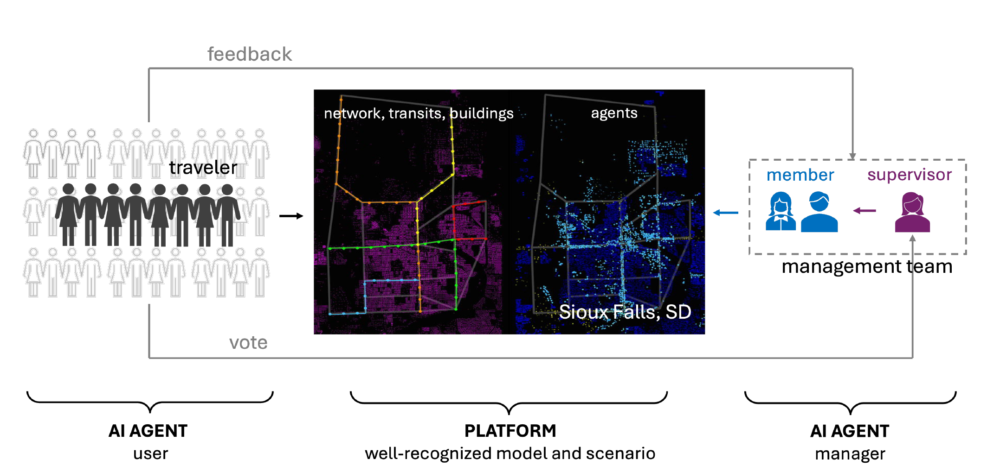

<div align="center">

# AgenticMobility

**An open research platform for LLM-driven mobility systems.**
[](pom.xml)
[](pom.xml)
[](LICENSE)

[English](docs/usage-guide.md) · [中文](docs/usage-guide.zh.md)
</div>

<div align="left">

A mobility research project within the Agentic City. Agentic Mobility connects LLM travelers and traffic managers through a shared transportation environment to study travel decisions, memory, policy responses, and collective outcomes.


</div>
[Quickstart](#quickstart) · [Experiments](#what-can-you-study) · [Documentation](#documentation) · [Citation](#citation)
## Overview

AgenticMobility is a research platform for studying how travel choices, personal memory, and congestion pricing interact. LLM travelers choose routes and departure times, experience the resulting traffic and tolls, and reflect on their own outcomes. An LLM manager observes public traffic aggregates and revises pricing policies at scheduled opportunities.

Both operate in a shared, full-day **Sioux Falls MATSim simulation**, alongside native MATSim travelers. The platform records intended decisions, executed trips, payments, policies, and memories so that researchers can examine the feedback between individual behavior and system-level intervention.



The diagram shows the joint traveler-and-manager mode. The experiment modes below enable each component separately. Travelers receive information according to their assigned group; the manager receives public aggregates and its own memory.

## What can you study?

| Research question | Experiment mode | Model access |
| --- | --- | --- |
| What happens under native traffic behavior? | Native MATSim travelers, no tolls | None |
| How do LLM travelers choose and adapt? | LLM-controlled target trips with native background traffic | Traveler decisions and reflections |
| How does adaptive pricing affect native traffic? | Native MATSim travelers + LLM manager | Manager policies and daily reflections |
| How do travelers and a pricing manager interact? | LLM-controlled target trips + LLM manager | Both traveler and manager calls |

Additional experiments include [fixed-toll interventions](scenarios/SiouxFalls-public/fixed-tolls.md), informed versus uninformed traveler groups, and [replay of saved traveler contexts](docs/usage-guide.zh.md#固定情境回放). Replay examines model choices without rerunning traffic.

See the [experiment commands](docs/usage-guide.md#experiments) for each mode. MATSim runs on CPU; live LLM modes use an existing model endpoint.

## How it works

| Step | What happens | Implementation |
| --- | --- | --- |
| **Prepare** | Fix the sampled population, target cohort, information groups, profiles, and route/time candidates. | [Experiment setup](src/main/java/org/matsim/agentic/MorningExperiment.java), [cohort](src/main/java/org/matsim/agentic/MorningCohort.java) |
| **Decide** | Update tolls on scheduled days and choose legal actions for controlled target trips. | [Daily loop](src/main/java/org/matsim/agentic/MorningLoop.java), [traveler policy](src/main/java/org/matsim/agentic/MorningLlmPolicy.java), [manager](src/main/java/org/matsim/agentic/MorningManager.java) |
| **Execute** | Run full-day MATSim traffic and charge actual entries into priced car links. | [Toll execution](src/main/java/org/matsim/agentic/MorningTollSystem.java) |
| **Reflect** | Update traveler memory from personal experience and manager memory from public aggregates. | [Traveler memory](src/main/java/org/matsim/agentic/MorningMemoryUpdater.java), [manager memory](src/main/java/org/matsim/agentic/MorningManagerMemory.java) |

**Traveler memory.** [Traveler v9](docs/traveler-v9.md) combines the previous private summary with three days of execution facts. Useful older experience can persist through the summary. Strict JSON validation and optional semantic review are recorded for inspection. In the default `hybrid` mode, LLM control applies to selected target trips; other trips retain native behavior.

**Manager timing.** The manager reflects after every completed day, including the initial **20 toll-free days**. Default pricing decisions occur on days **21, 51, 81, ...**. Each accepted policy replaces the previous policy and can price up to 40 directed car links throughout the simulation day. Daily reflection updates memory; it does not change prices. See [manager actions and information](scripts/manager_basic_joint.md) and [daily manager memory](scripts/manager_daily_memory.md).

## Installation

Requires **JDK 25**, including `javac`, and Git. The bundled Maven Wrapper downloads Maven and dependencies on first use. LLM experiments additionally require a reachable Chat Completions service.

```bash
git clone https://github.com/Jiaheng-Xiao/AgenticMobility.git
cd AgenticMobility
sh ./mvnw -B clean package
```

On Windows PowerShell, build with `.\mvnw.cmd -B clean package`. Repository access may require an authorized GitHub account.

The build creates `matsim-example-project-0.0.1-SNAPSHOT.jar` in the repository root. Use the explicit `MorningExperiment` entry point shown below. See the [operating guide](docs/usage-guide.md#installation) for environment setup and server updates.

## Quickstart

Start with a **two-day, 100-person native baseline** that makes no model calls. Run from the repository root after building:

```bash
java -Xmx4g -cp matsim-example-project-0.0.1-SNAPSHOT.jar org.matsim.agentic.MorningExperiment \
  --config scenarios/SiouxFalls-public/config.xml \
  --mode hybrid --policy mnl --llm-agents 0 \
  --demand 100 --sample-persons 100 --days 2 --seed 4711 \
  --output output/quickstart
```

**Inspect the output:** open `morning/status.json` within the run's output directory and confirm `complete=true` and `daysCompleted=2`. The same directory contains a manifest, daily metrics, and trip records. Reusing an output name can create a suffixed directory; inspect the directory reported by that run.

This is a diagnostic example. `--sample-persons` does not scale road capacity. For sampled experiments, use `--sample-rate k`: flow capacity scales as `k`, and storage capacity as `k^0.75`. [PowerShell equivalents](docs/usage-guide.md#quickstart) and [sampling details](docs/usage-guide.md#sampling-and-reproducibility) are in the operating guide.

## Run with LLM agents

Configure a reachable model service, replacing the key, model, and URL:

```bash
export AGENTIC_API_KEY='YOUR_MODEL_API_KEY'
export AGENTIC_MODEL='YOUR_SERVED_MODEL_NAME'
export AGENTIC_BASE_URL='http://127.0.0.1:8002/v1'
```

Then run **three days with three LLM-controlled people** and a 10% traffic sample:

```bash
java -Xmx8g -cp matsim-example-project-0.0.1-SNAPSHOT.jar org.matsim.agentic.MorningExperiment \
  --config scenarios/SiouxFalls-public/config.xml --mode hybrid \
  --policy llm --llm-agents 3 --days 3 --concurrency 3 \
  --demand 100 --sample-rate 0.1 --population-seed 4711 --seed 4711 \
  --thinking omit --response-format omit --max-requests 100 \
  --max-output-tokens 1024 --reason-max-chars 120 \
  --output output/llm-demo
```

This example exercises traveler decisions and memory. It has no manager. For the joint experiment, follow the [LLM travelers + manager guide](docs/usage-guide.md#llm-travelers--manager); the manager needs model access from day 1 for reflection, and its first default pricing opportunity is day 21.

`--max-requests` bounds application-level model calls, including decisions, reflections, and repairs; allocate for all enabled stages. `--thinking omit` leaves the service's reasoning behavior unchanged. The application does not automatically load `.env` files. See [model settings and budgets](docs/usage-guide.md#output-limits-and-request-budgets) and the [Slurm deployment guide](scripts/agentic_morning_qwen35.md).

## Experiment records and reproducibility

Each run writes a `morning/` directory that connects setup, intended actions, execution, and reflection:

| Question | Records to inspect |
| --- | --- |
| Which inputs and settings produced this run? | `manifest.json`: seeds, input/population/runtime hashes, protocol versions, and settings |
| Did the simulation finish? | `status.json`, `progress.json`: completion, completed days, phase, and failures |
| What did travelers choose and experience? | `decisions.jsonl.gz`, `trips.jsonl.gz`, `experiences.jsonl.gz` |
| How did tolls change and what was charged? | `policies.jsonl.gz`, `policy-applications.jsonl.gz`, `toll-payments.jsonl.gz` |
| How did memories change? | Traveler and manager memory-update records |
| What were the traffic outcomes and model costs? | `metrics.jsonl.gz`, `link-hours.jsonl.gz`, `api-usage.json` |

For a reproducible comparison, retain the exact Git commit, configuration, manifest, model identifier and service settings, seeds, output records, and analysis procedure. The [documented code snapshot](https://github.com/Jiaheng-Xiao/AgenticMobility/tree/84bbf46d4ce7cca2101e534c708f7ae0da8b794b) provides a fixed reference for the implementation described here; use the commit corresponding to your own run when reporting results.

Report completion and failure counts alongside travel times. The manager's link-delay objective and full-trip journey metrics have different scopes. Definitions and interpretation are in [outputs and evaluation](docs/usage-guide.md#outputs-and-evaluation) and the [scenario protocol](scenarios/SiouxFalls-public/README.md).

## Documentation

| Guide | Contents |
| --- | --- |
| [Operating guide](docs/usage-guide.md) | Experiment commands, PowerShell/Slurm, sampling, budgets, outputs, and troubleshooting |
| [中文操作指南](docs/usage-guide.zh.md) | Detailed setup, experiments, output inspection, and replay in Chinese |
| [Traveler v9](docs/traveler-v9.md) | Private memory, recent execution facts, output validation, and optional review |
| [Traveler and manager protocol](scripts/manager_basic_joint.md) | Actions, information boundaries, and all-day pricing |
| [Daily manager memory](scripts/manager_daily_memory.md) | Policy timing, daily reflection, failure handling, and audit records |
| [Public scenario](scenarios/SiouxFalls-public/README.md) | Input data, candidate routes, sampling, and measurement protocol |
| [Data provenance](THIRD_PARTY.md) | Input sources, modifications, attribution, and hashes |

The core implementation is in [`src/main/java/org/matsim/agentic/`](src/main/java/org/matsim/agentic/); experiment utilities are in [`scripts/`](scripts/). `MorningExperiment` is the current full-day entry point. `AgenticMobilityApplication` is an earlier prototype with a different interface.

## Limitations

- **Synthetic scenario:** Sioux Falls inputs support controlled research experiments. They are not observed individual trajectories from a real city.
- **Inference-based adaptation:** travelers and the manager update decisions and memories through model calls. This platform does not train model weights.
- **Evaluation required:** traffic improvement, behavioral realism, and policy effects must be established through experiments. A diagnostic run or a change from the toll-free period alone does not establish a causal benefit.
- **Model variability:** fixed traffic seeds and recorded inputs do not guarantee identical responses across model services or versions.

## Contributing

Contributions can include reproducible bug reports, documentation improvements, scenario extensions, and documented experiment protocols. [Open an issue](https://github.com/Jiaheng-Xiao/AgenticMobility/issues) with the exact commit, environment, command or configuration, expected and observed behavior, and relevant logs. Remove API keys and private data from attachments.

For implementation changes, include an appropriate check and update the affected guide. Build and test instructions are in [development and troubleshooting](docs/usage-guide.md#development-and-troubleshooting); the [CI configuration](.github/workflows/ci.yml) defines the Linux and Windows checks.

## Citation

When using this platform in research, reference [Jiaheng-Xiao/AgenticMobility](https://github.com/Jiaheng-Xiao/AgenticMobility) and identify the exact commit used, together with the scenario, model, and experimental settings. Cite the underlying MATSim software and scenario sources where applicable; source details are in [THIRD_PARTY.md](THIRD_PARTY.md).

## License and acknowledgments

Code is licensed under [GPL-2.0](LICENSE); third-party code and scenario data retain their documented terms in [THIRD_PARTY.md](THIRD_PARTY.md).

Built on MATSim and its example-project lineage. README organization was inspired by [REEF](https://github.com/Human-Agent-Society/reef).
