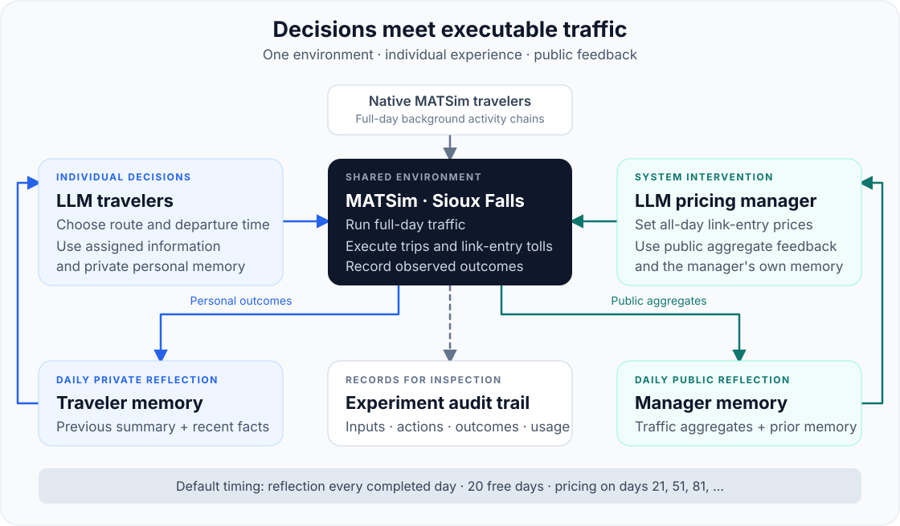

<div align="center">

# AgenticMobility

**An open research platform for LLM-driven mobility systems.**

A mobility research project within the Agentic City.

[Quickstart](#quickstart) ·
[Research Questions](#research-questions) ·
[Documentation](#documentation) ·
[Community](#community)

[English](docs/usage-guide.md) ·
[中文](docs/usage-guide.zh.md)

</div>

## Overview

AgenticMobility connects LLM travelers and managers
through a shared transportation environment to study travel
decisions, memory, policy responses, and collective outcomes.

The current v1 version supports joint route and departure-time
choice, daily reflection, and periodic congestion pricing in 
enriched Sioux Falls MATSim simulation.

AgenticMobility is the mobility component of the Agentic City
, which aims to study interacting agents across interconnected
urban systems.

## How it works



Travelers choose actions using personal information, recent
experience, private memory, and policy information available
to their assigned group. The manager uses public traffic
aggregates, policy history, and its own memory.

MATSim scenario executes the decisions and produces personal outcomes
and public observations, which inform subsequent decisions.

| Stage | What happens |
| --- | --- |
| Prepare | Fix the population, target cohort, information groups, and candidate actions. |
| Decide | LLM Travelers select routes and departure times; the manager updates pricing on scheduled days. |
| Execute | Scenario runs full-day traffic and records trips and actual toll payments. |
| Reflect | Travelers and the manager update their separate memories using the feedback available to them. |

Both roles reflect after completed simulation days. By default,
the manager has an initial 20-day toll-free period and 
opportunities on days 21, 51, 81, and so on.

LLM control applies to selected target trips. Other trips retain
native behavior. Adaptation occurs through decisions and memory
updates; model weights remain unchanged.

## Research questions

| Research question | Available experiment |
| --- | --- |
| How do LLM travelers choose and adapt? | LLM-controlled target trips within native background traffic |
| How does information access affect decisions? | Informed and uninformed traveler groups |
| How does adaptive pricing affect traffic? | Native travelers with an LLM pricing manager |
| How do travelers and managers respond to each other? | Joint traveler-and-manager experiments |
| How do adaptive policies compare with fixed interventions? | Native baseline, fixed tolls, and manager experiments |

The platform records decisions, execution, memories, and effective
policies to support inspection and controlled comparisons.

See the [experiment guide](docs/usage-guide.md#experiments)
for configurations and commands.

## Quickstart

### Install

Requires **JDK 25**, including `javac`, and Git.
The Maven Wrapper downloads Maven and dependencies on first use.

```bash
git clone https://github.com/Jiaheng-Xiao/AgenticMobility.git
cd AgenticMobility
sh ./mvnw -B clean package
```

On Windows PowerShell, build with:

```powershell
.\mvnw.cmd -B clean package
```

### Run a native baseline

Start with a two-day diagnostic simulation with 100 people
and no model calls:

```bash
java -Xmx4g -cp matsim-example-project-0.0.1-SNAPSHOT.jar org.matsim.agentic.MorningExperiment \
  --config scenarios/SiouxFalls-public/config.xml \
  --mode hybrid --policy mnl --llm-agents 0 \
  --demand 100 --sample-persons 100 --days 2 --seed 4711 \
  --output output/quickstart
```

Inspect `morning/status.json` within the run's output directory.
A completed example should report `complete=true` and
`daysCompleted=2`.

This diagnostic subsample does not scale road capacity.
Use the documented population-sampling configuration for
research experiments.

### Run with LLM agents

LLM experiments require a reachable Chat Completions service.
The operating guide provides instructions for:

- [LLM travelers](docs/usage-guide.md#llm-travelers)
- [Native travelers with a manager](docs/usage-guide.md#native-travelers--manager)
- [LLM travelers with a manager](docs/usage-guide.md#llm-travelers--manager)
- [Sampling and reproducibility](docs/usage-guide.md#sampling-and-reproducibility)

## Experiment status

The project is under active research development.
Experimental evaluation focuses on day-to-day behavior,
traffic outcomes, convergence, and sensitivity to random seeds.

| Area | Current status |
| --- | --- |
| Implementation | Traveler decisions, private memory, manager policies, and execution records are implemented. |
| Evaluation | Exploratory runs are under analysis; multi-seed comparisons are being prepared. |
| Manuscript | In preparation. |

Verified experimental configurations and results will be added
with their code versions, model settings, seeds, evaluation
procedures, and limitations.

The Sioux Falls inputs form a synthetic research scenario.
Behavioral realism and policy benefits require experimental
evidence beyond successful execution.

## Documentation

| Guide | Contents |
| --- | --- |
| [Operating guide](docs/usage-guide.md) | Setup, experiment commands, deployment, budgets, and troubleshooting |
| [中文操作指南](docs/usage-guide.zh.md) | Detailed instructions in Chinese |
| [Traveler](docs/traveler-v9.md) | Private memory, recent facts, and output validation |
| [Traveler and manager protocol](scripts/manager_basic_joint.md) | Actions, information boundaries, and pricing |
| [Daily manager memory](scripts/manager_daily_memory.md) | Reflection, policy timing, and failure handling |
| [Public scenario](scenarios/SiouxFalls-public/README.md) | Inputs, sampling, candidate actions, and evaluation scope |
| [Outputs and evaluation](docs/usage-guide.md#outputs-and-evaluation) | Records, metrics, completion, and interpretation |
| [Data provenance](THIRD_PARTY.md) | Sources, modifications, attribution, and hashes |

## Community

We welcome researchers and developers interested in language-model
agents, transportation, simulation, and policy evaluation.

You can participate by:

- Reporting reproducibility issues or improving documentation.
- Comparing decision, memory, or information-access settings.
- Sharing a documented experiment or baseline.
- Developing analysis tools and visualizations.
- Proposing scenario extensions and future research directions.

For experimental contributions, please include:

- The research question and comparison conditions.
- The code version and configuration.
- Model settings, seeds, and repetitions.
- Results, analysis procedures, and limitations.

[Open an issue](https://github.com/Jiaheng-Xiao/AgenticMobility/issues)
to report a problem or propose a contribution.

Development instructions are in the
[operating guide](docs/usage-guide.md#development-and-troubleshooting).

## Citation

When using AgenticMobility in research, reference this repository
and identify the exact commit used, together with the scenario,
model, and experimental settings.

Repository:
https://github.com/Jiaheng-Xiao/AgenticMobility

Please also cite the underlying software and scenario sources
where applicable. See [THIRD_PARTY.md](THIRD_PARTY.md).

## License and acknowledgments

Code is licensed under [GPL-2.0](LICENSE).
Third-party code and scenario data retain their documented terms
in [THIRD_PARTY.md](THIRD_PARTY.md).

Built on MATSim and its example-project lineage.
