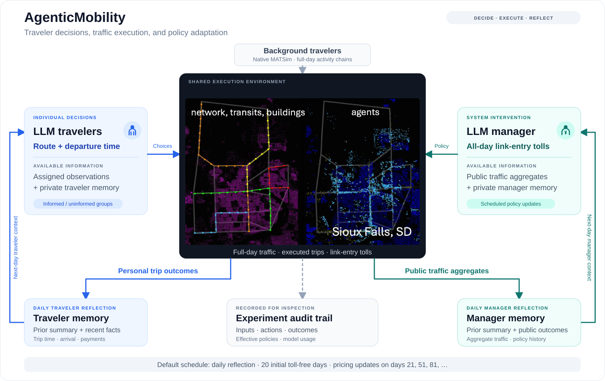
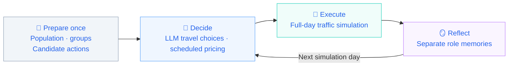

<div align="center">

<h1>Agentic Mobility</h1>

<p><strong>Research platform for LLM-agent-driven mobility systems.</strong></p>


English | [中文](README.zh.md)

<div align="left">
    
Agentic Mobility is the mobility research project within the 
[AgenticCity](https://github.com/Agentic-City-Research), which
aims to build an open research community around interacting 
agents and interconnected urban systems, starting with transportation.

</div>

🚀[Quickstart](#quickstart) | 📣[Research questions](#research-questions) | 🗺️[Documentation](#documentation) | 💬[Community](#community)

</div>

## 🧩Overview



AgenticMobility connects LLM travelers and traffic managers 
through a shared transportation environment to study decisions,
memory, policy responses, and collective outcomes. 

The current v1 implementation supports joint route and departure-time
choice, daily reflection, and periodic congestion pricing in a full-day
**enriched Sioux Falls MATSim simulation**, alongside native traffic.


## 🔄How it works

Travelers choose actions using personal information, recent
experience, private memory, and policy information available
to their assigned group. The manager uses public traffic
aggregates, policy history, and its own memory.



LLM control applies to selected target trips. Other trips retain native behavior. Adaptation uses model inference and memory updates; model weights remain unchanged.

## 🎯Research questions

| Research focus | Experiment setup |
| :--- | :--- |
| 📊 **Traveler adaptation** | LLM travelers + native travelers |
| 🔎 **Information access** | Informed vs. uninformed travelers |
| 🚦 **Adaptive pricing** | Native travelers + LLM manager |
| 🔄 **Traveler–manager interaction & Policy comparison** | LLM travelers + LLM manager |

[Fixed tolls](scenarios/SiouxFalls-public/fixed-tolls.md) and replay of saved traveler contexts provide additional comparisons. See the [experiment guide](docs/usage-guide.md#experiments) for commands and settings.

## 📦Quickstart

Requires **JDK 25** (including `javac`) and Git. The Maven Wrapper downloads Maven and dependencies on first use.

```bash
git clone https://github.com/Agentic-City-Research/Agentic-Mobility.git
cd Agentic-Mobility
sh ./mvnw -B clean package
```

On Windows PowerShell, build with `.\mvnw.cmd -B clean package`.

Run a two-day, 100-person diagnostic baseline with **no model calls**:

```bash
java -Xmx4g -cp matsim-example-project-0.0.1-SNAPSHOT.jar org.matsim.agentic.MorningExperiment \
  --config scenarios/SiouxFalls-public/config.xml \
  --mode hybrid --policy mnl --llm-agents 0 \
  --demand 100 --sample-persons 100 --days 2 --seed 4711 \
  --output output/quickstart
```

In the output directory reported by the run, inspect `morning/status.json` for `complete=true` and `daysCompleted=2`. Diagnostic sampling does not scale road capacity; use the documented sampling configuration for research experiments.

For [LLM travelers](docs/usage-guide.md#llm-travelers), [manager experiments](docs/usage-guide.md#native-travelers--manager), and [joint experiments](docs/usage-guide.md#llm-travelers--manager), configure a reachable Chat Completions service and follow the operating guide. MATSim runs on CPU; the repository calls an existing model service.

## 🧪Experiment status

| Area | Current status |
| --- | --- |
| Implementation | Traveler decisions, private memory, manager policies, and execution records are implemented. |
| Evaluation | Exploratory runs are under analysis; multi-seed comparisons are being prepared. |
| Manuscript | In preparation. |

Verified configurations and results will be published with their code versions, model settings, seeds, and evaluation procedures.

Each run records its manifest, completion status, decisions, trips, policies, memories, and API usage. See [outputs and evaluation](docs/usage-guide.md#outputs-and-evaluation) for record definitions and metric scopes.

Sioux Falls is a synthetic research scenario. Behavioral realism, convergence, and policy benefits require experimental evidence beyond successful execution.

## 📖Documentation

| Guide | Contents |
| --- | --- |
| [Operating guide](docs/usage-guide.md) | Setup, experiment commands, sampling, budgets, outputs, and troubleshooting |
| [Chinese operating guide](docs/usage-guide.zh.md) | Detailed instructions in Chinese |
| [Traveler v9](docs/traveler-v9.md) | Private memory, recent facts, and output validation |
| [Traveler and manager protocol](scripts/manager_basic_joint.md) | Actions, information boundaries, and pricing |
| [Daily manager memory](scripts/manager_daily_memory.md) | Daily reflection, policy timing, and failure handling |
| [Public scenario](scenarios/SiouxFalls-public/README.md) | Inputs, candidate actions, and evaluation protocol |
| [Outputs and evaluation](docs/usage-guide.md#outputs-and-evaluation) | Records, metric scopes, and completion checks |
| [Data provenance](THIRD_PARTY.md) | Sources, attribution, modifications, and input hashes |

## 🤝Community & Contributing

We welcome contributions from researchers and developers working on agents, transportation, simulation, and policy evaluation:

- Report reproducibility issues or improve the documentation.
- Share a documented experiment, baseline, or method comparison.
- Develop analysis tools, visualizations, or scenario extensions.

[Open an issue](https://github.com/Agentic-City-Research/Agentic-Mobility/issues) to discuss a contribution. The [contribution guide](CONTRIBUTING.md) describes the current entry points, development checks, and experiment-report requirements.

## 📚Citation and license

For research use, reference [Agentic-City-Research/Agentic-Mobility](https://github.com/Agentic-City-Research/Agentic-Mobility) and report the exact commit, scenario, model, and experimental settings. Manuscript information will be added when publicly available.

Code is licensed under [GPL-2.0](LICENSE). Third-party code and data retain their documented terms in [THIRD_PARTY.md](THIRD_PARTY.md). Built on MATSim and its example-project lineage.
