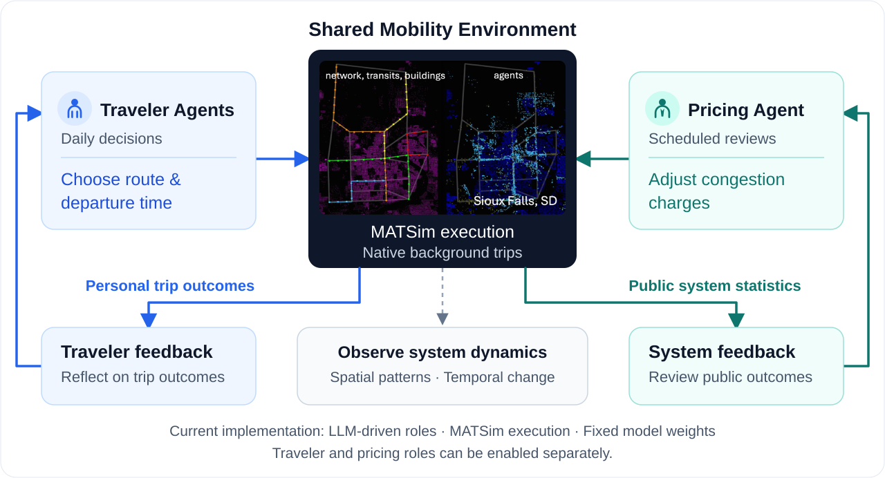
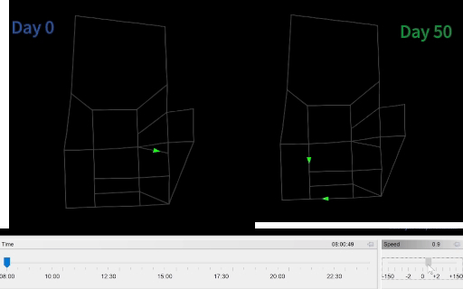
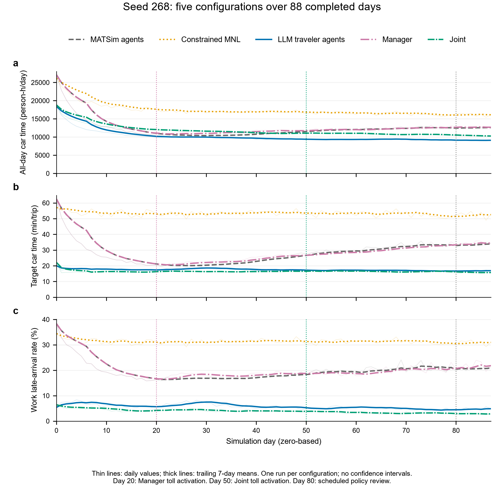
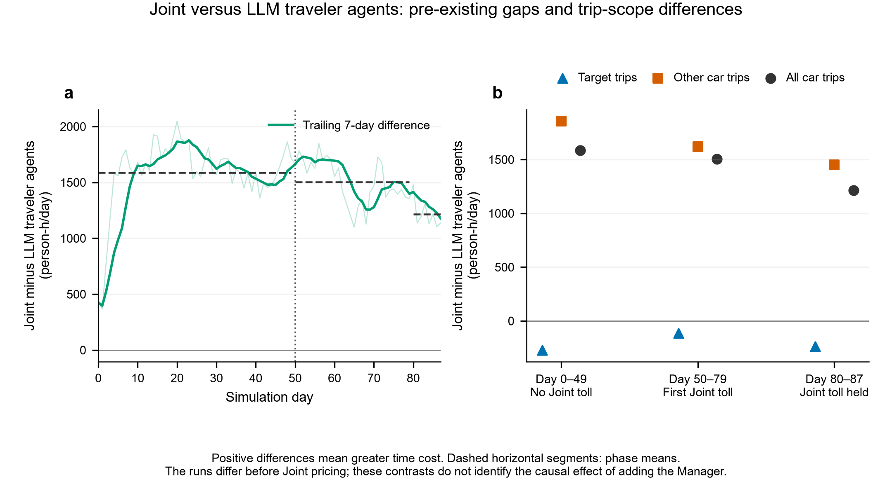

<div align="center">

<h1>Agentic Mobility</h1>

<p><strong>Exploring AI Agents and Emergent Dynamics in Mobility Systems</strong></p>
<p align="center">
  <a href="#quickstart">
    
  </a>
  <a href="LICENSE">
    
  </a>
</p>


    
Part of [AgenticCity](https://github.com/Agentic-City-Research),
exploring AI agents and interconnected urban systems.


    
[RESEARCH QUESTIONS 🎯](#research-questions) · [EXPERIMENT 01 🧪](#experiments) · [QUICKSTART 🚀](#quickstart) · [DOCUMENTATION 📖](#documentation) · [COMMUNITY 🤝](#community--contributing)

</div>

<br>

<a id="overview"></a>

## OVERVIEW 🧩

Agentic Mobility is a research platform for studying AI agents and collective dynamics in mobility systems. Agents interact through shared network conditions: their decisions affect the environment experienced by other agents.

The current implementation uses MATSim to execute mobility decisions and generate feedback. It supports LLM-controlled travelers and an LLM pricing agent, with the experiments below evaluating these roles separately.




### Daily simulation cycle

Each day follows a decide–execute–reflect cycle: traveler agents select routes and departure times, enabled pricing policies are applied, and MATSim executes the full-day traffic simulation. Each role then receives its permitted feedback and updates its own experience record. Pricing updates occur on scheduled review days.

LLMs control selected target trips; other trips follow native simulation behavior. Model weights remain fixed during the simulation. See [Methods & protocols](docs/methods-and-protocols.md) for information access, reflection, and policy execution.

<br>

<a id="research-questions"></a>

## RESEARCH QUESTIONS 🎯

The experiments below examine traveler decisions and pricing interventions separately. 
Information-access effects and joint traveler–pricing-agent configurations remain further research directions.

| Research focus | Research question |
| :--- | :--- |
| 📊 **Agent behavior** | How do AI agents make mobility decisions under different information and constraints? |
| 🚦 **System dynamics** | How do individual decisions and shared conditions shape one another over time? |
| 🔄 **Collective patterns** | What spatial and temporal patterns arise from repeated decisions and interventions? |


Configuration templates are provided in the [experiment guide](docs/experiments-and-evaluation.md). Each comparison requires its own documented population, action constraints, background traffic, and evaluation protocol.

<br>

<a id="experiments"></a>

## EXPERIMENT 01 🧪

The traveler case traces available information, selected actions, and realized outcomes. 
The time series and corridor comparisons show how aggregate outcomes vary over time and across the network.

### Five configurations in a shared mobility system

We compare individual decisions and system outcomes across five configurations of an enriched Sioux Falls scenario, using **simulation seed 268**. All configurations share the same network, population and facilities inputs, sampled population, target trips, candidate routes, and departure-time options. LLM traveler agents use `qwen3.5-9b`; the pricing agent uses `deepseek-flash`.


| Configuration       | Target-trip decisions                                                | Pricing                                          |
| :------------------ | :------------------------------------------------------------------- | :----------------------------------------------- |
| MATSim agents       | MATSim plan selection, rerouting, and time adjustment                | None                                             |
| Constrained MNL     | Joint route and departure-time MNL choices from the fixed action set | None                                             |
| LLM traveler agents | LLM-controlled route and departure-time choices                      | None                                             |
| Manager             | MATSim decisions                                                     | LLM pricing agent; tolls first applied on Day 20 |
| Joint               | LLM-controlled route and departure-time choices                      | LLM pricing agent; tolls first applied on Day 50 |


>
> <details>
> <summary>Traffic replay: Day 0 vs. Day 50</summary>
>
> This replay compares two days within the LLM run. It illustrates how traffic patterns change during that run; it is not a comparison against the native baseline.
>
> 
>
> </details>

**Zoom in on individual decisions.** The recorded traces show a route switch at an unchanged departure time and a return to the earliest allowed departure after a late arrival.

<details>
<summary>LLM traveler agent: switching routes after a late arrival</summary>

Simulated traveler `1005_1`, Day 65, seed 268; no pricing agent.

| Stage | Recorded example |
| :--- | :--- |
| Available information | Four routes, nine departure times, a 09:00 arrival target, and personal trips from Days 62–64; no network traffic information. |
| Selected action | `c1` at **08:12:47**, the same departure time as the previous day. |
| Recorded rationale | “I chose route c1 to avoid the inconsistency of c0 while ensuring I meet the 09:00 deadline on time.” |
| Realized outcome | **7.85 min** car time; destination arrival **08:41:33**. The previous day's `c0` trip took **31.28 min**, arriving **4 min 59 s late**. |

Both choices were executed as recorded. Shared conditions also varied between days.

</details>

<details>
<summary>Joint: punctuality with a much earlier departure</summary>

Simulated traveler `10010_2`, Day 60, seed 268; Joint configuration.

| Stage | Recorded example |
| :--- | :--- |
| Available information | Four routes, nine departure times, a 09:00 arrival target, personal trips from Days 57–59, and current pricing announcements; no network traffic information. |
| Selected action | `c1` at **05:56:43**, the earliest option and **90 minutes before** the original departure. |
| Recorded rationale | “Aggressive decision to diversify from unreliable c0 and avoid lateness.” |
| Realized outcome | **21.97 min** car time; destination arrival **06:33:36**. The previous day's later `c0` trip arrived **10 min 48 s late**. |

Route and departure time both changed. This trip paid zero tolls; the trace does not isolate a pricing effect.

</details>

[Case records and execution checks →](docs/seed268-individual-cases.md)

### Individual and aggregate mobility outcomes

**LLM traveler agents record the lowest all-day car travel time, 18.49% below MATSim agents. Joint records the lowest target-trip car time and work late-arrival rate.** The ordering therefore depends on the level and metric being evaluated.

| Configuration | All-day car time (person-hours/day) | Change vs. MATSim agents | Target-trip car time (min) | Work late-arrival rate |
| :--- | ---: | ---: | ---: | ---: |
| MATSim agents | 12,322.75 | — | 28.31 | 19.71% |
| Constrained MNL | 17,307.06 | +40.45% | 53.23 | 31.28% |
| LLM traveler agents | **10,044.57** | −18.49% | 17.43 | 5.67% |
| Manager | 12,530.01 | +1.68% | 28.48 | 19.91% |
| Joint | 11,568.74 | −6.12% | **16.33** | **3.82%** |

Values are daily means over Days 0–87. Relative changes use unrounded window means; negative time changes indicate lower travel time. Target-trip metrics cover **11,793 trips/day**, work lateness covers **11,332 work trips/day**, and all-day car time covers **33,644 car legs/day** across **16,822 simulated people**. All car legs completed on the included days, with no stuck vehicles. Car time includes pre-traffic waiting; the target trips include multiple activity purposes.

[](docs/assets/five_condition_trajectories.svg)

Thin lines show daily values; thick lines show trailing seven-day means, without confidence intervals. Actual toll activation differs between Manager (Day 20) and Joint (Day 50). Day 80 is a scheduled policy review: Manager adjusts its policy, while Joint holds its existing charges.

### Target-trip gains and system-level trade-offs

Compared with LLM traveler agents, Joint records **1.09 minutes lower target-trip car time (6.28%)** and a **1.85-percentage-point lower work late-arrival rate**, alongside **15.17% higher all-day car travel time**. Target trips account for a reduction of **215.01 person-hours/day**, while other car trips account for an increase of **1,739.18 person-hours/day**. Other car trips include non-target journeys made by the controlled travelers themselves.

These differences are already present before Joint tolling: over Days 0–49, Joint's all-day car time is **14.90% higher** than in the LLM traveler agent configuration. The comparison describes a trade-off between target-trip outcomes and the all-day system measure; it does not isolate the causal effect of adding a pricing agent.

<details>
<summary>Joint versus LLM traveler agents: trajectories and trip-scope decomposition</summary>

[](docs/assets/joint_vs_traveler_decomposition.svg)

Positive differences indicate greater travel time in Joint. Dashed horizontal segments show phase means. The decomposition sums to an additional **1,524.17 person-hours/day** over the common window; it does not identify which mechanism caused the difference.

</details>

LLM traveler agents and Joint select departures an average of **34.93** and **39.55 minutes earlier** than the original plans. These schedule changes accompany the punctuality results.

**Interpretation.** This is one run per configuration at a shared simulation seed. The results describe the observed configurations and do not establish cross-seed robustness or causal synergy between the two agent roles.

**[Seed 268 experiment settings, data, and validation →](docs/seed268-experiments.md)**

The records include the separate 100-day results for the four completed runs, metric definitions, policy history, aggregate CSVs, and execution-audit summaries.


> All planned car trips complete in both scenarios throughout the selected period. These are descriptive results from one paired seed and different code builds; they do not establish an isolated causal effect of LLM pricing.

**[Experiment settings, data, and reproduction →](docs/reported-experiments.md)**

See the experiment records for configurations, metric definitions, aggregate data, and available reproduction instructions.

<br>

<a id="quickstart"></a>


## QUICKSTART 🚀

Build the project, run a small native baseline, and check that it completes. Then, optionally connect a model service to run LLM-controlled travelers.

**Prerequisites:** JDK 25 (including `javac`), Git, and network access for the first build. The bundled Maven Wrapper downloads Maven and dependencies. The native baseline requires no model API.

### 1. Get the source and build

```bash
git clone https://github.com/Agentic-City-Research/Agentic-Mobility.git
cd Agentic-Mobility
sh ./mvnw -B clean package
```

On Windows PowerShell, build with `.\mvnw.cmd -B clean package`.

The build creates `matsim-example-project-0.0.1-SNAPSHOT.jar` in the repository root. Run the following commands from that directory.

### 2. Run a native baseline

Run a two-day diagnostic simulation with 100 native travelers and no model API calls.

**Bash (Linux/macOS)**

```bash
java -Xmx4g -cp matsim-example-project-0.0.1-SNAPSHOT.jar org.matsim.agentic.MorningExperiment \
  --config scenarios/SiouxFalls-public/config.xml \
  --mode hybrid --policy mnl --llm-agents 0 \
  --demand 100 --sample-persons 100 --days 2 \
  --population-seed 4711 --seed 4711 \
  --output output/quickstart
```

<details>
<summary>Windows PowerShell command</summary>

```powershell
java -Xmx4g -cp matsim-example-project-0.0.1-SNAPSHOT.jar org.matsim.agentic.MorningExperiment `
  --config scenarios/SiouxFalls-public/config.xml `
  --mode hybrid --policy mnl --llm-agents 0 `
  --demand 100 --sample-persons 100 --days 2 `
  --population-seed 4711 --seed 4711 `
  --output output/quickstart
```

</details>

### 3. Confirm the run completed

Use the output directory reported in the console (normally `output/quickstart`). If that directory already exists, the application creates a numbered alternative.

Open `<output-directory>/morning/status.json` and check that it contains:

```json
{
  "complete": true,
  "daysCompleted": 2
}
```

These are the completion fields to check; the file contains additional run information.

This 100-person example checks installation and execution. The `--sample-persons` option reduces the population without scaling road capacity. For research experiments, follow the [sampling and capacity guidance](docs/scenarios-and-data.md#sampling-and-capacity).

### 4. Optional: run an LLM traveler experiment

1. Follow the [API connection guide](docs/getting-started.md#5-connect-an-existing-model-service) to set `AGENTIC_BASE_URL`, `AGENTIC_MODEL`, and `AGENTIC_API_KEY` for a Chat Completions-compatible service.
2. Follow the [first LLM traveler experiment](docs/getting-started.md#start-with-a-small-traveler-run) to run seven simulation days with three LLM-controlled travelers in a 10% population sample. Bash and Windows PowerShell examples are provided.

MATSim runs on CPU; the model service can be hosted on another machine. Once configured, the platform calls the service automatically during enabled LLM stages. The same API setup is required for an LLM pricing agent.

For installation, troubleshooting, and additional instructions, see the [operating guide](docs/usage-guide.md) or its [Chinese version](docs/usage-guide.zh.md).

<br>

<a id="documentation"></a>

## DOCUMENTATION 📖

New to the project? Start with [Getting started](docs/getting-started.md). For research experiments, check the scenario and sampling settings, review the methods, then use the experiment guide to configure and record your runs.

| I want to… | Read | What it covers |
| :--- | :--- | :--- |
| Install and run my first simulation | [Getting started](docs/getting-started.md) | Requirements, diagnostic baseline, model API setup, and troubleshooting |
| Choose data and set the simulation scale | [Scenarios & data](docs/scenarios-and-data.md) | Scenario inputs, data provenance, population sampling, and road capacity |
| Understand how the agents work | [Methods & protocols](docs/methods-and-protocols.md) | Agent roles, information access, decisions, memory, and pricing |
| Design and evaluate an experiment | [Experiments & evaluation](docs/experiments-and-evaluation.md) | Configuration templates, baselines, request budgets, and run records |
| Inspect the reported results | [Reported experiments](docs/reported-experiments.md) | Completed comparisons, model settings, build identifiers, metrics, and aggregate data |
| Find detailed operating instructions | [Operating guide](docs/usage-guide.md) | Execution options, deployment, outputs, and troubleshooting |
| Read operating instructions in Chinese | [中文操作指南](docs/usage-guide.zh.md) | 安装、实验运行、部署、输出与故障排查 |

Browse the [documentation index](docs/README.md) for all guides.

<br>

<a id="community--contributing"></a>

## COMMUNITY & CONTRIBUTING 🤝

Contributions are welcome, including documentation, reproducible examples, analysis tools, and simulation scenarios.

[Report an issue](https://github.com/Agentic-City-Research/Agentic-Mobility/issues) · [Contribution guide](CONTRIBUTING.md) · [Contributors](https://github.com/Agentic-City-Research/Agentic-Mobility/graphs/contributors)

⭐ If you find Agentic Mobility useful, consider starring the repository.

<br>

For research use, reference [Agentic-City-Research/Agentic-Mobility](https://github.com/Agentic-City-Research/Agentic-Mobility) and report the exact commit, scenario, model, and experimental settings. Manuscript information will be added when publicly available.

Code is licensed under [GPL-2.0](LICENSE). Third-party code and data retain their documented terms in [THIRD_PARTY.md](THIRD_PARTY.md). Built on MATSim and its example-project lineage.
