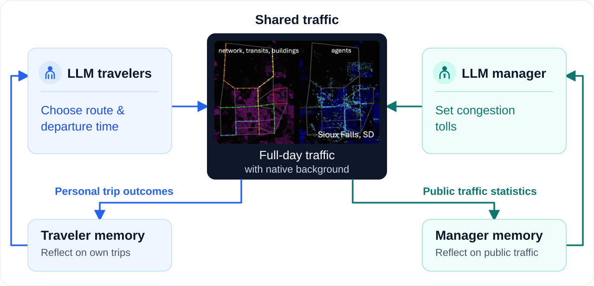
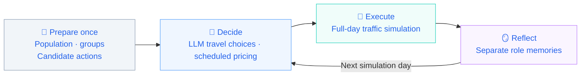

<div align="center">

<h1>Agentic Mobility</h1>

<p><strong>An open research platform for interactions between LLM travelers and traffic managers.</strong></p>
<p align="center">
  <a href="#quickstart">
    
  </a>
  <a href="LICENSE">
    
  </a>
</p>

English | [中文](README.zh.md)
</div>

<div align="left">
    
Agentic Mobility is the mobility research project within the 
[AgenticCity](https://github.com/Agentic-City-Research), which
aims to build an open research community around interacting 
agents and interconnected urban systems, starting with transportation.

</div>


<div align="center">
    
🚀[Quickstart](#quickstart) | 🗺️[Documentation](#documentation) |📣[Research questions](#research-questions) |  💬[Community](docs/wechat.md)

</div>

## 🧩Overview



Agentic Mobility connects LLM travelers and traffic managers in a
shared MATSim environment to study travel choices, memory, and policy
responses. The current implementation supports joint route and 
departure-time choice, daily reflection, and periodic congestion 
pricing in an **enriched Sioux Falls scenario**.


## 🔄How it works




Each simulation day follows a decide–execute–reflect cycle, 
with pricing updates on scheduled days.

LLMs control selected target trips; other trips follow native
simulation behavior. Agents adapt through memory updates 
while model weights remain fixed.

## 🎯Research questions

| Research focus | Experiment setup |
| :--- | :--- |
| 📊 **Traveler adaptation** | Native baseline vs. LLM-controlled target trips |
| 🔎 **Information access** | Informed vs. uninformed controlled travelers |
| 🚦 **Policy comparison** | Native baseline vs. fixed tolls vs. LLM pricing |
| 🔄 **Traveler–manager interaction** | LLM travelers with vs. without an LLM manager |

Comparisons require matched population, scenario, and background-traffic settings; detailed configurations are documented separately.

See the experiment guide for configurations and comparison settings.

## 📦Quickstart

Requires **JDK 25** (including `javac`) and Git. The Maven Wrapper downloads Maven and dependencies on first use.

```bash
git clone https://github.com/Agentic-City-Research/Agentic-Mobility.git
cd Agentic-Mobility
sh ./mvnw -B clean package
```

On Windows PowerShell, build with `.\mvnw.cmd -B clean package`.

**Run a diagnostic baseline without model API calls**

The following command runs a two-day diagnostic baseline with 100 native travelers.

```bash
java -Xmx4g -cp matsim-example-project-0.0.1-SNAPSHOT.jar org.matsim.agentic.MorningExperiment \
  --config scenarios/SiouxFalls-public/config.xml \
  --mode hybrid --policy mnl --llm-agents 0 \
  --demand 100 --sample-persons 100 --days 2 \
  --population-seed 4711 --seed 4711 \
  --output output/quickstart
```

<details>
<summary>Windows PowerShell command</summary>

```powershell
java -Xmx4g -cp matsim-example-project-0.0.1-SNAPSHOT.jar org.matsim.agentic.MorningExperiment `
  --config scenarios/SiouxFalls-public/config.xml `
  --mode hybrid --policy mnl --llm-agents 0 `
  --demand 100 --sample-persons 100 --days 2 `
  --population-seed 4711 --seed 4711 `
  --output output/quickstart
```

</details>

After a successful run, `morning/status.json` in the actual output directory should contain `complete=true` and `daysCompleted=2`. If the requested directory already exists, the application creates a numbered alternative. Use the output path reported in the console.

This 100-person example checks installation and execution. The `--sample-persons` option reduces the population without scaling road capacity. For research experiments, follow the [sampling and capacity guidance](docs/scenarios-and-data.md#sampling-and-capacity).

**Connect a model API**

Before running LLM travelers, an LLM manager, or joint experiments, follow the [API connection guide](docs/getting-started.md#5-connect-an-existing-model-service) to configure `AGENTIC_BASE_URL`, `AGENTIC_MODEL`, and `AGENTIC_API_KEY`. The platform then calls the configured service automatically during decisions, reflection, and other enabled stages. The service must support the Chat Completions API. MATSim runs on CPU, and the model service can be hosted on another machine.

For installation, troubleshooting, and additional instructions, see the [operating guide](docs/usage-guide.md) or its [Chinese version](docs/usage-guide.zh.md).

<a id="documentation"></a>


## 📖Documentation

| Guide | What you will find |
| :--- | :--- |
| [Getting started](docs/getting-started.md) | Installation, first run, and troubleshooting |
| [Methods & protocols](docs/methods--protocols.md) | Agent roles, information access, memory, and pricing |
| [Experiments & evaluation](docs/experiments--evaluation.md) | Experiment settings, baselines, outputs, and metrics |
| [Scenarios & data](docs/scenarios--data.md) | Scenario inputs, data provenance, and extensions |


## 🧪Project status

| Area | Current status |
| --- | --- |
| Implementation | Traveler decisions, private memory, manager policies, and execution records are implemented. |
| Evaluation | Exploratory runs are under analysis; multi-seed comparisons are being prepared. |
| Manuscript | In preparation. |

Verified configurations and results will be published with their code versions, model settings, seeds, and evaluation procedures.


## 🤝Community & Contributing

We welcome contributions to documentation, reproducible examples, analysis tools, and scenario extensions on agents, transportation, simulation, and policy evaluation.

Report an issue · Read the contribution guide · [Join the WeChat group](docs/wechat.md)

If Agentic Mobility looks useful to you, please give it a ⭐ — it helps the community to discover and contribute to the project.

## 📚Citation and license

For research use, reference [Agentic-City-Research/Agentic-Mobility](https://github.com/Agentic-City-Research/Agentic-Mobility) and report the exact commit, scenario, model, and experimental settings. Manuscript information will be added when publicly available.

Code is licensed under [GPL-2.0](LICENSE). Third-party code and data retain their documented terms in [THIRD_PARTY.md](THIRD_PARTY.md). Built on MATSim and its example-project lineage.
