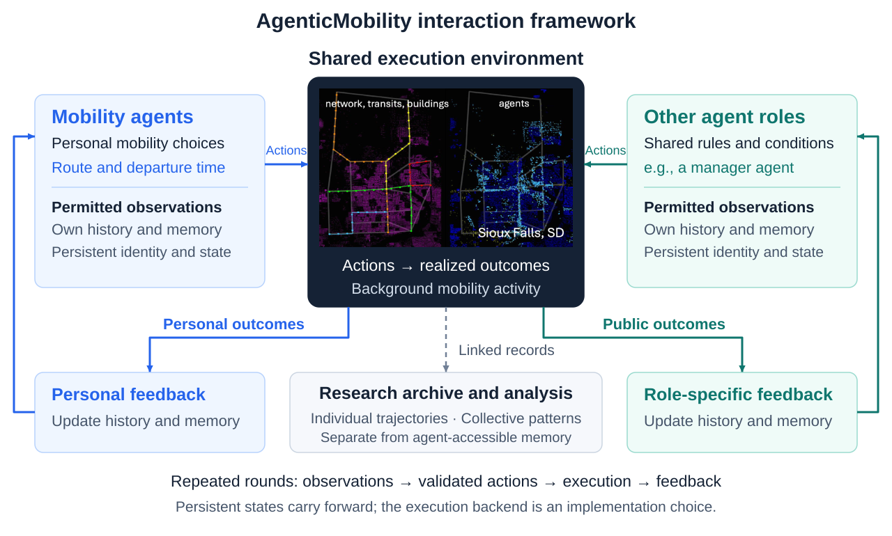
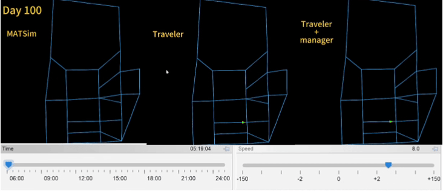
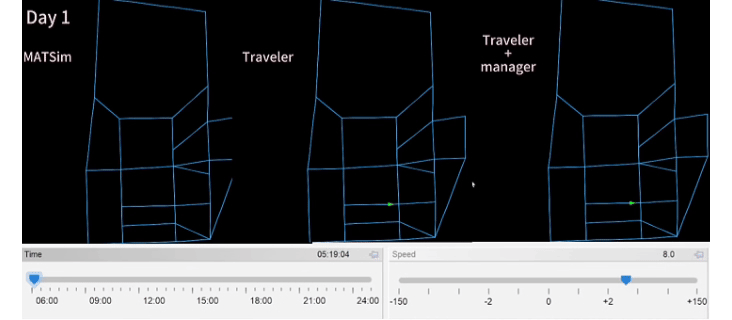
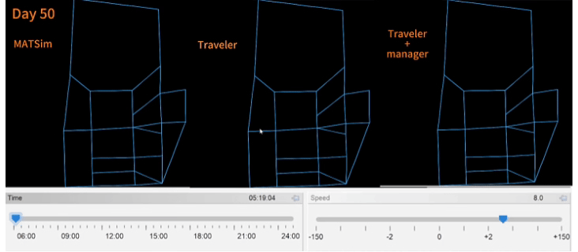
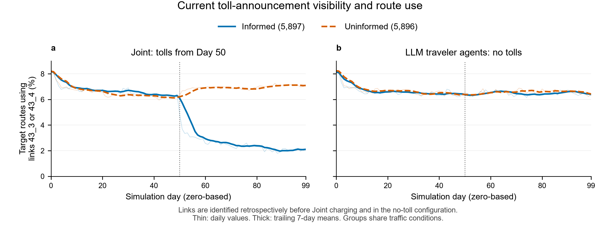

<div align="center">

<h1>Agentic Mobility</h1>

<p><strong>Exploring AI Agents and Emergent Dynamics in Mobility Systems</strong></p>
<p align="center">
  <a href="#quickstart">
    
  </a>
  <a href="LICENSE">
    
  </a>
</p>


    
Part of [AgenticCity](https://github.com/Agentic-City-Research),
exploring AI agents and interconnected urban systems.


    
[RESEARCH QUESTIONS 🎯](#research-questions) · [EXPERIMENT 🧪](#experiments) · [QUICKSTART 🚀](#quickstart) · [DOCUMENTATION 📖](#documentation) · [COMMUNITY 🤝](#community--contributing)

</div>

<br>

<a id="overview"></a>

## OVERVIEW 🧩

Agentic Mobility is a research platform for studying AI agents and collective dynamics in mobility systems. Agents interact through shared network conditions: their decisions affect the environment experienced by other agents.

The current implementation uses MATSim to execute mobility decisions and generate feedback. It supports LLM-controlled travelers and an LLM pricing agent, with the experiments below evaluating these roles separately.




### Daily simulation cycle

Each day follows a decide–execute–reflect cycle: traveler agents select routes and departure times, enabled pricing policies are applied, and MATSim executes the full-day traffic simulation. Each role then receives its permitted feedback and updates its own experience record. Pricing updates occur on scheduled review days.

LLMs control selected target trips; other trips follow native simulation behavior. Model weights remain fixed during the simulation. See [Methods & protocols](docs/methods-and-protocols.md) for information access, reflection, and policy execution.

<br>

<a id="research-questions"></a>

## RESEARCH QUESTIONS 🎯

The experiments below examine individual decisions and aggregate outcomes across five configurations. 
Information-access effects and causal interactions between traveler and pricing agents remain open research questions.

| Research focus | Research question |
| :--- | :--- |
| 📊 **Agent behavior** | How do AI agents make mobility decisions under different information and constraints? |
| 🚦 **System dynamics** | How do individual decisions and shared conditions shape one another over time? |
| 🔄 **Collective patterns** | What spatial and temporal patterns arise from repeated decisions and interventions? |


Configuration templates are provided in the [experiment guide](docs/experiments-and-evaluation.md). Each comparison requires its own documented population, action constraints, background traffic, and evaluation protocol.

<br>

<a id="experiments"></a>

## EXPERIMENT 🧪

The traveler case traces available information, selected actions, and realized outcomes. 
The time series and corridor comparisons show how aggregate outcomes vary over time and across the network.

### Five configurations, 100 completed days

We compare five configurations of the enriched Sioux Falls scenario over **Days 1–100**, using **simulation seed 268**. All share the same scenario inputs, sampled population and target-trip cohort. Constrained MNL and both LLM traveler configurations share fixed route and departure-time options. Traveler agents use `qwen3.5-9b`; pricing agents use `deepseek-flash`. 

| Configuration | Traveler decisions | Pricing agent |
| :--- | :--- | :--- |
| MATSim agents | MATSim replanning | None |
| Constrained MNL | MNL over fixed route–departure options | None |
| LLM traveler agents | LLM route–departure choices | None |
| Manager | MATSim replanning | Enabled; tolls from Day 20 |
| Joint | LLM route–departure choices | Enabled; tolls from Day 50 |

### Simulation Videos

Compare **MATSim**, **LLM Traveler**, and **LLM Traveler + Manager** at three simulation days. Each animation follows the same **500** sampled travelers from the full population of 16,822.

**Final Day — Simulation Day 100**

<p align="center">
  
</p>

Visualization: 500 sampled travelers. Quantitative results: the complete population relevant to each metric.

<details>
<summary>View the initial and intermediate snapshots</summary>

#### Initial Snapshot — Log Day 0

<p align="center">
  
</p>

#### Intermediate Snapshot — Log Day 50

<p align="center">
  
</p>

</details>


### Individual and system outcomes

**LLM traveler agents record the lowest all-day car time, 19.90% below MATSim agents. Joint records the shortest target-trip time and lowest work late-arrival rate.**

| Configuration | All-day car time (min/person) | Change vs. MATSim agents | Target car time (min/per trip) | Work late-arrival rate |
| :--- | ---: | ---: | ---: | ---: |
| MATSim agents | 44.34 | — | 29.32 | 19.97% |
| Constrained MNL | 61.35 | +38.37% | 53.19 | 31.25% |
| LLM traveler agents | **35.52** | −19.90% | 17.40 | 5.61% |
| Manager | 45.17 | +1.86% | 29.64 | 20.42% |
| Joint | 40.71 | −8.18% | **16.25** | **3.73%** |

All-day car time is normalized to min/person by dividing the daily person-hours total by the 16,822 simulated travelers and converting to minutes. 

Daily means cover **11,793 target trips**, including **11,332 work trips with arrival deadlines**, and **33,644 all-day car legs** across **16,822 people**.
All car legs completed, with no stuck agents. Car time includes waiting before network entry; target trips cover multiple activity purposes. Contrasts use unrounded means.

[](docs/assets/seed268/outcomes.svg)

Thin lines show daily values; thick lines show trailing seven-day means. Markers identify toll activation (Manager: Day 20; Joint: Day 50), the Day 80 policy review, and the configured MATSim route/time innovation cutoff on Day 90; existing-plan selection continues.

Compared with LLM traveler agents alone, **Joint has 6.63% shorter target-trip time and 1.87 percentage points less work lateness, alongside 14.62% more all-day car time**. Target trips save 226.73 person-hours/day, while other car trips add 1,682.97. Differences already exist before Joint tolling. Across individual targets, 60.65% have lower 100-day mean car time in Joint and 39.28% have higher time.

Route persistence coexists with schedule adjustment: LLM traveler agents and Joint change routes in **3.08% / 2.19%** of adjacent-day target decisions, but change departure times in **29.45% / 28.04%**. Their mean departures are **34.96 / 39.65 minutes earlier** than the original plans.

### Zoom in on individual decisions

Two recorded examples connect available information, selected actions, generated rationales and realized outcomes.

<details>
<summary>LLM traveler agent: switching routes after a late arrival</summary>

Traveler `1005_1`, Day 65; LLM traveler agents configuration.

| Stage | Recorded example |
| :--- | :--- |
| Available information | Four routes, nine departure times, a 09:00 arrival target, and personal trips from Days 62–64; no network traffic information. |
| Selected action | `c1` at **08:12:47**, the same departure time as the previous day. |
| Recorded rationale | “I chose route c1 to avoid the inconsistency of c0 while ensuring I meet the 09:00 deadline on time.” |
| Realized outcome | **7.85 min** car time; destination arrival **08:41:33**. The previous day's `c0` trip took **31.28 min**, arriving **4 min 59 s late**. |

Both choices were executed as recorded. Shared conditions also varied between days.

</details>

<details>
<summary>Joint: punctuality with a much earlier departure</summary>

Traveler `10010_2`, Day 60; Joint configuration.

| Stage | Recorded example |
| :--- | :--- |
| Available information | Four routes, nine departure times, a 09:00 arrival target, personal trips from Days 57–59, and current pricing announcements; no network traffic information. |
| Selected action | `c1` at **05:56:43**, the earliest option and **90 minutes before** the original departure. |
| Recorded rationale | “Aggressive decision to diversify from unreliable c0 and avoid lateness.” |
| Realized outcome | **21.97 min** car time; destination arrival **06:33:36**. The previous day's later `c0` trip arrived **10 min 48 s late**. |

Route and departure time both changed. This trip paid zero tolls; the trace does not isolate a pricing effect.

</details>

[Case records and execution checks →](docs/seed268-individual-cases.md)

### Current toll information and route choice

In Joint, **5,897 travelers receive current toll announcements and 5,896 do not**; both groups receive personal trip feedback, and neither receives network-wide traffic information. After charging starts, use of the two tolled links falls from **6.67% to 2.49%** among informed travelers, versus **6.54% to 6.94%** among uninformed travelers. Informed travelers pay **64.15% less per target trip**, while uninformed travelers depart earlier and record shorter travel times.

<details>
<summary>Information-group outcomes and route-use trajectories</summary>

| Measure | Informed | Uninformed |
| :--- | ---: | ---: |
| Use of subsequently tolled links, Days 1–50 | 6.67% | 6.54% |
| Use of tolled links, Days 50–100 | 2.49% | 6.94% |
| Mean target payment, Days 50–100 (scenario units/trip) | 0.075 | 0.208 |
| Target car time, Days 50–100 (min/trip) | 17.02 | 15.17 |
| Work late-arrival rate, Days 50–100 | 3.81% | 2.50% |

[](docs/assets/seed268/information_route_response.svg)

Links are identified retrospectively before charging and in the no-toll comparison. Payments include zero-payment trips. Group time differences already exist before charging; these observations do not isolate a toll-information treatment effect.

</details>

**Interpretation.** The main comparison contains one run per configuration. MNL uses uncalibrated homogeneous parameters, and some executable builds differ. Shared traffic and pre-existing differences limit causal attribution and claims of traveler–pricing synergy.

**[Experiment settings, data, behavioral results and validation →](docs/seed268-experiments.md)**

<br>

<a id="quickstart"></a>
## QUICKSTART 🚀

Build the project, run a small native baseline, and check that it completes. Then, optionally connect a model service to run LLM-controlled travelers.

**Prerequisites:** JDK 25 (including `javac`), Git, and network access for the first build. The Maven Wrapper downloads Maven and dependencies. The native baseline requires no model API.

Confirm that both commands report version 25:

```text
java -version
javac -version
```

### 1. Get the source and build

**Bash (Linux/macOS)**

```bash
git clone https://github.com/Agentic-City-Research/Agentic-Mobility.git
cd Agentic-Mobility
sh ./mvnw -B clean package
```

<details>
<summary>Windows PowerShell</summary>

```powershell
git clone https://github.com/Agentic-City-Research/Agentic-Mobility.git
cd Agentic-Mobility
.\mvnw.cmd -B clean package
```

</details>

The build creates `matsim-example-project-0.0.1-SNAPSHOT.jar` in the repository root. Run the simulation commands below from that directory.

### 2. Run a native baseline

Run a two-day diagnostic simulation with 100 native travelers and no model API calls.

**Bash (Linux/macOS)**

```bash
java -Xmx4g -cp matsim-example-project-0.0.1-SNAPSHOT.jar org.matsim.agentic.MorningExperiment \
  --config scenarios/SiouxFalls-public/config.xml \
  --mode hybrid --policy mnl --llm-agents 0 \
  --demand 100 --sample-persons 100 --days 2 \
  --population-seed 4711 --seed 4711 \
  --output output/quickstart
```

<details>
<summary>Windows PowerShell command</summary>

```powershell
java -Xmx4g -cp matsim-example-project-0.0.1-SNAPSHOT.jar org.matsim.agentic.MorningExperiment `
  --config scenarios/SiouxFalls-public/config.xml `
  --mode hybrid --policy mnl --llm-agents 0 `
  --demand 100 --sample-persons 100 --days 2 `
  --population-seed 4711 --seed 4711 `
  --output output/quickstart
```

</details>

### 3. Confirm the run completed

Use the output directory reported in the console (normally `output/quickstart`). If that directory already exists, the application creates a numbered alternative.

Open `<output-directory>/morning/status.json` and check that it contains:

```json
{
  "complete": true,
  "daysCompleted": 2
}
```

The status file also contains additional run information.

This 100-person example checks installation and execution. The `--sample-persons` option reduces the population without scaling road capacity. For research experiments, follow the [sampling and capacity guidance](docs/scenarios-and-data.md#sampling-and-capacity).

### 4. Optional: run an LLM traveler experiment

1. Follow the [API connection guide](docs/getting-started.md#5-connect-an-existing-model-service) to set `AGENTIC_BASE_URL`, `AGENTIC_MODEL`, and `AGENTIC_API_KEY` for a Chat Completions-compatible service.
2. Follow the [first LLM traveler experiment](docs/getting-started.md#start-with-a-small-traveler-run) to run seven simulation days with three LLM-controlled travelers in a 10% population sample. Bash and Windows PowerShell examples are provided.

MATSim runs on CPU; the model service can be hosted on another machine. Once configured, the platform calls the service automatically during enabled LLM stages. The same API setup is required for an LLM pricing agent.

For installation, troubleshooting, and additional instructions, see the [operating guide](docs/usage-guide.md) or its [Chinese version](docs/usage-guide.zh.md).

<a id="documentation"></a>

## DOCUMENTATION 📖

New to the project? Start with [Getting started](docs/getting-started.md). For research experiments, check the scenario and sampling settings, review the methods, then use the experiment guide to configure and record your runs.

| I want to… | Read | What it covers |
| :--- | :--- | :--- |
| Install and run my first simulation | [Getting started](docs/getting-started.md) | Requirements, diagnostic baseline, model API setup, and troubleshooting |
| Choose data and set the simulation scale | [Scenarios & data](docs/scenarios-and-data.md) | Scenario inputs, data provenance, population sampling, and road capacity |
| Understand how the agents work | [Methods & protocols](docs/methods-and-protocols.md) | Agent roles, information access, decisions, memory, and pricing |
| Design and evaluate an experiment | [Experiments & evaluation](docs/experiments-and-evaluation.md) | Configuration templates, baselines, request budgets, and run records |
| Inspect the reported results | [Reported experiments](docs/reported-experiments.md) | Completed comparisons, model settings, build identifiers, metrics, and aggregate data |
| Find detailed operating instructions | [Operating guide](docs/usage-guide.md) | Execution options, deployment, outputs, and troubleshooting |

Browse the [documentation index](docs/README.md) for all guides.

<a id="community--contributing"></a>

## COMMUNITY & CONTRIBUTING 🤝

Contributions are welcome, including documentation, reproducible examples, analysis tools, and simulation scenarios.

[Report an issue](https://github.com/Agentic-City-Research/Agentic-Mobility/issues) · [Contribution guide](CONTRIBUTING.md) · [Contributors](https://github.com/Agentic-City-Research/Agentic-Mobility/graphs/contributors)

⭐ If you find Agentic Mobility useful, consider starring the repository.

For research use, reference [Agentic-City-Research/Agentic-Mobility](https://github.com/Agentic-City-Research/Agentic-Mobility) and report the exact commit, scenario, model, and experimental settings. Manuscript information will be added when publicly available.

Code is licensed under [GPL-2.0](LICENSE). Third-party code and data retain their documented terms in [THIRD_PARTY.md](THIRD_PARTY.md). Built on MATSim and its example-project lineage.
