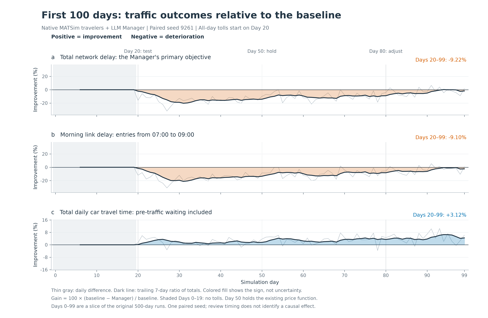
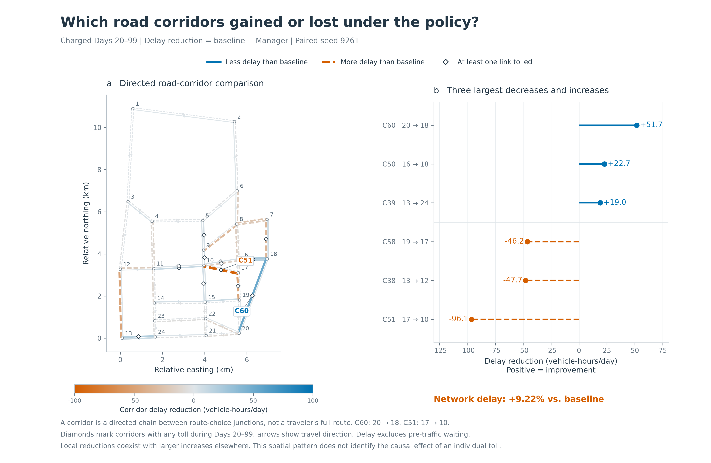

<div align="center">

<h1>Agentic Mobility</h1>

<p><strong>Exploring AI Agents and Emergent Dynamics in Mobility Systems</strong></p>
<p align="center">
  <a href="#quickstart">
    
  </a>
  <a href="LICENSE">
    
  </a>
</p>


    
Part of [AgenticCity](https://github.com/Agentic-City-Research),
exploring AI agents and interconnected urban systems.


    
[RESEARCH QUESTIONS 🎯](#research-questions) · [EXPERIMENT 01 🧪](#experiments) · [QUICKSTART 🚀](#quickstart) · [COMMUNITY 🤝](#community--contributing)

</div>

<br>

<a id="overview"></a>

## OVERVIEW 🧩

Agentic Mobility is a research platform for studying AI agents and collective dynamics in mobility systems. Agents interact through shared network conditions: their decisions affect the environment experienced by other agents.

The current implementation uses MATSim to execute mobility decisions and generate feedback. It supports LLM-controlled travelers and an LLM pricing agent, with the experiments below evaluating these roles separately.


### Daily simulation cycle

Each day follows a decide–execute–reflect cycle: traveler agents select routes and departure times, enabled pricing policies are applied, and MATSim executes the full-day traffic simulation. Each role then receives its permitted feedback and updates its own experience record. Pricing updates occur on scheduled review days.

LLMs control selected target trips; other trips follow native simulation behavior. Model weights remain fixed during the simulation. See [Methods & protocols](docs/methods-and-protocols.md) for information access, reflection, and policy execution.

<br>

<a id="research-questions"></a>

## RESEARCH QUESTIONS 🎯

The experiments below examine traveler decisions and pricing interventions separately. 
Information-access effects and joint traveler–pricing-agent configurations remain further research directions.

| Research focus | Research question |
| :--- | :--- |
| 📊 **Agent behavior** | How do AI agents make mobility decisions under different information and constraints? |
| 🚦 **System dynamics** | How do individual decisions and shared conditions shape one another over time? |
| 🔄 **Collective patterns** | What spatial and temporal patterns arise from repeated decisions and interventions? |


Configuration templates are provided in the [experiment guide](docs/experiments-and-evaluation.md). Each comparison requires its own documented population, action constraints, background traffic, and evaluation protocol.

<br>

<a id="experiments"></a>

## EXPERIMENT 01 🧪

The traveler case traces available information, selected actions, and realized outcomes. 
The time series and corridor comparisons show how aggregate outcomes vary over time and across the network.

### Traveler agents: decisions and mobility outcomes

> We examine individual and aggregate mobility outcomes by comparing LLM-controlled route and departure-time choices with native MATSim over Days 0–60. Both runs use seed 9261 and share the same population, network, and capacity settings, without a pricing agent or tolls.
>
> **A decision in context.** On Day 60, a traveler without access to network traffic information selected route c1 and departed at 07:31, citing recent experience with route reliability. The simulated trip took 14.13 minutes by car, with arrival at 07:48:52 before the 09:00 arrival target.
>
> <details>
> <summary>A traveler decision: route choice under limited information</summary>
>
> This example follows simulated commuter `10042_2` on Day 60 (model: `qwen3.5-9b`; no manager or tolls).
>
> | Stage | Recorded example |
> | :--- | :--- |
> | Available information | Four candidate routes (`c0`–`c3`) with distances, static free-flow time estimates, and estimated costs; nine allowed departure times from **06:01:19 to 08:01:19**, at 15-minute intervals; a **09:00 arrival threshold**; and personal trip records from Days 57–59. Network-wide traffic information was unavailable. |
> | Selected action | Route **`c1`**, approximately **5.31 km**, departing at **07:31:19**. Its static free-flow car-time estimate was **6.37 min**, compared with **5.62 min** for `c0`. |
> | Recorded rationale | “Recent experience shows c1 is reliable with no lateness compared to volatile c0.” |
> | Realized outcome | Actual trip departure: **07:31:19**. Car time: **14.13 min**. Door-to-door time: **17.55 min**. Destination arrival: **07:48:52**, before the 09:00 threshold. The execution audit confirmed that the completed route matched `c1`. |
>
> **Recent trajectory of the same traveler**
>
> | Day | Route | Trip departure | Car time (min) | Destination arrival | Arrival status |
> | :--- | :--- | :--- | ---: | :--- | :--- |
> | 57 | c0 | 07:31:19 | 11.28 | 07:46:01 | On time |
> | 58 | c0 | 08:01:19 | 75.18 | 09:19:55 | 19 min 55 s late |
> | 59 | c1 | 07:31:19 | 14.83 | 07:49:34 | On time |
> | 60 | c1 | 07:31:19 | 14.13 | 07:48:52 | On time |
>
> The Day 60 explanation emphasizes reliability, and the selected action can be traced through physical execution to the realized outcome. This individual trajectory illustrates decisions under limited information and changing shared conditions. Routes and departure times both vary across the displayed days.
>
> Car time includes pre-traffic waiting. Door-to-door time covers the complete target trip. The rationale is the explanation recorded in the model output.
>
> </details>
>
> **Aggregate results over Days 0–60**
> | Metric | Native MATSim | LLM travelers | Change vs. native |
> | :--- | ---: | ---: | ---: |
> | Mean target-trip car travel time (min) | 22.29 | 17.76 | −20.35% |
> | Mean target-trip door-to-door travel time (min) | 41.02 | 36.48 | −11.06% |
> | P95 target-trip car travel time (min) | 70.55 | 57.99 | −17.80% |
> | Late work arrivals (%) | 15.48 | 6.02 | −9.46 pp |
> | Total daily car travel time (person-hours) | 11,424.11 | 10,480.04 | −8.26% |
>
> Values are daily averages over Days 0–60. P95 is the average of daily P95 values, and pp denotes percentage points. Target-trip metrics cover 11,793 trips/day, work lateness covers 11,332 work trips/day, and total car travel time covers 33,644 car legs/day.
>
> [](docs/assets/llm-vs-native-61days.svg)
>
> The gray curves show two additional native runs (seeds 268 and 4711); the primary comparison uses seed 9261 in both conditions. Shading marks Days 56–60.
>
> <details>
> <summary>Traffic replay: Day 0 vs. Day 50</summary>
>
> This replay compares two days within the LLM run. It illustrates how traffic patterns change during that run; it is not a comparison against the native baseline.
>
> 
>
> </details>

### Pricing agent: interventions and system responses

We compare native MATSim travelers with and without an LLM pricing agent over the first **100 simulation days (Days 0–99)** of the original 500-day runs, using simulation seed 9261. Population, network, capacity, and native traveler strategy settings match across the two scenarios. All-day tolling begins on Day 20.

During the charged period (**Days 20–99**), total network delay is **9.22% higher**, morning link delay is **9.10% higher**, and total daily car travel time is **3.12% lower** than the native baseline. The reduction in total car time mainly reflects less pre-traffic waiting; it does not indicate lower delay within the road network.

[](docs/assets/first100_traffic_outcomes.svg)

Positive values indicate improvement. Thin gray lines show daily differences; dark lines show trailing seven-day ratios of totals. Summary percentages cover Days 20–99. Network delay excludes pre-traffic waiting, whereas total car travel time includes it. Morning link delay covers link entries from 07:00 to 09:00.

The pricing agent introduces tolls on **20 links on Day 20**, holds the same prices on **Day 50**, and adjusts the policy to cover **23 links on Day 80**. Network delay remains above the same-day baseline in each stage, although the gap narrows from **15.40%** during Days 20–49 to **2.70%** during Days 80–99. The final stage contains only 20 observed days, and this change cannot be attributed solely to the Day 80 adjustment.

<details>
<summary>Spatial variation across corridors</summary>



Local improvements coexist with larger increases elsewhere. For example, corridor C60 (20 → 18) experiences **51.67 fewer vehicle-hours of delay per day**, while C51 (17 → 10) experiences **96.11 more** than the baseline.

Corridors are directed road chains between route-choice junctions, rather than complete traveler routes. Blue indicates less delay; orange indicates more delay.

</details>

All planned car trips complete in both scenarios throughout the selected period. These are descriptive results from one paired seed and different code builds; they do not establish an isolated causal effect of LLM pricing.

**[Experiment settings, data, and reproduction →](docs/reported-experiments.md)**

See the experiment records for configurations, metric definitions, aggregate data, and available reproduction instructions.

<br>
<a id="quickstart"></a>

## QUICKSTART 🚀


Requires **JDK 25** (including `javac`) and Git. The Maven Wrapper downloads Maven and dependencies on first use.

**Get the source and build**

```bash
git clone https://github.com/Agentic-City-Research/Agentic-Mobility.git
cd Agentic-Mobility
sh ./mvnw -B clean package
```

On Windows PowerShell, build with `.\mvnw.cmd -B clean package`.

**Run a diagnostic baseline without model API calls**

The following command runs a two-day diagnostic baseline with 100 native travelers.

```bash
java -Xmx4g -cp matsim-example-project-0.0.1-SNAPSHOT.jar org.matsim.agentic.MorningExperiment \
  --config scenarios/SiouxFalls-public/config.xml \
  --mode hybrid --policy mnl --llm-agents 0 \
  --demand 100 --sample-persons 100 --days 2 \
  --population-seed 4711 --seed 4711 \
  --output output/quickstart
```

<details>
<summary>Windows PowerShell command</summary>

```powershell
java -Xmx4g -cp matsim-example-project-0.0.1-SNAPSHOT.jar org.matsim.agentic.MorningExperiment `
  --config scenarios/SiouxFalls-public/config.xml `
  --mode hybrid --policy mnl --llm-agents 0 `
  --demand 100 --sample-persons 100 --days 2 `
  --population-seed 4711 --seed 4711 `
  --output output/quickstart
```

</details>

After a successful run, `morning/status.json` in the actual output directory should contain `complete=true` and `daysCompleted=2`. If the requested directory already exists, the application creates a numbered alternative. Use the output path reported in the console.

This 100-person example checks installation and execution. The `--sample-persons` option reduces the population without scaling road capacity. For research experiments, follow the [sampling and capacity guidance](docs/scenarios-and-data.md#sampling-and-capacity).

**Connect a model API**

Before running LLM travelers, a pricing agent, or both, follow the [API connection guide](docs/getting-started.md#5-connect-an-existing-model-service) to configure `AGENTIC_BASE_URL`, `AGENTIC_MODEL`, and `AGENTIC_API_KEY`. The platform then calls the configured service automatically during decisions, reflection, and other enabled stages. The service must support the Chat Completions API. MATSim runs on CPU, and the model service can be hosted on another machine.

**[Run your first LLM-controlled traveler experiment →](docs/getting-started.md#start-with-a-small-traveler-run)**

After configuring your model service, follow the Bash or Windows PowerShell example to run seven simulation days with three LLM-controlled travelers in a 10% population sample.

For installation, troubleshooting, and additional instructions, see the [operating guide](docs/usage-guide.md) or its [Chinese version](docs/usage-guide.zh.md).

<a id="documentation"></a>


## 📖 Documentation

| Guide | What you will find |
| :--- | :--- |
| [Getting started](docs/getting-started.md) | Installation, API setup, first run, and troubleshooting |
| [Methods & protocols](docs/methods-and-protocols.md) | Agent roles, information access, memory, and pricing |
| [Experiments & evaluation](docs/experiments-and-evaluation.md) | Experiment configurations, baselines, and run records |
| [Reported experiments](docs/reported-experiments.md) | Model settings, build identifiers, result definitions, and aggregate data |
| [Scenarios & data](docs/scenarios-and-data.md) | Scenario inputs, data provenance, and extensions |


<br>

<a id="community--contributing"></a>

## COMMUNITY & CONTRIBUTING 🤝

Contributions are welcome, including documentation, reproducible examples, analysis tools, and simulation scenarios.

[Report an issue](https://github.com/Agentic-City-Research/Agentic-Mobility/issues) · [Contribution guide](CONTRIBUTING.md) · [Contributors](https://github.com/Agentic-City-Research/Agentic-Mobility/graphs/contributors)

⭐ If you find Agentic Mobility useful, consider starring the repository.

<br>

For research use, reference [Agentic-City-Research/Agentic-Mobility](https://github.com/Agentic-City-Research/Agentic-Mobility) and report the exact commit, scenario, model, and experimental settings. Manuscript information will be added when publicly available.

Code is licensed under [GPL-2.0](LICENSE). Third-party code and data retain their documented terms in [THIRD_PARTY.md](THIRD_PARTY.md). Built on MATSim and its example-project lineage.
