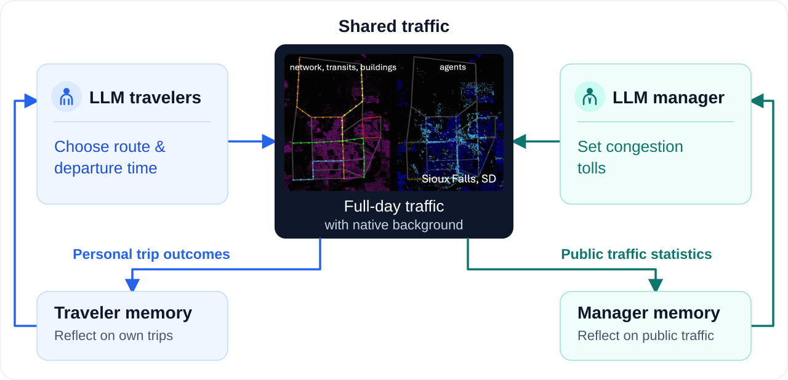
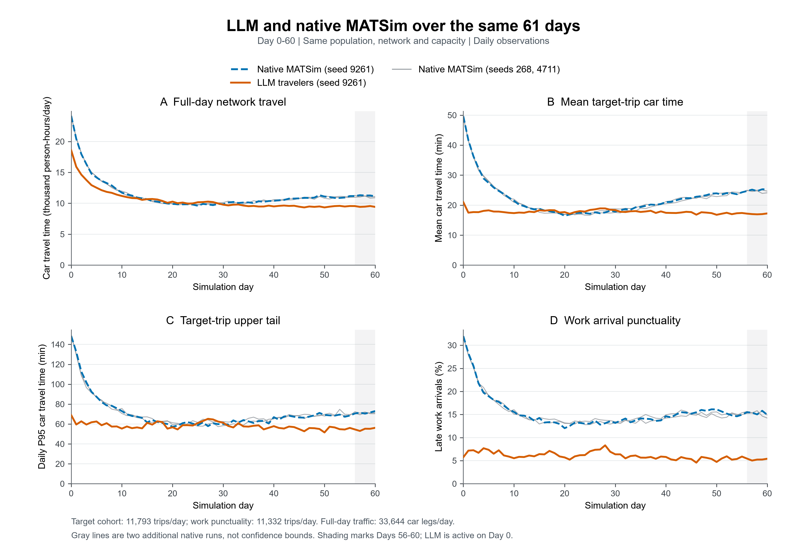
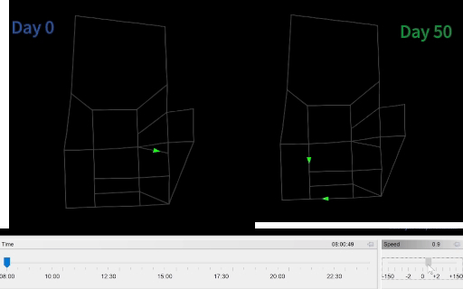
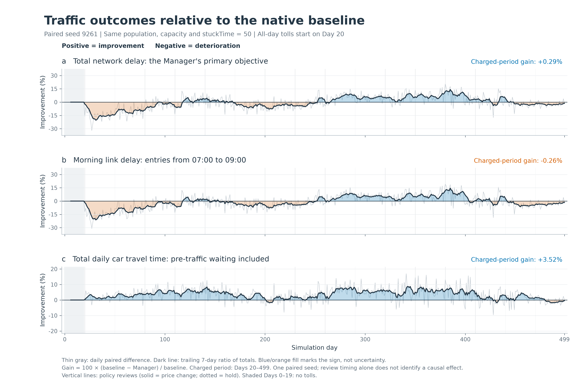
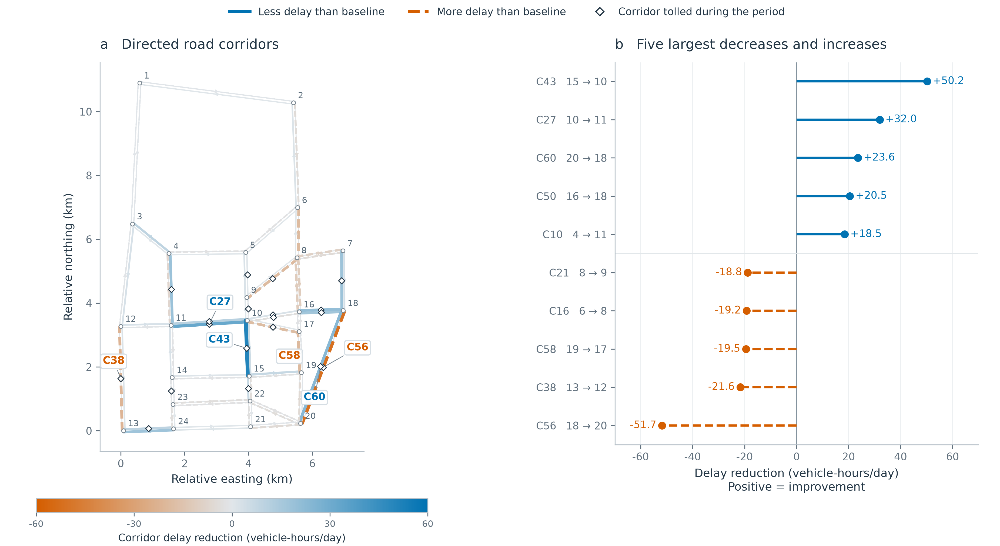

<div align="center">

<h1>Agentic Mobility</h1>

<p><strong>基于共享 MATSim 环境的 LLM 出行决策与交通管理研究平台</strong></p>

<p>
  <a href="#quickstart"></a>
  <a href="LICENSE"></a>
</p>

[English](README.md) | 中文

AgenticMobility 是 [AgenticCity](https://github.com/Agentic-City-Research) 的交通研究项目，以交通为起点，探索智能体与城市系统的持续交互。

🧪 [实验结果](#experimental-results) · 🚀 [快速开始](#quickstart) · 📖 [文档](#documentation) · 🎯 [研究方向](#research-directions) · 🤝 [参与社区](#community)

</div>

<a id="overview"></a>

## 🧩 项目概览



AgenticMobility 将 LLM 出行者、交通管理者与共享的 MATSim 环境连接起来，用于研究出行决策、管理政策与每日交通反馈。平台支持仅启用 LLM 出行者、仅启用 LLM 管理者及双方联合的配置；本页实验分别评估出行者决策与管理者收费。

当前实现基于增强的 Sioux Falls 场景，支持路线与出发时刻联合选择、每日反思和周期性拥堵收费，并保留背景交通及全日活动链。

### 每日仿真流程

每个模拟日依次完成决策、交通执行和反思：出行者选择路线与出发时刻，系统应用已启用的收费政策，MATSim 执行全日交通仿真；各角色随后接收其权限范围内的反馈并更新自身经历记录。管理者在预定日期评审和调整收费政策。

LLM 控制选定的目标行程，其他行程按 MATSim 原生行为机制运行，仿真期间模型权重保持不变。信息权限、反思与政策执行细节见[方法与协议](docs/methods-and-protocols.md)。

<a id="experimental-results"></a>

## 🧪 实验结果

以下探索性实验分别研究无收费条件下的 LLM 出行决策，以及面向原生出行者的 LLM 拥堵收费。每组实验均与各自的原生 MATSim 基线比较。

### LLM 出行者：路线与出发时刻联合选择

比较 LLM 出行者与原生 MATSim 在相同 61 个完整模拟日（Day 0–60）的结果，两组均使用随机种子 9261，人口、路网及容量设置一致，均未启用管理者或收费。

在这一观测窗口内，LLM 组的目标行程平均耗时更低，工作迟到比例更小，全体人口的全日汽车出行总耗时也更低。

| 指标 | 原生 MATSim | LLM 出行者 | 相对原生组的变化 |
| :--- | ---: | ---: | ---: |
| 目标行程平均汽车耗时（分钟） | 22.29 | 17.76 | −20.35% |
| 目标行程平均门到门耗时（分钟） | 41.02 | 36.48 | −11.06% |
| 目标行程汽车耗时 P95（分钟） | 70.55 | 57.99 | −17.80% |
| 工作迟到比例（%） | 15.48 | 6.02 | −9.46 个百分点 |
| 全日汽车出行总耗时（人时） | 11,424.11 | 10,480.04 | −8.26% |

表中数值为 Day 0–60 的逐日均值，P95 为每日 P95 的平均值。目标行程指标覆盖每天 11,793 次出行，迟到比例覆盖 11,332 次工作出行，全日汽车耗时覆盖 33,644 个汽车行程段。

[](docs/assets/llm-vs-native-61days.svg)

灰线表示另外两组原生运行（种子 268、4711），主要比较为两组种子 9261 的运行；阴影标记 Day 56–60。

<details>
<summary>交通回放：Day 0 与 Day 50</summary>

回放展示同一次 LLM 运行中两个日期的交通状态变化，不构成与原生基线的对照。



</details>

### LLM 管理者：面向原生出行者的拥堵收费

比较启用 LLM 收费管理者的原生出行者与无管理者基线，共 500 个完整模拟日（Day 0–499），均使用随机种子 9261。人口、路网、容量和原生策略设置一致，从 Day 20 开始全日收费。

收费期（Day 20–499）内，管理者组的全网延误比基线**低 0.29%**，早高峰路段延误**高 0.26%**，全日汽车出行总耗时**低 3.52%**。各指标随时间呈现改善与恶化交替的情况。

[](docs/assets/traffic_outcomes_manager.svg)

图中正值表示改善。收费期百分比按该期间两组指标总量之比计算。全网延误不含入网前等待，全日汽车出行耗时包含该等待；早高峰路段延误按 07:00–09:00 进入路段的车辆分组统计。

**延误在哪里变化？**

有向走廊对比显示，部分走廊延误减少，另一些走廊延误增加。颜色表示收费期平均每日走廊延误相对基线的变化；菱形表示该走廊至少一条路段曾在期内某一天收费。



每种设置目前仅包含一个 LLM 随机种子。代码构建版本与决策约束的差异限制了对单项设计的归因，两组实验的观测窗口和指标范围也不同。模型设置、构建标识、指标定义、汇总数据及解释范围见[实验记录与数据](docs/reported-experiments.md)。

<a id="quickstart"></a>

## 🚀 快速开始

需要 **JDK 25**（包含 `javac`）和 Git。首次构建时，Maven Wrapper 会下载 Maven 与所需依赖。以下命令均从仓库根目录执行。

**获取源码并构建**

```bash
git clone https://github.com/Agentic-City-Research/Agentic-Mobility.git
cd Agentic-Mobility
sh ./mvnw -B clean package
```

Windows PowerShell 中使用 `.\mvnw.cmd -B clean package` 构建。

**运行不调用模型 API 的入门示例**

下面的命令运行一个包含 100 名原生出行者、持续两个模拟日的诊断基线。

```bash
java -Xmx4g -cp matsim-example-project-0.0.1-SNAPSHOT.jar org.matsim.agentic.MorningExperiment \
  --config scenarios/SiouxFalls-public/config.xml \
  --mode hybrid --policy mnl --llm-agents 0 \
  --demand 100 --sample-persons 100 --days 2 \
  --population-seed 4711 --seed 4711 \
  --output output/quickstart
```

<details>
<summary>Windows PowerShell 运行命令</summary>

```powershell
java -Xmx4g -cp matsim-example-project-0.0.1-SNAPSHOT.jar org.matsim.agentic.MorningExperiment `
  --config scenarios/SiouxFalls-public/config.xml `
  --mode hybrid --policy mnl --llm-agents 0 `
  --demand 100 --sample-persons 100 --days 2 `
  --population-seed 4711 --seed 4711 `
  --output output/quickstart
```

</details>

运行成功后，程序实际输出目录中的 `morning/status.json` 应包含 `complete=true` 和 `daysCompleted=2`。输出目录重名时，程序会创建带编号的新目录，请以控制台报告的路径为准。

该 100 人示例用于检查安装与运行流程；`--sample-persons` 不会同步缩放路网容量。正式研究配置请参照[采样与容量设置](docs/scenarios-and-data.md#sampling-and-capacity)。

**接入模型 API**

运行 LLM 出行者、LLM 管理者或联合实验前，请按照 [API 接入指南](docs/getting-started.md#5-connect-an-existing-model-service) 配置 `AGENTIC_BASE_URL`、`AGENTIC_MODEL` 和 `AGENTIC_API_KEY`。配置完成后，平台会在决策和反思等阶段自动调用兼容 Chat Completions 的服务。MATSim 在 CPU 上运行，模型服务可部署在其他机器。

安装、故障排查和运行说明也可参考[中文操作指南](docs/usage-guide.zh.md)。

<a id="documentation"></a>

## 📖 文档

| 指南 | 主要内容 |
| :--- | :--- |
| [快速上手](docs/getting-started.md) | 环境安装、首次运行、API 配置与故障排查 |
| [方法与协议](docs/methods-and-protocols.md) | 主体角色、动作范围、信息权限、反思与收费机制 |
| [实验与评估](docs/experiments-and-evaluation.md) | 实验模式、配置、基线与运行记录 |
| [已报告实验](docs/reported-experiments.md) | 模型设置、构建标识、结果定义与汇总数据 |
| [场景与数据](docs/scenarios-and-data.md) | 场景输入、数据来源、人口采样与扩展要求 |

专题指南目前为英文。完整入口见[文档索引](docs/README.md)，中文说明见[操作指南](docs/usage-guide.zh.md)。

<a id="research-questions"></a>
<a id="research-directions"></a>

## 🎯 研究方向

平台支持以下研究方向。本页已展示出行者决策与管理者收费的独立对比；信息权限及双方联合交互仍是后续研究方向。

| 研究方向 | 可采用的比较设置 |
| :--- | :--- |
| 📊 **出行决策** | 原生交通基线 vs. LLM 控制目标行程的路线与出发时刻 |
| 🔎 **信息权限** | 知情 vs. 不知情受控出行者 |
| 🚦 **收费政策** | 无收费 vs. 固定收费 vs. LLM 调价 |
| 🔄 **出行者与管理者交互** | 仅 LLM 出行者 vs. LLM 出行者与管理者联合实验 |

具体实验需记录并匹配人口、动作约束、背景交通与评估协议，配置模板见[实验指南](docs/experiments-and-evaluation.md)。

<a id="community"></a>

## 🤝 社区与贡献

欢迎关注智能体、交通、城市仿真与政策研究的研究者和开发者参与：

- 报告安装、运行或复现问题，完善文档与示例。
- 分享记录完整的实验配置、基线方案或方法比较。
- 开发分析工具、可视化和新的交通场景。

[报告问题](https://github.com/Agentic-City-Research/Agentic-Mobility/issues) · [阅读贡献指南](CONTRIBUTING.md) · [查看贡献者](https://github.com/Agentic-City-Research/Agentic-Mobility/graphs/contributors)

如果 Agentic Mobility 对你的研究有帮助，欢迎点亮 ⭐，让更多研究者发现并参与项目。

<a id="citation-and-license"></a>

## 📚 引用与许可证

用于研究时，请注明 [Agentic-City-Research/Agentic-Mobility](https://github.com/Agentic-City-Research/Agentic-Mobility)，并记录具体提交版本、场景、模型和实验设置。论文公开后将补充正式引用信息。

代码采用 [GPL-2.0](LICENSE) 许可证。第三方代码与数据保留各自的使用条款，来源和说明见 [THIRD_PARTY.md](THIRD_PARTY.md)。本项目基于 MATSim 及其示例工程构建。
