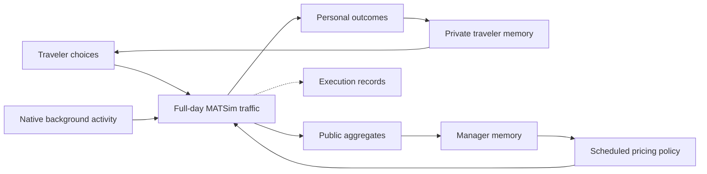

# Methods & protocols

[Documentation](README.md) · [Getting started](getting-started.md) · [Experiments & evaluation](experiments-and-evaluation.md) · [Scenarios & data](scenarios-and-data.md)

AgenticMobility studies day-to-day interaction through a shared transport environment. Travelers choose routes and departure times, the manager chooses congestion tolls at scheduled opportunities, and MATSim executes their consequences. Each role updates a separate memory from the feedback available to it.

This guide describes `MorningExperiment`, Traveler v9, and the default `basic` manager. The current implementation covers transport interaction; broader AgenticCity integration remains a research direction.

## System boundary



Interaction is mediated by policies and traffic conditions. There is no direct traveler-to-traveler or traveler-to-manager messaging in this protocol. Native traffic remains active alongside LLM-controlled target trips.

Adaptation changes experiences, summaries, decisions, and policies. Model weights remain fixed during a run. The current interface does not implement transport mode choice, a supervisor/member management team, voting, or model fine-tuning.

## Roles and information access

| Role | Input before a decision | Available action | Feedback after execution |
| :--- | :--- | :--- | :--- |
| Informed LLM traveler | Fixed personal conditions and schedule, legal options, static route information, recent personal facts, previous summary, and the complete current network toll rules. | Choose one legal route and departure time for the target trip. | Own executed trip, timing, completion state, and actual payments. |
| Uninformed LLM traveler | The same personal conditions, options, static route information, recent facts, and summary; current tariffs remain unknown. | The same route/time action space. | Own executed outcomes and payments, which can inform later memory. |
| LLM manager | Public car-network information, past aggregate traffic, effective policy and policy history, and its own memory. | Submit a complete legal link-entry toll policy on scheduled days. | Public traffic and policy-execution feedback. |
| Native traveler | Information used by the configured native routing, scoring, and replanning mechanisms. | Native activity, route, and plan behavior under the selected experiment mode. | The corresponding native execution and scoring feedback. |

Traveler prompts exclude live or historical network-wide congestion, other travelers' experiences, and unchosen routes' realized travel times. Both information groups receive static route information; they use personal executions to learn about congestion.

The manager does not receive individual profiles, traveler memories, or person-level bills. Its memory is its own persistent state, built from public feedback.

### Information groups

Groups are assigned at the **person level** with a stable seed. The default informed share is `0.5`, and `--information-scope controlled` applies the split to controlled people. People outside that scope use native public-policy routing information. `--information-scope all` extends the split to the full simulated population.

All trips of one assigned person share the information-visibility group, but the target-trip LLM prompt and native routing for other trips remain distinct mechanisms. Shared roads couple the groups' traffic outcomes.

An uninformed traveler cannot see current tariffs. For each link and time-of-day bin, the latest own actual entry charge (including zero) is used as a potentially stale estimate; an unobserved entry uses zero as an explicitly uncertain prior, not a known current tariff. Actual charges follow the policy at execution. Informed travelers receive all current network toll rules; unlisted links and windows have zero toll. Traveler-only and managed runs use the same no-toll interface before intervention.

## Fixed population, cohort, and identity

Preparation fixes the sampled population, eligible target trips, controlled people, profiles, information groups, and action sets.

By default, target eligibility uses the **original planned start of the destination activity in `[0,09:00)`**, rather than a trip's later realized departure or arrival. This is the `planned-arrival` selection rule; missing or invalid original planned starts are not estimated to create eligibility. Moving a trip's departure later does not remove it from the fixed target set.

`--llm-agents` selects **people** from the eligible cohort. A person can have more than one eligible target trip. The primary target-trip identity is `personId/tripIndex`, also stored as `tripId`. Traveler memory is maintained per target trip; it is not an automatically unified memory of every activity undertaken by a person.

The main `hybrid` mode retains native plan selection and replanning. Target routes and departure choices are overlaid after native replanning; controlled people's other trips and non-controlled people's trips retain native behavior. Native background adaptation therefore remains part of the shared environment.

## Joint route and departure-time actions

For target trip `i`, the legal action on day `d` is a pair drawn from fixed route and departure sets:

$$
a_{i,d}=(r_{i,d},\tau_{i,d})\in\mathcal{R}_i\times\mathcal{T}_i.
$$

### Route candidates

The reference generator uses BFS-LE: explore subnetworks formed by removing internal links, find free-flow shortest paths within those states, remove duplicates, and select candidates using cost and overlap constraints. It is not described as a K-shortest-path generator.

| Setting | Default |
| :--- | ---: |
| Maximum search states per OD | 10,000 |
| Initial distinct-path pool target | 16 |
| Final route count | Up to 4 |
| Free-flow time ratio to `c0` | 2.5 |
| Extra free-flow time allowance | 300 seconds |
| Distance ratio to `c0` | 2.5 |
| Extra distance allowance | 2,000 metres |
| Maximum pairwise overlap | 0.85 |

For each of time and distance, a candidate passes if its ratio is within the limit **or** its absolute excess is within the allowance. It must pass both dimensions. Overlap is shared directed-link length divided by the shorter route's length.

The free-flow shortest route `c0` is retained. A pool can contain fewer than four candidates; routes are not duplicated to fill it. Search-limit and candidate-quality records explain preparation outcomes. A search result is not an enumeration of every possible path in the network.

Routes, IDs, and their base ordering are frozen for the run. Importing `--candidate-file` reuses that pool; a missing OD fails preparation rather than generating replacements. `--candidate-order original|reverse|shuffle` changes presentation only.

### Departure options

The default grid is anchored to the original departure: **60 minutes earlier up to, but excluding, 30 minutes later, at 15-minute intervals**. It usually contains six choices. Day-zero, original origin-activity, and exclusive simulation-end boundaries can shorten the grid; the original departure is retained.

The grid is not shifted relative to yesterday's choice. It need not align with clock-quarter hours. Arrival deadlines do not automatically remove otherwise legal late-arriving choices. A trip with one route can still have multiple departure options.

The selected departure, written plan, and realized departure are recorded separately. Earlier activity or trip delays can postpone execution even when an action was written correctly.

## Facts, forecasts, profiles, and memory

| Information type | Meaning |
| :--- | :--- |
| Explicit personal facts and schedule | Supplied fixed information. Missing values remain unknown. |
| Synthetic profile | A fixed experimental preference description, not a measured demographic preference. |
| Route/time forecast | Static estimates and visible cost information, not experienced travel or a guaranteed arrival. |
| Executed facts | Observations of what actually happened within the role's information boundary. |
| Self-written summary | A model-generated interpretation that may contain uncertainty or mistakes. |
| Research archive | Full process records for inspection, not a freely searchable agent history. |

`--personal-profiles legacy` generates fixed synthetic traits; `input` uses supplied attributes without those synthetic traits. Explicit personal attributes and schedules take precedence over a synthetic profile or subjective summary. Unknown income, value of time, or lateness tolerance is not inferred from age or a profile label.

Times and durations are seconds, distances are metres, and costs use the scenario's monetary unit. `null` is not zero. An unfinished trip does not provide a complete arrival time or full travel duration. Missing lateness can also mean that no arrival deadline was supplied.

### Traveler memory cycle

| Phase on simulation day D | Visible dynamic state |
| :--- | :--- |
| Choice | Previous accepted summary and facts from D−5 through D−1 by default, plus any unsummarized facts. |
| Execution | New facts about the selected trip and actual payments. |
| Reflection | Every fifth day by default: previous accepted summary and facts since the previous reflection, including today. |
| Next day | The accepted replacement summary enters the next choice and reflection. |

The first summary is empty. Later reflections require the previous scheduled summary. `--history-window` accepts 1–5 pre-choice factual days; when omitted it follows the reflection interval, 5 by default. With the default five-day interval, reflection covers the five days since the prior reflection; daily reflection covers one day.

The default summary target is about **240 Unicode code points**, with a hard limit of **500**. Spaces and punctuation count. A 241–500-character summary is legal. Each successful reflection returns a complete non-empty replacement summary, integrating useful older experience with new facts.

The personal toll ledger separately supplies own latest link/bin observations for route estimates; the full trip archive does not restore other forgotten details to a prompt. Fixed profiles and schedules are supplied separately. The program does not impose a familiarity bonus, an exploration probability, or a rule that lateness must cause a route change.

### Traveler output contract

A joint choice contains exactly `routeId`, numeric `departureSeconds`, and `reason`. For illustration only:

```json
{
  "routeId": "c0",
  "departureSeconds": 25200,
  "reason": "This option fits my schedule and avoids the tolls currently visible to me."
}
```

The illustrated route, time, and reason are not experimental observations. Actual IDs and times must match the enumerated actions in the request. The reason is one short sentence, with a default hard limit of 120 Unicode code points. Reflection returns exactly one `memory` string.

Local validation rejects truncated responses, blank output, malformed or trailing JSON, duplicate or extra keys, wrong types, illegal actions, and text above the hard limit. `--repair-attempts 3` means **three total output attempts**, consisting of the initial call and at most two error-feedback retries. Failure exhaustion stops the traveler experiment; the program does not clip memory, salvage incomplete JSON, or substitute a different policy.

The optional `--traveler-semantic-review` is off by default. It permits one additional model check of each structurally legal choice or summary. Review uses the traveler's permitted facts and may revise explanatory text or memory; the selected route and departure remain locked. Failed review retains the original structurally legal output and records the failure. See [Traveler v9](traveler-v9.md) for review states and exact validation details.

## Congestion-pricing manager

The manager is instructed to reduce full-day network delay using public observations and its own policy experience. The task objective and the availability of an action do not establish that a policy improves traffic.

### Separate policy and reflection calls

| Task | Default timing | Output |
| :--- | :--- | :--- |
| Policy decision | Days 21, 51, 81, … | A complete policy and structured decision. |
| Manager reflection | After every completed day, including days 1–20 | A replacement memory only. |

There are 20 initial toll-free days. `--manager-update-interval 30` controls subsequent policy opportunities. On day 21, the manager can use results only through day 20; that policy's first outcomes become available after day 21 executes. Reflection cannot directly change tolls.

Policy context includes the complete car-network topology, relevant capacity facts, past public traffic summaries, policy history, and manager memory. Public road details prioritize major delay/failure locations and currently or recently priced links; omission does not imply an unlisted road is uncongested. Daily reflection uses new observations and selected summaries without repeating the complete topology.

### Basic policy contract

The top-level output contains exactly `rules` and `decision`.

| Rule requirement | Current `basic` behavior |
| :--- | :--- |
| `link_id` | An existing directed network link permitting `car`. |
| `start`, `end` | The complete execution horizon: `0` and the configured QSim end time. |
| `amount` | A finite, nonnegative monetary amount per actual entry. |
| Policy size | At most 40 rules, with at most one rule per link. |
| Price limits | No predefined amount cap, price grid, or increase step. |
| Acceptance | The complete accepted policy replaces the previous one. Unlisted links are unpriced. |

For the supplied scenario the full-day window is `[0,108000)`, or 00:00–30:00. Each repeated entry is charged again, including actual entry onto an origin partial link. Duplicate notifications of the same entry are not charged twice. Payments already made remain recorded if a trip later fails to finish.

An unchanged policy persists between accepted updates. Empty `rules` withdraw all charges. Merely changing departure time does not reduce the direct toll on an otherwise identical completed route with the same link-entry counts under an all-day fixed-price policy.

The `decision` object contains:

- `action`: `hold`, `test`, `adjust`, or `remove`.
- `evidenceBasis`: `untested`, `observational`, or `observedTrial`.
- `hypothesis`, `expectedNetworkEffect`, `uncertainty`, `evaluationPlan`, and `revisitCondition`: non-empty explanatory strings, each capped at 400 Unicode code points.

`hold` must preserve the price function. `test` and `adjust` must change it. `remove` may only reduce or withdraw prices. Policy versions and price-function fingerprints are separate; a new version of identical prices does not start a new price episode. Explanatory fields remain model interpretations rather than measured facts.

### Manager memory and optional restrictions

Manager memory targets 400–600 English words with a 1,000-word hard limit and no hard minimum. This word limit differs from the traveler's character limit. Successful reflection replaces the entire summary; structured policies and public records remain the execution ledger.

The default `basic` profile has no automatic performance-triggered withdrawal or cooldown. The explicitly selected `controlled` profile adds restricted trial rules, safety withdrawal, and cooldown behavior. These are different experimental conditions.

Fixed-policy files are a separate intervention mechanism. They can contain explicit time windows and are mutually exclusive with `--manager`. Their format is described in [Scenarios & data](scenarios-and-data.md#fixed-toll-files).

## Daily execution and persistent state

1. **Determine the effective policy.** At a scheduled opportunity, use only already completed public observations to propose a replacement policy.
2. **Prepare choices.** Build permitted traveler contexts, collect legal route/time pairs, and apply the target-trip overlay after native replanning.
3. **Execute traffic.** Run the full-day activity chains and charge actual priced-link entries.
4. **Record feedback.** Save personal outcomes, public aggregates, and the effective policy identity.
5. **Reflect and commit.** Update traveler and manager memories separately, then make accepted state available to the next day.

The first MATSim iteration has no replanning event, so its controlled choices are prepared at iteration start. Later choices are prepared after native replanning. Choice and reflection workers return pending results; plan changes and accepted memory updates are committed on the simulation thread. Traveler batches are checked before their results are committed.

Daily vehicle execution restarts for each iteration. What persists is identity, fixed conditions, experience, summaries, and policies, rather than a continuously running vehicle state across midnight-to-midnight iterations.

### Day numbering

With `--days D`, iteration numbering starts at 0. Human-readable simulation day is `day - firstIteration + 1`. Thus policy days 21, 51, and 81 correspond to iterations 20, 50, and 80 in the standard setup. `policy-applications` also records `simulationDay`. Keep both numbering conventions explicit when connecting records.

### Failure handling

| Failure | Current handling |
| :--- | :--- |
| Traveler choice or reflection remains structurally invalid after allowed attempts | Fail the experiment; no silent replacement action or successful-looking memory update. |
| Manager policy remains invalid after bounded output repairs | Retain the current policy and record the skipped update. |
| Manager policy API failure, budget failure, or outer batch stall | Can abort the run; policy failure is not universally recoverable. |
| Manager reflection fails, is invalid, or times out | Retain prior memory and record the fallback; the next input includes observations since the last successful update. |
| Optional traveler semantic review fails | Retain the original legal proposal and record review failure. |

Cancelled reflection workers cannot commit late results. HTTP transport retries and output-validation attempts are separate mechanisms.

## Implementation and version references

| Component | Reference |
| :--- | :--- |
| Entry point and effective settings | [`MorningExperiment`](../src/main/java/org/matsim/agentic/MorningExperiment.java) |
| Fixed cohort and legal actions | [`MorningCohort`](../src/main/java/org/matsim/agentic/MorningCohort.java), [`MatsimOdCandidates`](../src/main/java/org/matsim/agentic/MatsimOdCandidates.java), [`MorningDepartureOptions`](../src/main/java/org/matsim/agentic/MorningDepartureOptions.java) |
| Information access and prompt construction | [`MorningTravelerInformation`](../src/main/java/org/matsim/agentic/MorningTravelerInformation.java), [`MorningPromptRenderer`](../src/main/java/org/matsim/agentic/MorningPromptRenderer.java) |
| Traveler output and reflection | [`MorningLlmPolicy`](../src/main/java/org/matsim/agentic/MorningLlmPolicy.java), [`MorningMemoryUpdater`](../src/main/java/org/matsim/agentic/MorningMemoryUpdater.java), [Traveler v9](traveler-v9.md) |
| Lifecycle and observations | [`MorningLoop`](../src/main/java/org/matsim/agentic/MorningLoop.java), [`MorningObservations`](../src/main/java/org/matsim/agentic/MorningObservations.java) |
| Policy, manager memory, and execution | [`MorningManager`](../src/main/java/org/matsim/agentic/MorningManager.java), [`MorningManagerMemory`](../src/main/java/org/matsim/agentic/MorningManagerMemory.java), [`MorningTollSystem`](../src/main/java/org/matsim/agentic/MorningTollSystem.java) |

Current protocol identifiers are `morning-information-v12-configurable-history`, `morning-reflection-v10-period-window`, `morning-output-v3-strict-json-audit`, `morning-pricing-v11-full-day-car`, and `morning-manager-memory-v2-full-day-car`. The optional review is `morning-semantic-review-v1-single`. Manifest schema is 23. Preserve the identifiers recorded by the actual run when working across revisions.
