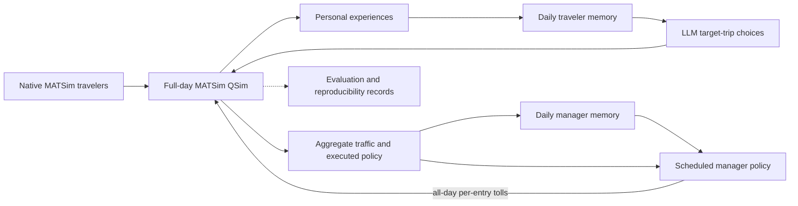

# AgenticMobility operating guide

[Project overview](../README.md) · [Traveler v9 protocol](traveler-v9.md)

Commands run from the repository root unless stated otherwise. This guide contains the detailed experiment, deployment, output, and troubleshooting instructions.

**A research platform for LLM travelers and congestion-pricing managers in MATSim.**

[](../pom.xml)
[](../pom.xml)
[](../LICENSE)

[Installation](#installation) · [Quickstart](#quickstart) · [Experiments](#experiments) · [Slurm](#slurm-with-an-existing-qwen-service) · [Documentation](#documentation)


AgenticMobility connects language-model decisions to an executable transport simulation. Travelers choose routes and departure times, experience congestion and tolls, and update their own memories. A manager observes aggregate traffic, reflects after each simulation day, and revises congestion-pricing policies at scheduled opportunities.

The included Sioux Falls scenario retains full-day activity chains and native MATSim background traffic. Decisions, executed trips, policies, memories, and reproducibility records make it possible to compare intended actions with actual outcomes.

The current `MorningExperiment` interface uses continuous private summaries, five-day execution facts and reflections by default, strict bounded JSON output, and optional single-call semantic review with daily reflection. The manager reflects daily and revises all-day toll policies on scheduled update days. These mechanisms are recorded in manifest schema **23**; traveler and manager protocol versions are tracked separately.

## When to use AgenticMobility

| Research question | Experiment setup |
| --- | --- |
| How do LLM travelers choose routes and departure times? | LLM-controlled target trips within native full-day traffic |
| How does access to toll announcements affect choices? | Fixed informed and uninformed groups with distinct information access |
| What happens when a manager adjusts congestion pricing? | Native or LLM travelers with an LLM pricing manager |
| How do adaptive policies compare with a fixed intervention? | Native baseline, file-defined tolls, and manager experiments |
| How sensitive are choices to a model or candidate order? | Replay saved traveler contexts without rerunning traffic |

This is a research implementation. Memories and decisions evolve through inference; model weights are not trained. Traffic improvement, behavioral realism, and causal policy effects require experimental evaluation.

## How it works

The simulation separates daily observation and memory from periodic policy intervention.

| Stage | What happens | Implementation |
| --- | --- | --- |
| Prepare | Select a stable population and cohort, construct route/time options, and assign profiles and information groups. | [`MorningExperiment`](../src/main/java/org/matsim/agentic/MorningExperiment.java), [`MorningCohort`](../src/main/java/org/matsim/agentic/MorningCohort.java) |
| Decide | Publish a policy if an update is scheduled, then obtain choices for controlled target trips. | [`MorningLoop`](../src/main/java/org/matsim/agentic/MorningLoop.java), [`MorningLlmPolicy`](../src/main/java/org/matsim/agentic/MorningLlmPolicy.java), [`MorningManager`](../src/main/java/org/matsim/agentic/MorningManager.java) |
| Execute | Run full-day traffic and charge actual entries into priced car links. | MATSim QSim, [`MorningTollSystem`](../src/main/java/org/matsim/agentic/MorningTollSystem.java) |
| Observe and reflect | Record personal experiences and public aggregates; update memories after the completed day. | [`MorningObservations`](../src/main/java/org/matsim/agentic/MorningObservations.java), [`MorningMemoryUpdater`](../src/main/java/org/matsim/agentic/MorningMemoryUpdater.java), [`MorningManagerMemory`](../src/main/java/org/matsim/agentic/MorningManagerMemory.java) |

**Traveler actions.** Eligible target trips are selected from original plans, by default with a planned destination activity start before 09:00. Controlled trips have up to four frozen route candidates. The default departure grid spans 60 minutes before to 30 minutes after the original departure, in 15-minute steps, subject to activity and simulation boundaries. Profiles, schedules, visible prices, and personal history enter the prompt. Other trips retain native behavior in the `hybrid` workflow.

**Traveler memory and information.** LLM travelers replace their summaries every five days by default: a 500 Unicode-character limit, with a prompt target of 240 characters. Recent factual experiences cover the preceding five days by default and are provided separately alongside unsummarized facts. Each reflection receives the previous summary to carry useful longer-term experience beyond that window. Informed travelers see current network toll announcements; uninformed travelers retain unknown current prices and use their own experiences. The default information split applies to controlled people; `--information-scope all` extends it to background people.

**Manager actions.** The default `basic` manager returns a complete policy with at most 40 rules, one per existing directed car link. Each rule sets a finite nonnegative amount per entry throughout `[0, QSim endTime)`. The supplied public scenario ends at 30:00, so its all-day window is `[0,108000)`, including trips after midnight. Each traversal is charged separately. An accepted policy replaces the previous policy; an empty policy withdraws all tolls.

**Two timescales.** The first 20 simulation days are free. Policy decisions occur on days **21, 51, 81, ...** by default. Manager memory updates **every completed day**, including the free period, targeting 400–600 English words with a 1,000-word hard limit. Reflection cannot change tolls. Failed or timed-out reflection retains old memory; the next input includes missed observations. Holding an identical price function does not restart its observation period. The optional `controlled` profile adds legacy pricing restrictions, daily safety withdrawal, and cooldown behavior.

## Installation

| Requirement | Purpose |
| --- | --- |
| **JDK 25**, including `javac` | Compile and run the project |
| Git | Obtain and update source code |
| Bundled Maven Wrapper | Build without installing Maven separately; first use downloads Maven and dependencies |
| Reachable Chat Completions service | Live LLM travelers or a manager |
| Python 3 / PowerShell | Optional analysis, scenario utilities, and convenience scripts |

MATSim runs on the CPU. Model serving can run locally or on a separate GPU server. This repository calls an existing service; it does not start a model server.

```bash
git clone https://github.com/Agentic-City-Research/Agentic-Mobility.git
cd Agentic-Mobility
java -version
javac -version
```

Private repository access requires an authorized GitHub account. For HTTPS authentication, enter a [personal access token](https://docs.github.com/en/authentication/keeping-your-account-and-data-secure/managing-your-personal-access-tokens) with access to this repository when Git asks for a password. Both Java commands must use JDK 25.

For example, if a full JDK is already installed at `$HOME/opt/java25`, select it in Bash before building or submitting jobs:

```bash
export JAVA_HOME="$HOME/opt/java25"
export PATH="$JAVA_HOME/bin:$PATH"
java -version
javac -version
```

Change `JAVA_HOME` to the actual JDK location. A Java runtime without `javac` cannot compile the project.

All commands below run from the repository root. Build on Linux/macOS:

```bash
sh ./mvnw -B clean package
```

Build on Windows PowerShell:

```powershell
.\mvnw.cmd -B clean package
```

An installed Maven can also run `mvn -B clean package`. The build produces **`matsim-example-project-0.0.1-SNAPSHOT.jar` in the repository root**. Rebuild after changing Java source code. The executable JAR's main class is `org.matsim.agentic.MorningExperiment`; the explicit entry point below also works.

### Update a server checkout

From the existing Git clone, check local changes, pull `main`, and rebuild:

```bash
git status --short
git pull --ff-only origin main && sh ./mvnw -B clean package
git log -1 --oneline
```

Resolve any pull conflict with local work before rebuilding. After a revision has already passed tests, `sh ./mvnw -B -DskipTests clean package` builds without executing them again on the server. A downloaded source archive has no Git history; use a clone for subsequent `git pull` updates. Confirm the checkout commit and runtime JAR hash when comparing experiments.

## Quickstart

Run a small, two-day traffic simulation with no model calls:

```bash
java -Xmx4g -cp matsim-example-project-0.0.1-SNAPSHOT.jar org.matsim.agentic.MorningExperiment \
  --config scenarios/SiouxFalls-public/config.xml \
  --mode hybrid --policy mnl --llm-agents 0 \
  --demand 100 --sample-persons 100 --days 2 --seed 4711 \
  --output output/quickstart
```

Windows PowerShell:

```powershell
java -Xmx4g -cp matsim-example-project-0.0.1-SNAPSHOT.jar org.matsim.agentic.MorningExperiment `
  --config scenarios/SiouxFalls-public/config.xml `
  --mode hybrid --policy mnl --llm-agents 0 `
  --demand 100 --sample-persons 100 --days 2 --seed 4711 `
  --output output/quickstart
```

`--llm-agents 0` leaves all travelers under native MATSim behavior. `--sample-persons 100` is a diagnostic subsample **without capacity scaling**; use `--sample-rate` for sampled experiments. Add `--validate-only` to prepare and check inputs without QSim or model calls.

## Experiments

These examples share 10% population sampling, a fixed population seed, and a fixed MATSim seed.

### Bash: common configuration

```bash
JAR="matsim-example-project-0.0.1-SNAPSHOT.jar"
APP="org.matsim.agentic.MorningExperiment"
COMMON=(--config scenarios/SiouxFalls-public/config.xml --mode hybrid
        --demand 100 --sample-rate 0.1 --population-seed 4711 --seed 4711 --days 100)
```

The following commands use **Bash arrays**. PowerShell equivalents are provided below.

### Native baseline

```bash
java -Xmx8g -cp "$JAR" "$APP" "${COMMON[@]}" \
  --policy mnl --llm-agents 0 --output output/baseline
```

This mode needs no model service. With zero controlled travelers, `--policy mnl` does not replace native MATSim route choices.

### Connect a model service

Configure these variables in the same terminal before any LLM experiment:

```bash
export AGENTIC_API_KEY='YOUR_MODEL_API_KEY'
export AGENTIC_MODEL='YOUR_SERVED_MODEL_NAME'
export AGENTIC_BASE_URL='http://127.0.0.1:8001/v1'
```

Use the exact served model name and a reachable endpoint. The client sends requests to `/chat/completions` under the base URL. See [`.env.example`](../.env.example) for configuration variables; the application does not automatically load `.env` files.

### LLM travelers

```bash
java -Xmx8g -cp "$JAR" "$APP" "${COMMON[@]}" \
  --policy llm --llm-agents 3 --concurrency 3 \
  --thinking omit --response-format omit \
  --history-window 5 --max-output-tokens 1024 --reason-max-chars 120 \
  --memory-max-output-tokens 1024 --memory-max-chars 500 --repair-attempts 3 \
  --max-requests 1000 \
  --output output/llm-travelers
```

Three eligible people have their target trips controlled by the LLM; the sampled traffic background remains present. `--llm-agents all` controls all eligible target people, rather than every trip in the full-day population. For a short initial service check, change `--days 100` to `--days 7` when defining `COMMON`.

### Native travelers + manager

```bash
java -Xmx8g -cp "$JAR" "$APP" "${COMMON[@]}" \
  --policy mnl --llm-agents 0 --manager --manager-profile basic \
  --manager-update-interval 30 --manager-max-output-tokens 8192 \
  --manager-memory-max-output-tokens 2048 --max-requests 300 \
  --thinking omit --response-format omit \
  --output output/native-manager
```

The model controls the manager only. A 100-day run has 100 daily reflections and three scheduled policy opportunities before repairs. The manager needs a working API from the **first day**, even though charging starts no earlier than day 21.

### LLM travelers + manager

```bash
java -Xmx8g -cp "$JAR" "$APP" "${COMMON[@]}" \
  --policy llm --llm-agents 3 --concurrency 3 --manager --manager-profile basic \
  --thinking omit --response-format omit \
  --history-window 5 --max-output-tokens 1024 --reason-max-chars 120 \
  --memory-max-output-tokens 1024 --memory-max-chars 500 --repair-attempts 3 \
  --manager-update-interval 30 --manager-max-output-tokens 8192 \
  --manager-memory-max-output-tokens 2048 --max-requests 2000 \
  --output output/llm-manager
```

Traveler choice, traveler reflection, manager policy, and manager reflection share the model endpoint and credentials, with separate output-token limits. Include all enabled stages in the request budget.

### Fixed tolls

For an intervention without a model manager:

```bash
java -Xmx8g -cp "$JAR" "$APP" "${COMMON[@]}" \
  --policy mnl --llm-agents 0 \
  --fixed-toll-policy scenarios/SiouxFalls-public/fixed-tolls-75_1-1unit.json \
  --fixed-toll-free-days 20 --output output/fixed-tolls
```

The file-defined policy activates after the free period and then repeats unchanged. Fixed files retain their explicit time windows; this example charges 08:00–09:00. They are independent of the manager's all-day constraint. `--fixed-toll-policy` and `--manager` are mutually exclusive.

### Windows PowerShell equivalents

```powershell
$Jar = 'matsim-example-project-0.0.1-SNAPSHOT.jar'
$App = 'org.matsim.agentic.MorningExperiment'
$Common = @('--config', 'scenarios/SiouxFalls-public/config.xml', '--mode', 'hybrid',
            '--demand', '100', '--sample-rate', '0.1', '--population-seed', '4711',
            '--seed', '4711', '--days', '100')

# Native baseline
java -Xmx8g -cp $Jar $App @Common --policy mnl --llm-agents 0 --output output/baseline

# Configure the existing model service before either LLM command
$env:AGENTIC_API_KEY = 'YOUR_MODEL_API_KEY'
$env:AGENTIC_MODEL = 'YOUR_SERVED_MODEL_NAME'
$env:AGENTIC_BASE_URL = 'http://127.0.0.1:8001/v1'

# LLM travelers
java -Xmx8g -cp $Jar $App @Common --policy llm --llm-agents 3 --concurrency 3 `
  --thinking omit --response-format omit --history-window 5 --max-output-tokens 1024 --reason-max-chars 120 `
  --memory-max-output-tokens 1024 --memory-max-chars 500 --repair-attempts 3 `
  --max-requests 1000 --output output/llm-travelers

# Native travelers + manager
java -Xmx8g -cp $Jar $App @Common --policy mnl --llm-agents 0 --manager --manager-profile basic `
  --manager-update-interval 30 --manager-max-output-tokens 8192 `
  --manager-memory-max-output-tokens 2048 --max-requests 300 `
  --thinking omit --response-format omit --output output/native-manager
```

`--thinking omit` omits the provider-specific field; it does not guarantee that model reasoning is disabled. Enable `--response-format json_schema` only if the service supports it. Responses are always validated locally.

### Slurm with an existing Qwen service

Build the JAR first. The [Qwen Slurm template](../scripts/agentic_morning_qwen35.slurm) runs the CPU simulation against an already running GPU service. It discovers the service node from its Slurm job, checks the advertised model ID, and makes an isolated JAR copy for the submitted experiment.

Set the repository and JDK paths below to their server locations. Replace `YOUR_CPU_PARTITION` and the service identifiers with your cluster's values. The model API key must already be stored in `$HOME/.vllm_api_key`; this is separate from the GitHub token used to clone the private repository. Python 3 is required by this template.

```bash
export PROJECT_DIR="$HOME/AgenticMobility"
export JAVA_BIN="$JAVA_HOME/bin/java"
export QWEN_JOB_NAME="qwen35-9b"
export QWEN_PORT="8002"
export MODEL_NAME="qwen3.5-9b"
cd "$PROJECT_DIR"

# Small LLM-traveler service check
DAYS=7 LLM_AGENTS=3 CONCURRENCY=3 SAMPLE_RATE=0.1 \
  ENABLE_MANAGER=0 MAX_REQUESTS=300 \
  sbatch --partition=YOUR_CPU_PARTITION scripts/agentic_morning_qwen35.slurm

# Native travelers + manager; daily reflection starts on day 1
DAYS=100 LLM_AGENTS=0 SAMPLE_RATE=0.1 ENABLE_MANAGER=1 MAX_REQUESTS=400 \
  sbatch --partition=YOUR_CPU_PARTITION scripts/agentic_morning_qwen35.slurm
```

Use `QWEN_JOB_ID` if multiple running jobs share the same service name. The Qwen-specific generation parameters default to `{"chat_template_kwargs":{"enable_thinking":false}}`; adapt `QWEN_GENERATION_PARAMS` to the service you actually run.

| Template variable | Current default / behavior |
| --- | --- |
| `MAX_OUTPUT_TOKENS`, `REASON_MAX_CHARS` | 1024 tokens / 120 Unicode characters for traveler choices |
| `HISTORY_WINDOW` | Pre-choice factual days; default 5. Reflection uses its own configured period. |
| `TRAVELER_SEMANTIC_REVIEW` | 0; set to 1 for one review of each valid traveler choice and memory, and set `TRAVELER_REFLECTION_INTERVAL=1` |
| `SEMANTIC_REVIEW_MAX_OUTPUT_TOKENS` | 2048; increase the request budget when enabling reviews |
| `ENABLE_MANAGER` | 0; set to 1 to enable daily manager reflection and scheduled policy decisions |
| `MANAGER_MAX_OUTPUT_TOKENS`, `MANAGER_MEMORY_MAX_OUTPUT_TOKENS` | 8192 policy tokens / 2048 reflection tokens |
| `RESPONSE_FORMAT` | `json_schema`; use `omit` if unsupported by the service |
| `NATIVE_TIME_MUTATION` | 1; set to 0 consistently across groups to disable native departure-time mutation |

The template fixes traveler memory at 1024 output tokens / 500 characters and structural generation at three total attempts. It checks the Qwen service even with zero LLM travelers; the [native baseline command](#native-baseline) itself needs no service. Submit the template with `sbatch`. It is not a model-serving job.

### Sampling and reproducibility

For sample rate `k` in `(0,1]`, population size is `floor(N × k)` and the absolute QSim capacity factors are:

$$
\text{flowCapacityFactor}=k,\qquad \text{storageCapacityFactor}=k^{0.75}.
$$

These factors apply to the original road network. For `--demand 100`, `k=0.1` selects 8,411 of 84,110 people; storage capacity is approximately 0.177828. `--demand 200` selects doubled-demand input before sampling.

`--population-seed` fixes sampling independently of `--seed`, which controls MATSim randomness. Keep input files, demand, sample rate, and population seed identical across comparison groups. Reuse candidates and profiles with `--candidate-file` and `--profile-file`. Model generation seeds are separate; recorded requests and responses are still needed to reproduce LLM experiments.

The defaults retain native departure-time mutation. Use `--no-native-time-mutation` consistently across comparison groups when testing fixed native activity ends. Do not combine `--sample-rate` with diagnostic `--sample-persons`.

### Output limits and request budgets

| Task | Output-token option | Default / example |
| --- | --- | --- |
| Traveler choice | `--max-output-tokens` | 1024 |
| Traveler reflection | `--memory-max-output-tokens` | 1024 |
| Optional traveler semantic review | `--semantic-review-max-output-tokens` | 2048; review is disabled by default |
| Manager policy | `--manager-max-output-tokens` | 8192 |
| Manager reflection | `--manager-memory-max-output-tokens` | 2048 |

The service context limit must cover input, chat/structured-output overhead, and requested output. Compression and prefix caching do not remove this requirement. Reduce policy output allocation only if it still accommodates the intended complete policy.

For `n` LLM-controlled target trips over `D` days, plan the following client calls before structural repairs:

| Enabled stage | Planned calls |
| --- | --- |
| Traveler choices and five-day reflection | `n × (D + floor(D / 5))` |
| Optional traveler semantic review | Requires daily reflection; approximately `2 × n × D` additional calls for reviews |
| Manager daily reflection and policy | `D + P`, where `P` is the number of scheduled policy opportunities |

With the default 20 free days and 30-day policy interval, `P=0` for `D<=20`, otherwise `P=1+floor((D-21)/30)`. For three controlled trips over 100 days, default five-day reflections require 360 traveler calls. Daily reflection with semantic review requires approximately 1,200 traveler calls. The manager adds 103 calls, before repairs.

`--max-requests` caps shared client dispatches including structural repair/task retries; HTTP-level retries are internal to the client. Preflight includes semantic review and both manager stages. Set a budget above the planned count and inspect dispatch counters separately from successful-response token usage in `api-usage.json`.

### Traveler v9: continuous memory and bounded output

The traveler maintains one continuous summary alongside a bounded window of exact execution facts:

| Phase on day D | Input and result |
| --- | --- |
| Choose | Fixed personal facts, legal route/time candidates, previous private summary, and actual results from D-5 through D-1 by default, plus unsummarized facts |
| Execute | Record actual route, departure/arrival, travel time, lateness, completion, and payments |
| Reflect | Every fifth day by default, integrate the previous summary with actual results from D-4 through D, including today |
| Next day | Carry the accepted summary into both choice and reflection |

Initial reflection starts with empty memory; later reflections receive the prior scheduled summary. Fewer facts are supplied on initial days. `--history-window` accepts 1..5 for choice and defaults to the configured reflection interval. Default reflection uses five days including today; daily reflection uses one day. The summary carries useful older experience beyond that factual window, within its text limit. The complete execution archive remains separate.

Decision reasons default to **120 Unicode characters**, including spaces and punctuation. Private memory targets **240 characters** and is capped at **500**. Both tasks default to **1024 output tokens**. The prompt specifies compact, complete JSON; local validation enforces text, field, and action constraints. Character and token limits measure different things. Explicit CLI settings override environment values; `AGENTIC_MAX_OUTPUT_TOKENS` and `AGENTIC_REASON_MAX_CHARS` can otherwise override the Morning defaults. `.env.example` documents the current traveler defaults; record effective settings for each experiment.

`--repair-attempts 3` means one initial attempt and at most two retries. Empty/whitespace-only output, token-limit truncation, malformed/trailing JSON, duplicate/extra fields, excessive text, and illegal actions are rejected and retried with the error. Exhaustion fails the experiment. The program does not complete truncated JSON, clip memory, or invent an action. Actual lateness is recorded for reflection and does not require a route switch or an earlier departure.

Semantic review is **disabled by default**. Enable it for an LLM-traveler run as follows, with a budget that includes the extra calls:

```bash
java -Xmx8g -cp "$JAR" "$APP" "${COMMON[@]}" \
  --policy llm --llm-agents 3 --concurrency 3 \
  --thinking omit --response-format omit \
  --history-window 1 --max-output-tokens 1024 --reason-max-chars 120 \
  --memory-max-output-tokens 1024 --memory-max-chars 500 --repair-attempts 3 \
  --traveler-reflection-interval 1 --traveler-semantic-review --semantic-review-max-output-tokens 2048 \
  --max-requests 2000 --output output/llm-reviewed
```

PowerShell's convenience runner uses `-TravelerSemanticReview -TravelerReflectionInterval 1`. The Qwen template uses `TRAVELER_SEMANTIC_REVIEW=1 TRAVELER_REFLECTION_INTERVAL=1`.

Each valid choice or memory can receive **at most one additional review call**, outside structural retries. The model checks clear factual contradictions against visible fixed facts and recent executed records, with previous subjective memory supplied separately. Claim/evidence quotes must occur in the original text and factual input. The selected route and numeric departure time are locked: review may revise only the reason or memory.

| Review status | Accepted result |
| --- | --- |
| `no_conflict` | Original output |
| `corrected` | Reviewed text passing local checks, with actions unchanged |
| `unresolved` | Structurally legal reviewed output, explicitly marked unresolved |
| `review_failed` | Original legal output; no second semantic attempt |

Malformed/truncated review, unsupported evidence quotes, API/budget errors, or action changes retain the original valid output. Unverified older experience is not automatically discarded. Quotes establish provenance; the model's interpretation can still be wrong. No hidden policy, live road information, other travelers' experiences, or older private archive is added.

See [Traveler v9 protocol](../docs/traveler-v9.md) for parameters, audit fields, and service-side whitespace diagnostics.

## Outputs and evaluation

Each experiment writes MATSim outputs and a `morning/` record directory. `--output` names the experiment; otherwise the program generates a date-and-parameter directory. Repeated names receive a suffix. JSONL records are UTF-8 and gzip-compressed.

| Record | What to inspect |
| --- | --- |
| `manifest.json` | Schema 23: inputs, seeds, population/runtime hashes, protocol versions, fact-window/length limits, review switch, and per-task settings |
| `status.json`, `progress.json` | Completion, completed days, current phase, and failures |
| `metrics.jsonl.gz`, `link-hours.jsonl.gz` | Daily evaluation, all-car travel, aggregate link traffic, and completion counts |
| `cohort.jsonl.gz`, `candidates.jsonl.gz` | Fixed target membership and frozen route options |
| `decisions.jsonl.gz`, `trips.jsonl.gz`, `experiences.jsonl.gz` | Intended choices, executed travel, and personal outcomes |
| `memory-updates.jsonl.gz`, `memory-final.jsonl.gz` | Traveler summaries |
| `llm-results.jsonl.gz` | Accepted traveler decisions, structural attempts, and final semantic-review status |
| `policies.jsonl.gz`, `policy-applications.jsonl.gz`, `toll-payments.jsonl.gz` | Accepted policies, daily effective versions, and actual entry charges |
| `manager-contexts.jsonl.gz`, `manager-decisions.jsonl.gz` | Policy inputs and accepted decisions |
| `manager-memory-contexts.jsonl.gz`, `manager-memory-updates.jsonl.gz` | Daily manager reflection inputs and replacement/retained memory |
| `attempts.jsonl.gz`, `memory-attempts.jsonl.gz`, `manager-attempts.jsonl.gz`, `manager-memory-attempts.jsonl.gz` | Prompts, responses, settings, validation, latency, and reported token/cache usage |
| `semantic-reviews.jsonl.gz` | Original response/output, visible context, quoted evidence, review response/output, final result, hashes, settings, usage, and unresolved status when enabled |
| `api-usage.json` | Traveler/manager/review call counters and service-reported usage |

Check `morning/status.json` for `complete=true` and the expected number of days before analyzing a completed run. `--validate-only` uses validation-specific status fields. Process exit status and console/MATSim logs also report errors and interruptions.

### Prompt and output diagnostics

Attempt records include `outputCharacters`, `outputWhitespaceCharacters`, `outputWhitespaceRatio`, `blankOutput`, and `finishReason`. These fields distinguish excessive formatting whitespace from a long valid explanation. They record the response without stripping meaningful spaces or salvaging incomplete JSON; increasing output tokens alone does not resolve whitespace generation.

Shared instructions precede fixed personal facts, route attributes, and changing daily state. Compact tables retain route/time choices, costs, profiles, and personal history. Prefix caching depends on the inference service; inspect reported `promptCacheHitTokens`, `promptCacheMissTokens`, `promptCacheUsageReported`, and latency rather than assuming a cache hit. Caching can reduce shared-input processing, but does not shorten the prompt, increase the context limit, or reduce output generation.

`api-usage.json` separates `attemptedDecisionCalls`, `attemptedMemoryCalls`, `attemptedTravelerSemanticReviewCalls`, and manager policy/memory counters. Token/cache totals rely on service reporting; missing usage is not evidence of zero consumption.

### Evaluation metrics

Report completion and failure counts alongside travel time and delay:

- Full-day car person-hours include waiting before road-traffic entry. The complete total is `null` if any planned car leg fails to finish; completed totals and observed lower bounds are retained separately.
- Cohort metrics include car and door-to-door travel times, completion, punctuality, P95/slowest-5% completed car times, route distance, and travel-time index.
- The manager's objective uses full-day delay on completed full-link traversals. Aborted, unfinished, and partial traversals are separate; this scope differs from complete OD journeys.

Missing outcomes are not filled with zero travel time. Compare matched experimental groups and multiple simulation seeds. Changes relative to the initial free period describe observed differences; they do not alone establish causal pricing benefits.

### Manager input

Basic policy decisions retain complete car-network topology and necessary capacity parameters. Repeated values use shared dictionaries; traffic uses period and recent seven-day aggregates. Road details retain major delay/failure locations, current priced links, and recently withdrawn links. Recent policy effects are preserved while older observations are summarized.

Daily reflection omits full topology and uses the executed policy, current price episode, new observations, trends, and selected road statistics. The manager receives public aggregate facts and its own notes; traveler profiles, private memories, and individual payment histories are excluded. Execution records remain separate from the model's interpretations.

## Architecture



| Location | Responsibility |
| --- | --- |
| [`src/main/java/org/matsim/agentic/`](../src/main/java/org/matsim/agentic) | Orchestration, decisions, memories, candidates, tolls, and records |
| [`src/test/java/`](../src/test/java) | Offline regression and synthetic traffic tests |
| [`scenarios/SiouxFalls-public/`](../scenarios/SiouxFalls-public) | Current full-day configuration and fixed-policy examples |
| [`scenarios/Souix Falls 2014/`](../scenarios/Souix%20Falls%202014) | Car network, facilities, and original/doubled-demand populations |
| [`scripts/`](../scripts) | Runners, replay, analysis, scenario conversion, and Slurm templates |

`MorningExperiment` is the full-day entry point. `MorningReplay` evaluates saved traveler contexts without QSim or memory updates. Superseded prototypes and upstream examples are available in [the pre-cleanup source history](https://github.com/Agentic-City-Research/Agentic-Mobility/tree/065f6cda9eab4dca7034bcfe07cae0e3a0bacf1c).

## Documentation

This operating guide, the project README, and the Traveler v9 guide are in English. The detailed operating, scenario, and manager guides are in Chinese. For current Slurm defaults, use the template and examples above; older deployment notes may describe earlier sampling or memory settings.

| Guide | Contents |
| --- | --- |
| [Detailed operating guide](../docs/usage-guide.zh.md) | Windows/Linux setup, advanced options, output fields, and replay |
| [Public scenario](../scenarios/SiouxFalls-public/README.md) | Population, cohort, route/time candidates, and measurement protocol |
| [Current traveler and basic manager protocol](../scripts/manager_basic_joint.md) | Actions, information boundaries, and all-day pricing |
| [Traveler protocol](../docs/traveler-v9.md) | Continuous private memory, configurable recent facts, strict JSON, and optional semantic review |
| [Daily manager memory](../scripts/manager_daily_memory.md) | Timing, context, validation, failures, and audit records |
| [Controlled manager](../scripts/manager_v5.md) | Restrictions, safety withdrawal, and cooldown |
| [Fixed toll policies](../scenarios/SiouxFalls-public/fixed-tolls.md) | File schema, activation, and time windows |
| [Slurm guide](../scripts/agentic_morning_qwen35.md) | Run a CPU simulation against an existing Qwen service |
| [Data provenance](../THIRD_PARTY.md) | Sources, modifications, attribution, and hashes |

List all CLI options:

```bash
java -cp matsim-example-project-0.0.1-SNAPSHOT.jar org.matsim.agentic.MorningExperiment --help
```

The [PowerShell runner](../scripts/run_public_experiment.ps1) additionally creates an isolated runtime JAR copy and captures console logs. The [generic Slurm template](../scripts/run_hpc_qwen.slurm) and [Qwen template](../scripts/agentic_morning_qwen35.slurm) require site-specific paths, partition settings, and a running service; submit them with `sbatch`.

## Development and troubleshooting

```bash
sh ./mvnw -B test
```

Windows runner checks:

```powershell
pwsh -File scripts/test_run_public_experiment.ps1
```

Normal regression tests use offline clients or local test services. Full-background validation is opt-in with `-Dmorning.fullTrafficValidation=true`. See [CI](../.github/workflows/ci.yml) for Linux and Windows checks.

| Symptom | Check |
| --- | --- |
| Missing `javac` or `No compiler is provided` | Select a full JDK 25; check Maven's Java version |
| `mvn: command not found` | Use the bundled Wrapper: `sh ./mvnw` or `.\mvnw.cmd` |
| `release version 25 not supported` | Align `JAVA_HOME`, `PATH`, and Maven with JDK 25 |
| HTTP 400 for `response_format` | Use `--response-format omit`, or a format supported by the service |
| Model context-length error | Reduce input/output allocation or increase service context; include chat-template overhead |
| Empty/whitespace output or token-limit truncation | Inspect whitespace ratios and finish reasons; check compact JSON generation and service behavior before raising token limits |
| Changed settings after loading environment variables | Set explicit v9 limits and check exported variables against the run manifest |
| Connection refused / model not found | Verify service node, port, API credentials, and exact model name |
| No pricing during the first 20 days | Expected: policy decisions begin on day 21; manager reflection begins on day 1 |
| Insufficient request budget | Include traveler choices/reflections, optional semantic reviews, daily manager reflections, policy calls, and repair allowance |

Contributions can include reproducible bug reports, tests, compatibility fixes, and documented experiment protocols. Include the commit, runtime configuration, and relevant logs when reporting a problem, with credentials removed.

## License and acknowledgments

Code retains the project's [GPL-2.0 license](../LICENSE) and existing source notices. Maven Wrapper is covered by [Apache-2.0](../LICENSES/Apache-2.0.txt). Sioux Falls inputs and derived populations retain their documented CC BY 4.0 attribution conditions; see [THIRD_PARTY.md](../THIRD_PARTY.md).

The project builds on MATSim and its example-project lineage. Sioux Falls is a synthetic benchmark, rather than individual observations of real city residents.

The project homepage organization was inspired by [REEF](https://github.com/Human-Agent-Society/reef). AgenticMobility's implementation and protocols are described by the linked source and guides.
